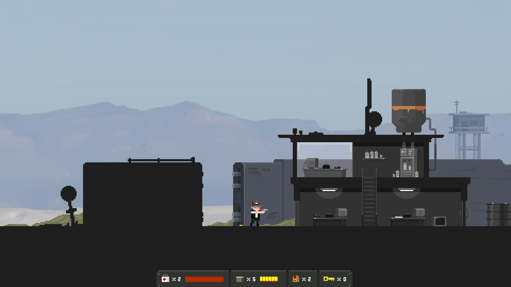

# BG-50：延後載入時保留背景完成標記

背景已讀完貼圖，主線因本格原2ms軟預算延後時，原版會先丟完成標記、同路徑又不重排，可能白等原3秒備援。現在真正開始載入才取件與計逾時。原每格一張、2ms／3秒、純背景IO與主線ResourceLoader、快取與scope規則保持。[設計](../../../../design/20-campaign-experience/PREFETCH_BUDGET_READINESS.md)、[收據](validation.json)、[全部原檔](raw.zip)、[SHA](manifest.json)。

正式pistol匯入檔由真WorkerThreadPool讀完；另一真工作明示持mutex20ms，原預算拒絕時ready舊版消失、新版保留，下一格真正cache增加。負控制5／2→5／0。原InputFeel／Cutscene／Chapter1Map只加五項，2368／2→2368／0；單元明示200ms競爭以確保原2ms分支准入。原所有斷言／輸入／等待逐位元保持，只另加失敗時唯讀狀態；runner／selector／filters／known_failures不變。

最後整合基準ad8c1cfe：checks: 55034, new failures: 0, known failures (tests/known_failures.txt): 0  (wall time 1090 s)，含準備1091.19秒。原50組全部跑完；四核心容器以兩程序保留引擎背景工作空間，沒有改判準。全部分片、固定來源SHA與真正指令收據保留。

環境暫停後，一次ad8整合測試僅完成部分套件便中斷，三個原程序已成zombie、沒有終局收據；完整部分log另存interrupted-ad8-integration。舊7a失敗收據不冒充那次結果，最後仍按原50組重新完整驗證。

前兩輪基準7a均保留：第一輪55,025項／1個爆炸效能超標（+12.64ms，原6ms）；未修改7a及本次來源隔離同Fx套件各44／0，原監測idle／burst為6.92／3.02及3.62／5.03ms，不稱性能改善或修好唯一根因。Godot4.7.2 main.cpp證實TIME_PROCESS每秒才寫process_max，原40格取樣不能當逐格平均；原檔／URL／SHA保留。第二輪55,025／2為原通訊守門失敗；唯讀十組觀察8774／0後找到另一個同呼叫同步缺口，已分票ad8c1cfe交付並整合，本票不混入Hover程式，也不補造舊失敗缺少的瞬間狀態。原暖檔檢查在這兩輪均通過。

第一次ad8整合原生exit0但退出有12個ObjectDB／3個資源留存，故當輪不通過。未改來源的verbose、改回Hover交付前的verbose對照、最後原設定整合程序均0引擎ERROR／0退出洩漏診斷；沒有增加清理等待、關效果或改原工具。這個首次留存未定位，不聲稱修好；成功與失敗完整log均保留。

最後正式街道／倉庫沿用原frame_time工具，僅增加正式環境與讀回：ch1_street中位數209.46ms，超33.3ms共24格，實際預載34張／暖檔逾時0次；ch1_warehouse中位數211.65ms，超33.3ms共22格，實際預載34張／暖檔逾時0次。最新四圖已逐張檢視，原v1四圖也保留；其他診斷程序圖保留但不統稱逐張看過。軟體Vulkan llvmpipe不通過硬體停頓門檻，不當作冷快取或效能改善。

原工具明示生命99999、長無敵、虛擬手把及自動跳過；新輪沒有走正式前提，圖中目標仍序章。這是正式Level與預載管線，不冒充自然整章、全UI／角色接點、人手實玩或實體GPU。原硬體冷啟與使用者親手玩條件保持。HUNTDOWN與The Final Station官方研究原圖／URL／SHA收zip，只作畫面層級參考，不推論預載演算法。先讀User-guide與原生命週期研究；使用Godot背景載入規約，不回到RD背景ResourceLoader。

HUD起因7358項／1暖檔順序失敗原log保留，該輪缺失敗當刻計數；本次已證實的丟標記缺口不逕稱唯一根因。7a完整CI96,007／0／0、550秒原job也保留。

原檔654項、8,331,527bytes，zip SHA `8050ab20717899a1ca1bab9832150437b445122b0bc837d74fc2babcaa910aa6`，逐項解出核對完成。
