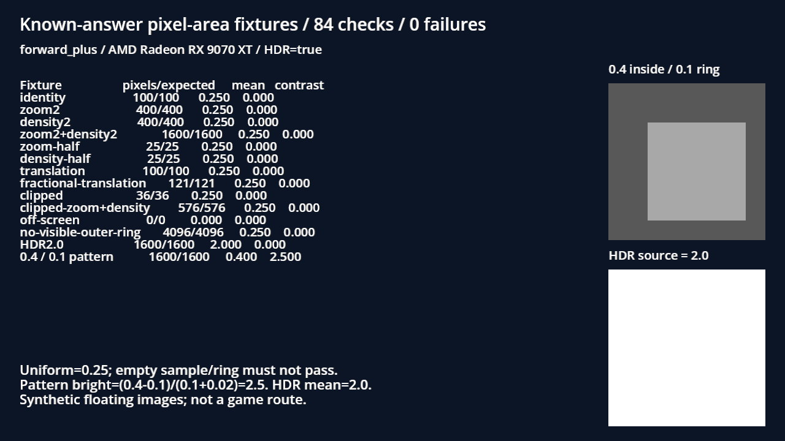

# BG-53：獨立已知答案幾何回歸

2026-11-11。只新增獨立測試場景與本附件，正式 ContrastProbe 由 root 修正。本子任務沒有更改正式光影、角色、對比公式或門檻，也不代替 BG-40／42／48／49 的修後場景重驗。

## 紅→綠

| 執行 | 檢查 | 失敗 | 真正結束碼 | 引擎／腳本 ERROR |
|---|---:|---:|---:|---|
| 舊工具、凍結測試 | 84 | 38 | 1 | 0 |
| 修正工具、完全相同測試來源 | 84 | 0 | 0 | 0 |
| 初次原生結果圖 | 84 | 0 | 0 | 0；但最後一列與說明重疊，版面退件 |
| 只縮小 Label 行距後的最終原生 | 84 | 0 | 0 | 0 |

[收據與 SHA](receipt.json)。紅與綠的整份測試 SHA 相同；最後原生來源只多一行 line_spacing=-4，不宣稱其整檔 SHA 與紅綠相同。[單行差異（ZIP 內 native-presentation-only.patch）](raw.zip)、[原測試](test-source.gd)、[最終原生測試](test-source-native.gd)。已用位元組比較確認只有該行、84 個條件與固定答案皆不變。工具來源全為 LF，避免推送時正規化造成來源 SHA 改變。

## 期望值如何獨立取得

輸入均為 64×64、RGBAF 浮點 Image。取樣的手工像素區間與個數直接寫成常數，沒有用被測程式的世界矩形面積或其轉換函式計算期望值。

| 固定均勻 0.25 案例 | 手工像素數 |
|---|---:|
| identity／整數平移 | 100 |
| zoom=2／density=2，各自單獨 | 400 |
| zoom=2 且 density=2 | 1600 |
| zoom=0.5／density=0.5，各自單獨 | 25 |
| 分數平移 (0.25,0.75)，端點需完整覆蓋 | 121 |
| 左上裁切 | 36 |
| 放大與 density 同時左上裁切 | 576 |
| 完全離畫面 | 0 |
| 方框涵蓋整張影像、沒有可見外圈 | 4096 |

有效取樣平均值應維持 0.25；均勻圖對比為 0。完全離畫面平均值為 0，沒有外圈時也不能製造可通過門檻的假對比。這組測試覆蓋軸向縮放與平移，沒有宣稱驗遍所有旋轉或剪切。

另外，HDR 均勻圖值 2.0 在 zoom2+density2 下平均值仍是 2.0，不截成 1。已知圖以實際迴圈直接填入 [16,56)×[16,56) 的 1600 個 0.4 像素，其餘為 0.1。外框 [8,64)² 有 3136 像素、外圈 1536 個，故 outer=0.1，bright=(0.4−0.1)/(0.1+0.02)=2.5、dark=−2.5，最後取 2.5。

舊版實際把均勻 0.25 算成 1.0，HDR 2.0 算成 8.0，明暗圖外圈 0.1 算成 0.4、對比算成 0；原始失敗都保留在 red。

## 原生固定圖

Godot 4.7.2 official、AMD Radeon RX 9070 XT、Vulkan Forward+、HDR 2D、1280×720。右側顯示的是與計算共用的浮點測試圖；左側文字直接來自真正執行結果。這是合成固定圖與量測結果的硬體顯示，沒有假稱遊戲路線或人物可讀性驗收。計算直接讀浮點 Image，沒有從 PNG 顏色反推數值；既有截圖量化精度問題由 BG-54 另行處理。

最終圖已實際看過，全部列與說明可讀，沒有重疊。原始重疊版亦保留在 native-overlap。



## 重跑與原始位元組

```powershell
C:/Tools/Godot/Godot_v4.7.2-stable_win64_console.exe --headless --path C:/Users/stanl/Github/Nest-Egg res://tools/test_contrast_probe_geometry.tscn -- --out=<絕對目錄>
python tools/comfyui/gpu_lock.py -- C:/Tools/Godot/Godot_v4.7.2-stable_win64_console.exe --path C:/Users/stanl/Github/Nest-Egg --rendering-method forward_plus --rendering-driver vulkan res://tools/test_contrast_probe_geometry.tscn -- --native --out=<絕對目錄>
```

[raw.zip](raw.zip)保存執行 log、JSON、來源、真正結束碼及 PNG 的原始位元組，已逐檔回讀驗 SHA。ZIP SHA 在 receipt；[manifest-raw.json](manifest-raw.json)列的是 **ZIP 內原始檔案** 的 SHA。旁邊可直接閱讀的 log 若被 Git 的 text/eol 正規化，不可拿它的新位元組冒充原始量測收據；以 ZIP 內容為準。

## 修正擷取與受影響範圍的後續驗證

2026-11-11 使用 BG-54 修正後的原生 PNG 編碼再跑相同 84 條件，84／0、exit 0；[最終新圖](../../images/BG-53-corrected-native.png)與原始位元組另存 [新量測](../BG-53-corrected-lighting-2026-11-11/README.md)，沒有覆寫本附件的歷史原圖或收據。

受影響選擇器實跑 6 組（含 4 組光影／開發工具與 2 組共用近戰），3893 checks、新失敗 0、已知失敗 0、exit 0。[測試收據](affected-tests-receipt.json)、[原 byte log ZIP](affected-tests-raw.zip)。既有過濾器保留退出階段 CanvasItem／ObjectDB／resource 診斷，不宣稱所有原 log 無 ERROR。
