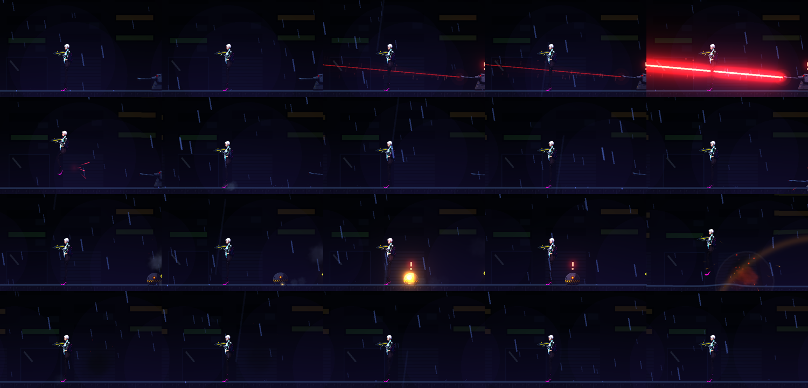
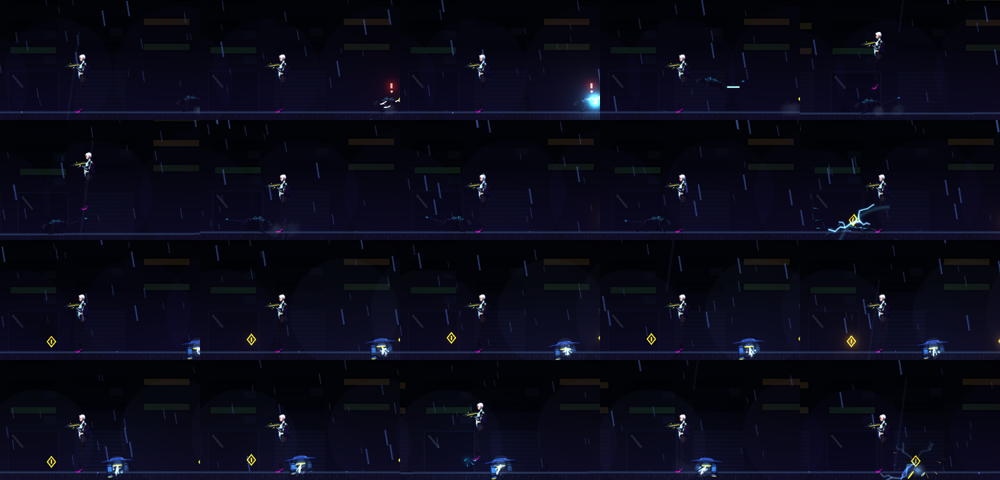
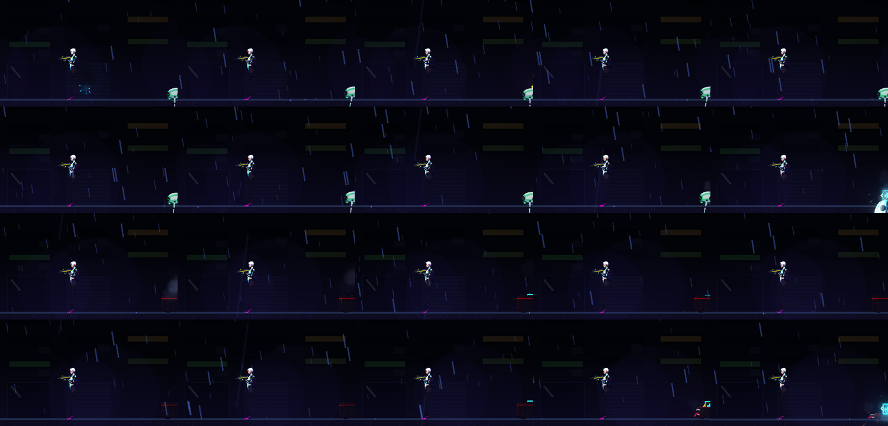
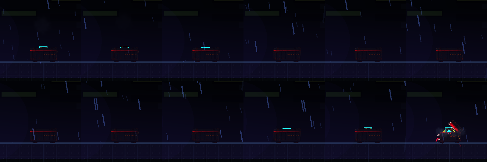

# [NE-100] 既有非人形敵人的骨架、動畫與專屬動作

> 狀態：完成

## 內文

### 需求
七種既有非人形敵人（監視蜂、探照無人機、維修機、自爆蟲、電擊犬、哨戒砲台、偽裝箱）目前是程式畫的暫代圖。用 NE-91 的立繪為它們各做骨架、動畫器與專屬動作（例如電擊犬四足步態與撲咬、偽裝箱開合、砲台旋轉與後座、維修機機械臂與光束），取代 `_draw_body`，原有的行為、預兆與數值不變。

### 來源
2026-10-03～04，使用者在敵人與 NPC 重畫的討論中提出；設計見 `design/12-cast-redraw/CREATURES.md`、`ANIMATION.md`。

### 驗收條件
- [x] 每種敵人用自己的骨架與動畫器取代程式繪製，零件圖由新立繪切出
- [x] 原有的預兆、判定位置、行為與數值不變，測試全部沿用
- [x] 每個敵人有自己的動作資料、專屬特效
- [x] 遊戲內實際交戰檢查
- [x] 效能不下降

### 測試流程
1. 預覽各動作
2. 進遊戲交戰
3. 單獨執行各敵人套件

---

# 跟其他票的關係

- Blocks：無
- Blocked by：NE-91（立繪）、NE-98、NE-99（動畫器機制）
- Related：NE-97、NE-104、NE-105

---

---

# Commit-1

## 內文

探照無人機、維修機、自爆蟲、電擊犬、哨戒砲台、偽裝箱（監視蜂已先完成）原本都是程式畫的幾何圖形，動作只有整體晃動。
現在每一種都改用新立繪切成的零件，各有自己的動作：探照機與維修機的推進燈、機械臂隨狀態擺動，維修時雙臂前伸；自爆蟲六條腿交替步行，引信點燃時機身發抖、核心越閃越快；電擊犬跑步起伏、低吼壓低、撲咬時身體拉長，電極尾巴隨狀態甩動；砲台的砲塔頭與砲管跟著瞄準方向轉，開火時砲管後座，雷射與子彈從砲管口射出；偽裝箱平常是緊閉的貨箱，現形或撲咬時換成張嘴的外觀，震動預兆時整個箱子抖動。偽裝箱的碰撞框改成和新貨箱外觀一樣大。原有的預兆、行為與數值不變，資料裡若零件缺失會記錄錯誤並退回原本的程式繪製。
驗收：新增零件式生物套件 77 項（每份資料都建得起來、各狀態外觀不同且沒有異常數值、每格移動量有限、顯示指定零件、瞄準與後座、壞資料不崩潰）；連同突擊敵人、敵人特效、受擊與站姿套件共 435 項、0 失敗；遊戲內逐格擷取六種敵人從巡邏、發現、出招到被擊殺的流程。依指示沒有跑完整測試套件。

### 截圖

