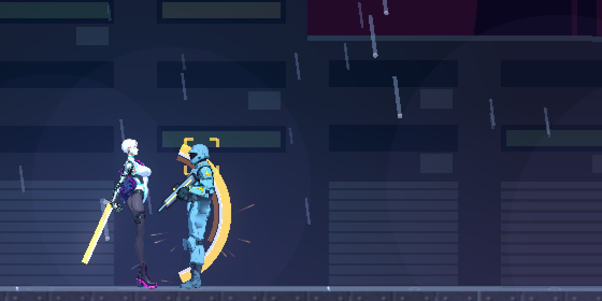
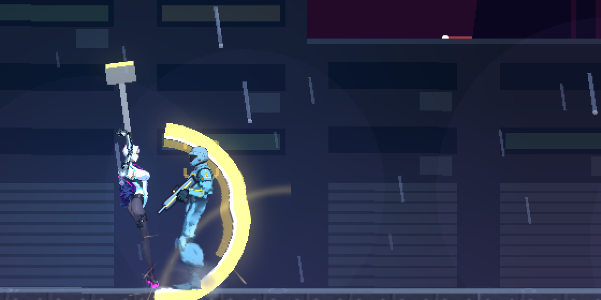
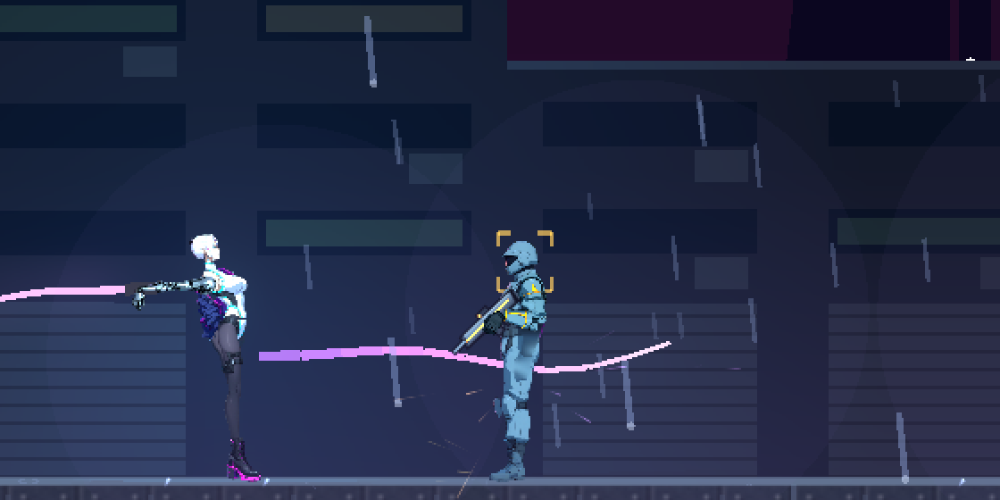
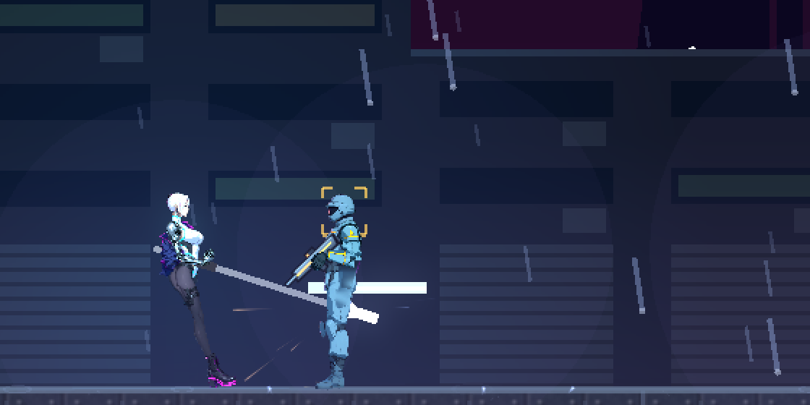
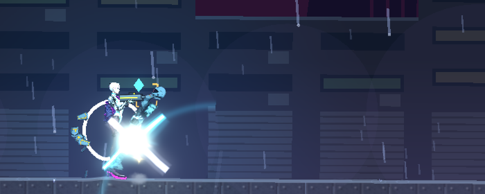
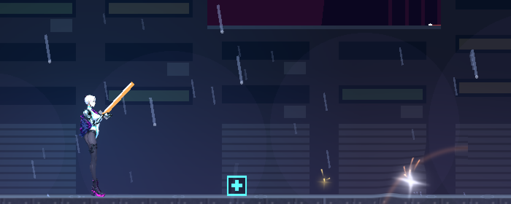

# [NE-101] 特效升級（二）：玩家、環境與全面檢查

> 狀態：完成

## 內文

### 需求
NE-95 做完了敵人與爆炸、命中、槍口。這張接手 NE-95 沒有做、而且要等 NE-117 的近戰武器完成後才能做的：近戰揮砍與終結技的特效、拾取與補給的特效，以及同屏多個爆炸時的效能。原則：合理且順暢、粒子克制，不誇張（數量與強度由 `Fx` 的三個克制係數統一調整，發光倍率的上限由 `LightKit.HDR_PEAK_MAX` 統一夾住）。
玩家子彈拖尾、格擋與完美反彈、衝刺殘影、義體能力與重生、環境特效（雨、蒸汽、火花、霓虹閃爍）、所有光影設定下的亮度預算，以及實際玩一輪調整 NE-95 的強度與時機，原本也寫在這張，已改由 NE-95 負責並完成（見該票 Commit-2），這張不重複做。

### 來源
2026-10-03～04，使用者在敵人與 NPC 重畫的討論中提出；設計見 `design/12-cast-redraw/CREATURES.md`、`ANIMATION.md`。

### 驗收條件
- [x] 近戰武器的揮砍與終結技特效升級：依武器類型的軌跡、命中火花與衝擊、重武器落地的塵土與震動，克制不誇張
- [x] 拾取與補給（武器、彈藥、醫療、信用點、劇情道具）的拾取特效升級
- [x] 同屏多個爆炸時效能不下降（有量測數字）

### 測試流程
1. 執行特效相關截圖情境
2. 各光影設定下檢查
3. 玩一輪第一章與第二章
4. 單獨執行特效相關測試

---

# 跟其他票的關係

- Blocks：無
- Blocked by：無
- Related：NE-95（玩家與環境特效、亮度預算已在 NE-95 完成）、NE-117（近戰武器）

---

# Commit-1

## 內文

近戰武器完成後，揮砍與終結技、拾取與補給的特效還是舊的一套。
- 近戰軌跡：每把武器有自己的顏色與樣式——匕首與戰戟是沿著揮擊方向戳出去的亮線，長刀與液壓錘是弧形揮砍，鞭子是甩動的彎曲鞭痕；軌跡一開始就已經掃出一段，命中頓幀凍住玩家的那一刻也看得到。
- 命中與揮擊：斬擊是火花與小星芒、刺擊是細長的火花、重擊（液壓錘）有塵土、衝擊波與較大的火花；鞭子甩到頂端有一下爆響，重武器揮下時揚起塵土。種類與顏色都是招式資料（impact_fx、trail.color、trail.style）。
- 終結技：目標身上交叉的兩道斬痕、星芒與衝擊波。
- 拾取：武器是星芒、衝擊波與向上的火花扇，補給是往上飄的綠色光點，信用點是往上彈的金色火花，消耗品是小衝擊波，劇情道具是慢慢擴散的光環與餘燼；道具圖示偶爾閃過一道小星芒提醒可以撿。
- 同屏爆炸：十二個爆炸同時發生，粒子總數約 290（固定容量的粒子場，不新增節點），每影格的處理時間與平時沒有可量測的差別（平時 8.31 毫秒、爆炸時 8.01 毫秒，測試環境、無畫面輸出）；測試有預算：多出來的處理時間不超過 6 毫秒、節點不暴增。
- 截圖環境的畫面更新很慢，近戰軌跡只有零點一秒，所以截圖用慢動作情境拍；相容性渲染器沒有泛光，真正的亮度觀感仍請在正式渲染器下確認。

### 測試結果

| 項目 | 結果 |
|---|---|
| 完整測試套件（含新增的近戰與拾取特效套件 34 項） | 31393 項，新失敗 1（音效實驗室的試聽檔缺 GUN-0031.ogg，是別的工作的本機資料，與本票無關），已知失敗 12 項不變 |
| 十二個爆炸同時發生 | 粒子約 290、節點 +0、每影格無可量測的額外處理時間 |
| 執行 log | 無與本票相關的 ERROR |

### 截圖

