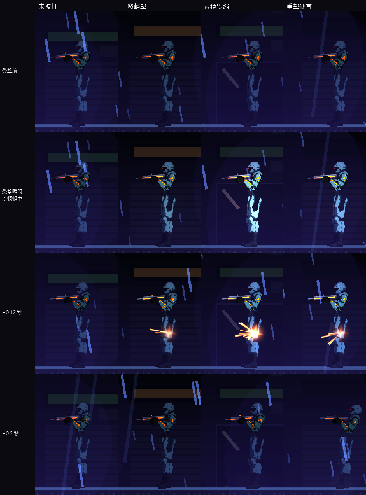

# [NE-102] 分層敵人受擊反應與命中頓幀

> 狀態：完成

## 內文

### 需求
目前一般中彈只有閃白與擊退，敵人不會畏縮，打起來沒有重量感；命中頓幀只在死亡時出現。要做出輕微畏縮、硬直、被打斷三層受擊反應，由攻擊的重量與敵人的耐打程度決定；命中頓幀只凍結攻擊方與被打方，依武器輕重不同。

### 來源
2026-10-04，使用者希望敵人動起來更有真實感、要有受擊判定與動畫；業界做法整理見 `design/12-cast-redraw/ENEMY_FEEL_RESEARCH.md`。

### 驗收條件
- [x] 輕武器的子彈命中：敵人只有閃白與輕微晃動，不中斷當前動作
- [x] 中等武器或連續命中累積後：敵人畏縮並短暫中斷動作
- [x] 重武器、近戰、格擋反彈：敵人明顯硬直後仰，動作被打斷
- [x] 敵人出招瞬間可以有霸體（輕擊打不斷），蓄力階段不行；頭目對輕擊幾乎不畏縮
- [x] 命中頓幀：子彈幾乎無、近戰明顯、擊殺最長；多次命中重疊時取最長而非相加；不影響其他敵人與介面
- [x] 閃白強度不過曝，在最亮的光影設定下不被泛光吃掉
- [x] 每個敵人的耐打程度與各層門檻是資料，可以個別調整
- [x] 連續射擊同一隻敵人不會被無限硬直鎖死
- [x] 所有現有敵人的行為與數值不變（除了新增的受擊反應）

### 測試流程
1. 對每種武器各打一次普通敵人、精銳敵人、頭目，觀察三層反應是否分明
2. 連續射擊同一隻敵人，確認不會被鎖死
3. 在雨夜與最亮的區段檢查閃白不過曝

---

# 跟其他票的關係

- Blocks：NE-103、NE-104、NE-105
- Blocked by：無
- Related：NE-95、NE-96、NE-100、NE-101

---

# Commit-1

## 內文

敵人中彈只有閃白與擊退，不會畏縮，打起來沒有重量感，命中頓幀只在擊殺時出現，而且會把整個遊戲（其他敵人與介面）一起放慢。
現在每次命中依「衝擊力」分三層反應：輕擊（手槍、步槍、衝鋒槍）只有微弱閃白與輕微晃動；連續命中累積到敵人的韌性就畏縮，動作與預兆計時暫停約 0.18 秒再從原處繼續；重擊（近戰、反彈回去的子彈、爆炸、電磁砲）直接硬直約 0.45 秒、打斷動作。敵人出招中有霸體，輕擊與累積都打不斷，只有更重的一擊才會打斷，蓄力階段不在其中，所以可以被打斷。反應結束後 0.5 秒內不會再被畏縮，連續射擊鎖不住敵人；頭目的韌性很高，輕擊與近戰幾乎推不動。
命中頓幀改成只凍結攻擊方與被打方：畏縮約 0.03 秒、硬直約 0.06 秒、擊殺約 0.07 秒，重疊時取較長而不相加，其他敵人、粒子與介面照常動。閃白改成可依力道調整強度，並把最亮的閃白從 1.7 降到 1.4，頭目的白色裝甲不再被閃成一片白。韌性、畏縮與硬直秒數、出招中的狀態都是敵人資料，頭目、重裝機槍手、鎮暴員、精銳保全、火焰兵與哨戒砲台各自設了不同的韌性。
驗收：新增 29 項受擊測試（衝擊力推算、三層門檻、霸體、保護時間、頭目、局部頓幀與節點被釋放時的安全）全數通過；另跑與改動相關的敵人、頭目、骨架、特效與角色套件，共 1879 項、0 失敗。依指示沒有跑完整測試套件。截圖用中性光（最亮的設定）擷取同一排敵人：輕擊幾乎看不出差別、累積畏縮時上身後仰且閃白較強、重擊硬直在 0.5 秒時仍後仰。

### 測試結果

| 項目 | 結果 |
|---|---|
| 受擊反應套件 | 通過 29 / 29 |
| 相關套件（敵人、頭目、骨架、特效、角色） | 通過 1879 / 1879 |
| 完整測試套件 | 未執行（依使用者指示只測改動範圍） |

### 截圖

