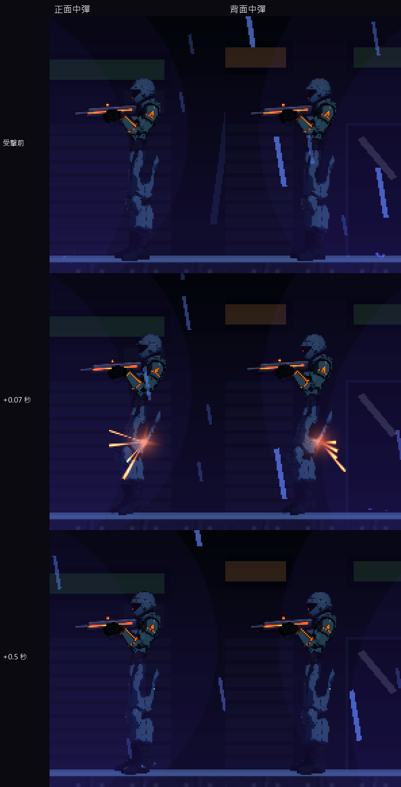
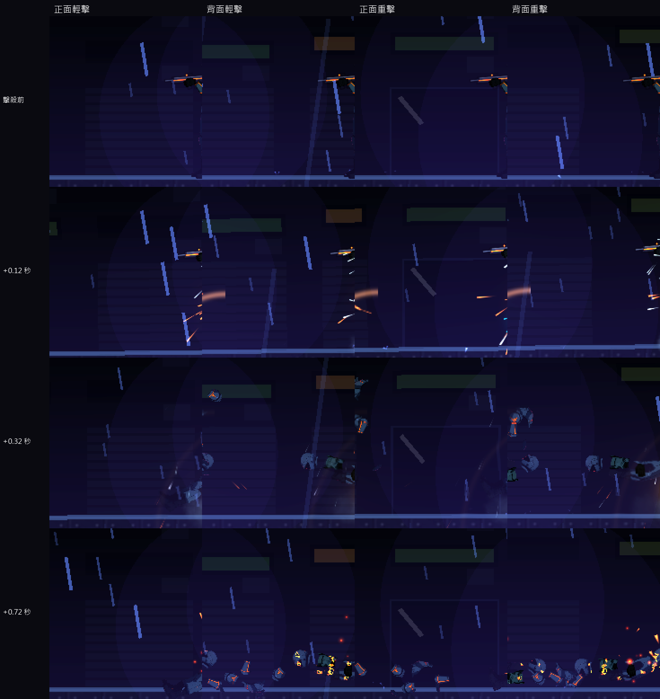

# [NE-103] 加入敵人受擊方向反應與依力道的死亡倒法

> 狀態：完成

## 內文

### 需求
敵人被打到時身體不會依被打的方向反應，死亡倒法固定，打什麼武器、從哪邊打都一樣。要讓骨架依來襲方向與力道疊加受擊姿勢再彈回，不蓋掉走路與出招動作；死亡倒法依最後一擊的方向與力道變化；屍體與飛出的碎片有數量上限並重複使用。

### 來源
2026-10-04，使用者希望敵人動起來更有真實感、要有受擊判定與動畫；業界做法整理見 `design/12-cast-redraw/ENEMY_FEEL_RESEARCH.md`。

### 驗收條件
- [x] 被打到時身體往來襲的反方向後仰再回正，正面與背面中彈的方向不同
- [x] 受擊反應疊在原本的走、跑、瞄準動作上，輕擊不會讓動作跳到別的姿勢
- [x] 死亡倒法依最後一擊的方向與力道變化：輕擊、重擊、終結技、爆炸各有不同
- [x] 屍體留存數量有上限，超過時最舊的淡出；飛出的零件與碎片重複使用
- [x] 只有頭目與終結技的擊殺有慢動作，一般擊殺沒有
- [x] 每個角色的受擊幅度與回彈手感是它自己動作資料的一部分，任兩個角色至少有幾項不同
- [x] 既有死亡特效、掉落與計分不變

### 測試流程
1. 從左、右、上方、爆炸分別擊殺同一種敵人，確認倒法不同
2. 一場戰鬥連續擊殺 30 隻以上，畫面與效能沒有累積問題
3. 用預覽工具檢查每個人形敵人的受擊與倒下

---

# 跟其他票的關係

- Blocks：無
- Blocked by：NE-102
- Related：NE-96、NE-101

---

# Commit-1

## 內文

敵人被打到時，身體只會固定往後縮一下，不管子彈從前面還是背後來；死亡倒法也固定，打什麼武器、從哪邊打都一樣；裝甲片每次脫落都新建節點。
現在受擊的退縮看來襲方向：從正面中彈，頭與上身後仰、骨盆往後頂；從背後中彈，上身前傾。退縮疊加在原本的走、跑、瞄準動作上，輕擊幅度小、畏縮與硬直幅度依序加大，不會讓動作跳到別的姿勢。
死亡倒法依最後一擊的方向與力道變化：向後倒的角色從背後中彈會改成向前撲；重擊致死倒得更快、角度更大，並順著受力方向被推開、往上彈起；爆炸有向上的擊退，會被炸得更高；終結技沒有擊退，原地倒下。每個角色原本各自的死法（跪下、癱坐、向前趴）保留，只有向後倒的角色會依方向翻轉。
場上同時倒著的屍體最多 8 具，超過時最舊的快速淡出；脫落的裝甲片改用物件池重複使用，同時最多 24 片，大量擊殺時節點數不會暴增。
驗收：新增 15 項測試（受擊方向、倒法方向與力道、爆炸炸得更高、屍體上限、物件池上限與重複使用、裝甲片仍會飛出），連同上一張票共 44 項全數通過；另跑與改動相關的敵人、頭目、骨架、特效與角色套件共 1893 項，0 失敗。依指示沒有跑完整測試套件。慢動作的處理：整個遊戲已經沒有全域慢動作，一般擊殺只有 0.07 秒的局部頓幀，頭目與終結技的頓幀較長，但不是真的慢動作。

### 測試結果

| 項目 | 結果 |
|---|---|
| 受擊反應套件（含 NE-102） | 通過 44 / 44 |
| 相關套件（敵人、頭目、骨架、特效、角色） | 通過 1893 / 1893 |
| 完整測試套件 | 未執行（依使用者指示只測改動範圍） |

### 截圖

