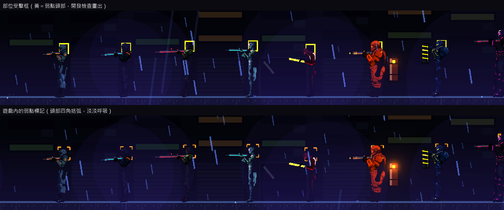
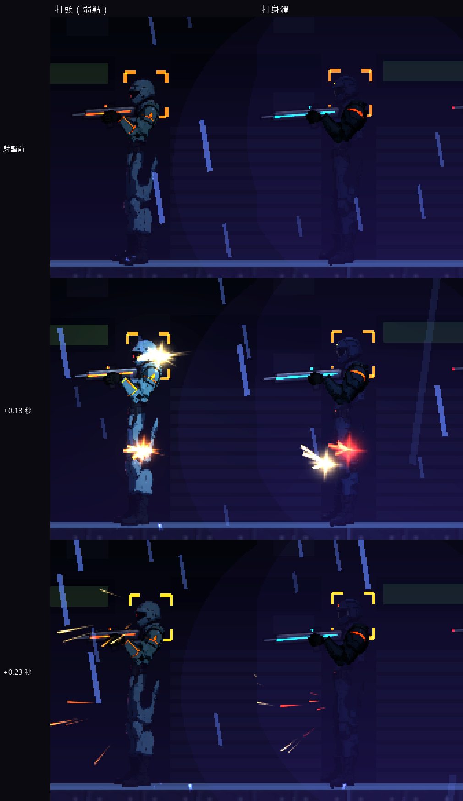

# [NE-104] 加入敵人部位判定與弱點

> 狀態：完成

## 內文

### 需求
敵人只有一個整體的受擊框，打頭或打腿都一樣，沒有弱點，也看不出打中哪裡。要讓敵人依部位有各自的受擊判定與傷害倍率（頭、核心、背上的燃料槽等弱點），打中不同部位有不同回饋，判定位置跟著動畫走。

### 來源
2026-10-04，使用者希望敵人動起來更有真實感、要有受擊判定與動畫；業界做法整理見 `design/12-cast-redraw/ENEMY_FEEL_RESEARCH.md`。

### 驗收條件
- [x] 人形敵人至少有頭、身體兩種部位，頭的傷害倍率高於身體；倍率是每個敵人的資料
- [x] 有弱點的敵人（各人形敵人的頭、火焰兵背上的燃料槽）打中弱點時有明確但克制的回饋（音效、閃光）；頭目與觸手的核心等設計出來時，沿用同一套資料加入
- [x] 判定位置跟著骨架動作移動，蹲下與倒下時頭的判定跟著降低
- [x] 同一發子彈只算一個部位，不重複計傷
- [x] 玩家從畫面能看出哪裡是弱點
- [x] 格擋、護盾與裝甲脫落邏輯不變
- [x] 判定用簡單的形狀，不用逐像素判定；預覽工具可以顯示判定形狀供檢查

### 測試流程
1. 瞄準頭、身體、弱點各打同一隻敵人，確認傷害與回饋不同
2. 蹲下、跳躍、倒下時檢查判定位置與畫面一致
3. 用預覽工具顯示判定形狀，逐一檢查人形敵人

---

# 跟其他票的關係

- Blocks：無
- Blocked by：NE-102
- Related：NE-98、NE-99、NE-100、NE-262

---

# Commit-1

## 內文

敵人只有一個整體的受擊框，打頭或打腿的傷害一樣，也沒有弱點，看不出打中哪裡。
現在人形敵人（保全、精銳保全、狙擊手、潛行者、切割者、火焰兵、鎮暴員、重裝機槍手）的頭是獨立的受擊判定，傷害 ×1.5（狙擊手與潛行者 ×2），倍率、大小與跟隨的骨頭都寫在敵人資料裡。判定跟著頭部骨頭走，蹲下時一起降低，敵人死亡後停用。同一發子彈只算一次傷害，頭和身體重疊的地方取頭；爆炸與近戰打整體，不分部位。頭目露出弱點時的原有倍率與重裝機槍手散熱時的倍率照常疊加，格擋、護盾與裝甲脫落沒有改變。
打中弱點有克制的回饋：少量金色火花與較亮的命中聲，不另外震動；畫面上弱點有淡淡呼吸的頭部四角括弧標記，玩家看得出頭是弱點。開發檢查時可以畫出所有部位的判定形狀。
火焰兵背上的燃料槽本來就是獨立的判定，維持原樣。頭目核心與觸手核心等設計還沒出現的弱點，等做出來時用同一套資料加入。部位資料寫錯（沒有名稱、大小無效、找不到骨頭）時記錄具體位置並略過那一筆，不會崩潰。
驗收：受擊反應套件加入 16 項部位測試，共 60 項全數通過（資料、打頭 2 點傷害與打身體 1 點、弱點旗標、蹲下時頭降低、死亡後停用、爆炸只算一次、壞資料容錯）；另跑與改動相關的敵人、頭目、骨架、特效與角色套件共 1910 項，0 失敗，沒有資源洩漏訊息。依指示沒有跑完整測試套件。同時修掉上一張票留下的問題：有一個測試在擊殺後立刻結束關卡，會讓完整測試腳本看到資源洩漏的錯誤行。

### 測試結果

| 項目 | 結果 |
|---|---|
| 受擊反應套件（含 NE-102、NE-103） | 通過 60 / 60 |
| 相關套件（敵人、頭目、骨架、特效、角色） | 通過 1910 / 1910 |
| 完整測試套件 | 未執行（依使用者指示只測改動範圍） |

### 截圖

