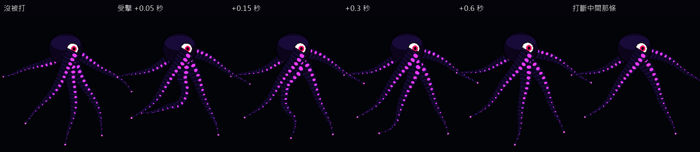
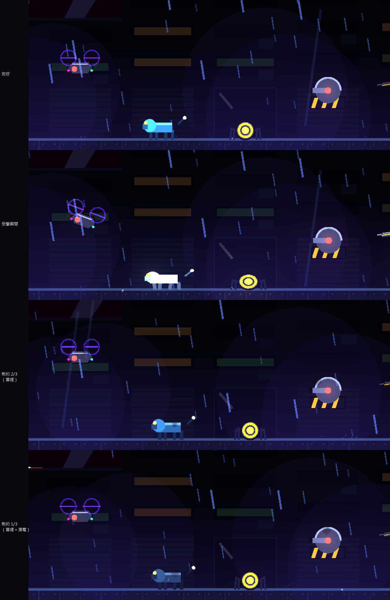

# [NE-105] 加入非人形敵人的受擊反應與損傷狀態

> 狀態：完成

## 內文

### 需求
觸手、蠕行、多足、飛行與軌道類敵人被打到時，沒有符合身體構造的反應，只會閃白。要讓每一類生物有自己的受擊反應（觸手受擊波、翅膀抽動、多足失衡、蟲身收縮），可斷的肢體飛出，並依血量改變外觀的損傷狀態。

### 來源
2026-10-04，使用者希望敵人動起來更有真實感、要有受擊判定與動畫；業界做法整理見 `design/12-cast-redraw/ENEMY_FEEL_RESEARCH.md`。

### 驗收條件
- [x] 觸手與蠕行類：被打到的位置產生往兩端傳的波，被打斷的肢體整條飛出（剩餘肢體改變步態，隨 NE-98 的落腳步行一起做）
- [x] 多足與地面爬行類（現有的電擊犬、自爆蟲）：被打到時失衡踉蹌一步（斷腿後步態改變，隨 NE-99 的多足步態一起做）
- [x] 飛行類（現有的偵察機、探照與維修無人機）：被打中時失速傾斜下沉，被擊毀時打轉墜落（翅膀抽動隨 NE-99 的翼式飛行一起做）
- [x] 砲台與固定型機械（現有的哨戒砲台、迫擊砲、偽裝箱）：受擊時整體震動；雲母與吊軌砲出現時用同一份反應資料各自設定
- [x] 損傷狀態依血量（約 66%、33%）改變外觀，數值是資料
- [x] 飛出的肢體每次擊殺有數量上限，並重複使用
- [x] 每種生物的反應是它自己的資料，不與其他種類共用
- [x] 原有行為與數值不變

### 測試流程
1. 用預覽工具逐一觸發各類生物的受擊、斷肢與損傷階段
2. 進遊戲與每類敵人交戰，確認反應合理、不干擾判定

---

# 跟其他票的關係

- Blocks：無
- Blocked by：NE-102
- Related：NE-98、NE-99、NE-100

---

# Commit-1

## 內文

觸手、蠕行、多足、飛行與固定型的非人形敵人被打到時只會閃白，沒有符合身體構造的反應，也看不出它受了多重的傷。
現在沒有骨架的機械類敵人依資料有自己的受擊反應：偵察機、探照無人機與維修無人機是失速（往被打的方向傾斜、往下沉一點，被擊毀時打轉墜落），電擊犬與自爆蟲是踉蹌（歪一下、壓扁再彈回，腳底不動），哨戒砲台、迫擊砲與偽裝箱是整體震動；反應的種類與幅度每種敵人各自設定，測試保證任兩隻不同。反應力道依輕擊、畏縮、硬直三層加大。機械類的受擊閃白也改成保留外形與顏色，不再糊成一團白。
損傷狀態依生命比例進入兩個階段（剩約 2/3、約 1/3）：外觀逐漸變舊，進入新階段噴一小團火花，之後持續冒煙，第二階段還會漏電，數量克制、越嚴重越密，門檻是敵人資料。人形敵人仍然用裝甲脫落，不套用這個機制。
觸手生物（目前是原型）可以被打：打中的位置從受擊點往兩端傳一道波，邊傳邊衰減，不影響其他觸手；單條觸手可以被打斷，整條離開身體、用脫落零件的物件池飛出去（場上有數量上限），剩下的觸手照常擺動。實際的觸手敵人（纏絲、打撈臂等）、多足與翼式飛行的步態與翅膀動作屬於 NE-98、NE-99，做出來時直接使用這些資料與介面。
驗收：受擊反應套件加入 41 項測試（反應資料有效且不重複、力道與失速下沉、損傷階段、墜落打轉、受擊波的位置與傳遞與衰減、斷肢與重複斷肢、飛出零件、斷肢後仍可動畫），共 100 項全數通過；另跑與改動相關的敵人、頭目、骨架、特效與角色套件，全數通過且沒有資源洩漏訊息。依指示沒有跑完整測試套件。

### 測試結果

| 項目 | 結果 |
|---|---|
| 受擊反應套件（含 NE-102～104） | 通過 100 / 100 |
| 相關套件（敵人、頭目、骨架、特效、角色） | 通過 1950 / 1950 |
| 完整測試套件 | 未執行（依使用者指示只測改動範圍） |

### 截圖

