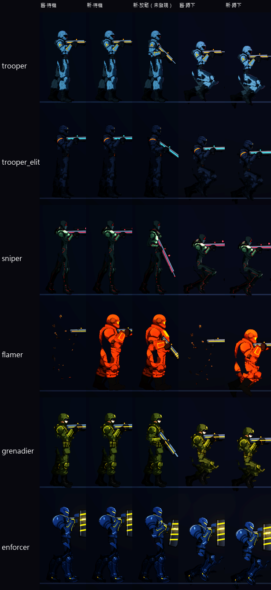
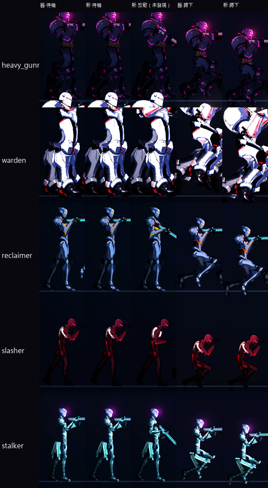

# [NE-106] 修正敵人站姿與待機姿勢不合理

> 狀態：完成

## 內文

### 需求
重畫後的人形敵人，站姿與待機看起來不自然：幾乎所有敵人不論有沒有發現玩家，都是同一個把槍舉到肩膀、雙腳併直、上身僵直的姿勢；重裝機槍手的槍抬得與頭同高、雙腿併攏；蹲下看起來像坐著。要讓每個敵人依角色與狀態（未發現、警戒、交戰）有合理又各自不同的站姿與待機。

### 來源
2026-10-04，使用者發現大多數敵人套用的骨架看起來很奇怪，不是站姿不合理，就是走路、攻擊動畫不合理；用預覽工具看各敵人的八種動作確認。

### 驗收條件
- [x] 逐一檢查所有人形敵人（保全、精銳保全、狙擊手、火焰兵、擲彈兵、鎮暴員、重裝機槍手、切割者、迷彩獵手、監管者、回收員）的站姿，列出問題清單附預覽截圖
- [x] 未發現玩家時槍口自然朝下或持於身側，發現後才舉槍，兩個狀態之間有過渡
- [x] 重心與雙腳站位合理：雙腳分開、重心落在腿上，上身依角色前傾或後仰，不是僵直
- [x] 蹲下是腿部彎曲壓低重心，不像坐著，槍口位置仍正確
- [x] 每個角色的待機呼吸、重心轉移與姿勢各自不同，符合其體型與性格
- [x] 持武器的手位置與武器種類相符（機槍、狙擊槍、噴火器、發射器、盾牌）
- [x] 預覽中各角色的八種動作關節沒有扭曲、露縫或錯位

### 測試流程
1. 用預覽工具逐一看各人形敵人的八種動作，對照問題清單
2. 進遊戲看敵人從未發現到交戰的姿勢變化
3. 兩個以上敵人並排，確認一眼看得出差異

---

# 跟其他票的關係

- Blocks：無
- Blocked by：無
- Related：NE-90、NE-96、NE-107

---

# Commit-1

## 內文

重畫後的人形敵人，不論有沒有發現玩家都是同一個舉槍的姿勢，雙腳併直、上身僵直，蹲下時腳懸在半空像坐著。
逐一看過 11 個人形敵人的站姿，發現的問題是：待機一律把槍舉到肩上、雙腳站位幾乎相同、重心沒有任何起伏、蹲下時身體只降了固定的高度，腳底沒有踩到地。
現在沒發現玩家（巡邏、待機、潛行）時，武器自然垂下成低持槍，發現後平滑舉起，兩個狀態之間有過渡；垂下的角度與貼身程度每個角色各自設定，頭與上身仍然看向前方，不會跟著槍口低頭。待機的站位每個角色各自不同（雙腳分開的程度、前後腳的重量），重心會左右微微移動，快慢與幅度各自不同。蹲下時腳底踩實，只是把身體壓低，槍口位置與瞄準不變。人形敵人的腳底現在會依實際腿的角度自動補償身體高度，站、跑、蹲三種狀態下最低的腳底都貼著地。
驗收：新增的姿勢測試 91 項全數通過（含 NE-107 的落腳與後座力）（11 個敵人的站姿與放鬆資料各自不同、站跑蹲腳底貼地誤差不到 0.6 像素、放鬆與舉槍的平滑過渡、沒有武器與空中與死亡時不出錯）；另跑與改動相關的敵人、頭目、骨架、特效、角色、NPC 套件，連同 NE-107 共 2805 項全數通過、0 失敗，沒有資源洩漏訊息。依指示沒有跑完整測試套件。凜與 NPC 的站姿與步態沒有改動。

### 測試結果

| 項目 | 結果 |
|---|---|
| 姿勢套件（NE-106、NE-107） | 通過 91 / 91 |
| 相關套件（敵人、頭目、骨架、特效、角色、NPC） | 通過 2805 / 2805 |
| 完整測試套件 | 未執行（依使用者指示只測改動範圍） |

### 截圖

