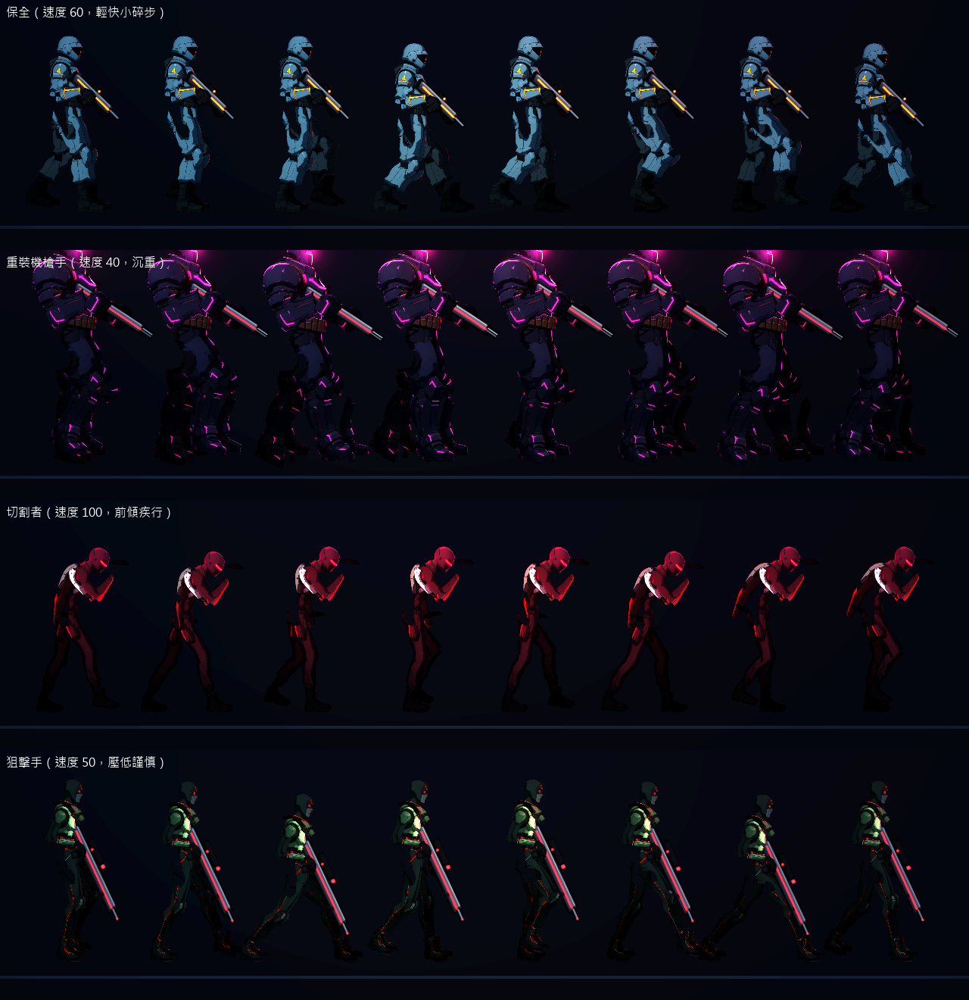
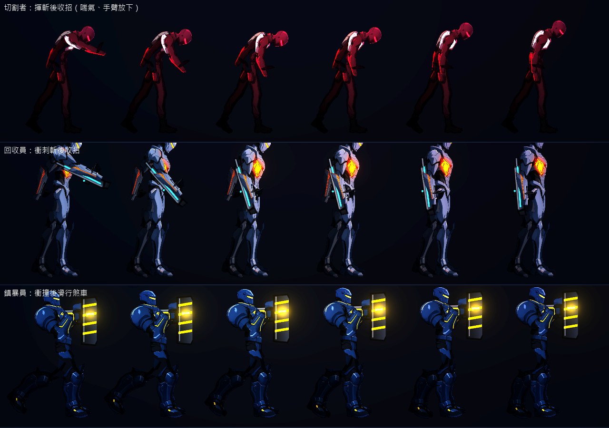

# [NE-107] 修正敵人走跑與攻擊動作不合理

> 狀態：進行中

## 內文

### 需求
重畫後的人形敵人，走路、跑步與攻擊動作看起來不合理：跑步像是雙腳在空中擺動、腳與地面沒有踩實而滑步，步幅與速度不相稱，攻擊（開槍、衝撞、砸擊、揮斬、噴火）缺少預備、發力與收招的過程，重量感不對。要讓走跑與每一種攻擊都有合理的重心、落腳與節奏。

### 來源
2026-10-04，使用者發現大多數敵人套用的骨架看起來很奇怪，不是站姿不合理，就是走路、攻擊動畫不合理；用預覽工具看各敵人的動作確認；業界做法見 `design/12-cast-redraw/ENEMY_FEEL_RESEARCH.md`。

### 驗收條件
- [x] 逐一檢查所有人形敵人的走、跑與各招式動作，列出問題清單附連續畫面截圖
- [x] 走跑時腳落地時不滑動，步幅與移動速度相稱，身體隨步伐起伏與前傾
- [x] 不同體型的敵人有不同的步伐重量（輕盈快速、沉重緩慢），任兩個敵人的步態有明顯差異
- [x] 每一種攻擊都有預備、出招、收招三段：預備清楚可讀，出招有發力方向，收招有恢復時間
- [x] 開槍的後座力與身體反應符合武器大小
- [ ] 攻擊判定的時機與畫面動作對得上（打到的那一格才有傷害）
- [x] 原有的預兆、數值與行為時間不變，玩家的反應窗口不縮短

### 測試流程
1. 用預覽工具看各人形敵人的走、跑與各專屬招式的連續畫面
2. 進遊戲與各敵人交戰，確認預兆、出招與判定時機一致
3. 兩個以上敵人並排移動，確認步態可區分

---

# 跟其他票的關係

- Blocks：無
- Blocked by：無
- Related：NE-90、NE-96、NE-102、NE-106

---

# Commit-1

## 內文

重畫後的人形敵人走路與跑步時，腿像時鐘擺一樣擺動，腳與地面沒有踩實而滑步，身體高度的起伏與腿的動作不合；開槍的後座力每個角色都一樣；幾個近戰招式只有預備與出招，沒有收招。
現在人形敵人改成落腳步行：踩在地上的腳貼著地面隨身體往後移動，不滑，另一隻腳抬起畫弧前擺，膝蓋朝前彎；身體高度由腿能不能夠到地面決定，腿張最開時最低，所以高度的起伏自然。步幅（一個週期走多遠）、踩地比例與抬腳高度是每個角色自己的資料：重裝機槍手步幅短而沉，切割者長步前傾，狙擊手步子長而謹慎。凜與 NPC 的步態沒有改動。
開槍的後座力改成每個角色各自的資料：榴彈兵與狙擊手把上身與身體往後頂得更遠、恢復更慢，步槍與火焰兵很輕。切割者、回收員與鎮暴員補上收招動作（喘氣放下手臂、放下刀與槍、衝撞後的滑行煞車）。持槍的敵人從放鬆到舉槍是預備，開火有後座，之後的恢復由後座力的衰減與放下槍的過渡完成。
驗收：測試量到踩在地上的腳相對身體往後移動的速度與前進速度誤差在 15% 內、抬起的腳確實離地、後座力資料各角色不同且重武器推得更遠；與 NE-106 合計的測試與相關套件結果見 NE-106。還沒做、所以狀態維持「進行中」的是：攻擊判定的時機與畫面動作是否對得上，需要進遊戲逐一和各敵人交戰檢查。

### 測試結果

| 項目 | 結果 |
|---|---|
| 姿勢套件（NE-106、NE-107） | 通過 87 / 87 |
| 相關套件（敵人、頭目、骨架、特效、角色、NPC） | 通過 2805 / 2805 |
| 完整測試套件 | 未執行（依使用者指示只測改動範圍） |

### 截圖

