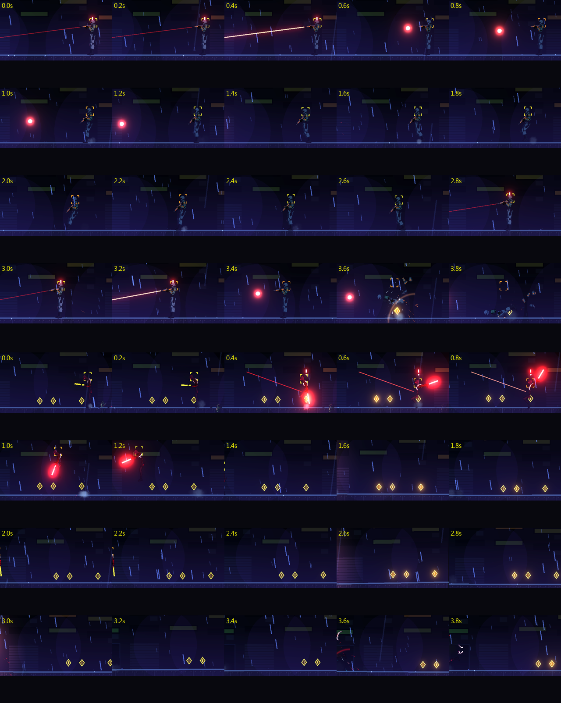

# [NE-107] 修正敵人走跑與攻擊動作不合理

> 狀態：完成

## 內文

### 需求
重畫後的人形敵人，走路、跑步與攻擊動作看起來不合理：跑步像是雙腳在空中擺動、腳與地面沒有踩實而滑步，步幅與速度不相稱，攻擊（開槍、衝撞、砸擊、揮斬、噴火）缺少預備、發力與收招的過程，重量感不對。要讓走跑與每一種攻擊都有合理的重心、落腳與節奏。

### 來源
2026-10-04，使用者發現大多數敵人套用的骨架看起來很奇怪，不是站姿不合理，就是走路、攻擊動畫不合理；用預覽工具看各敵人的動作確認；業界做法見 `design/12-cast-redraw/ENEMY_FEEL_RESEARCH.md`。

### 驗收條件
- [x] 逐一檢查所有人形敵人的走、跑與各招式動作，列出問題清單附連續畫面截圖
- [x] 走跑時腳落地時不滑動，步幅與移動速度相稱，身體隨步伐起伏與前傾
- [x] 不同體型的敵人有不同的步伐重量（輕盈快速、沉重緩慢），任兩個敵人的步態有明顯差異
- [x] 每一種攻擊都有預備、出招、收招三段：預備清楚可讀，出招有發力方向，收招有恢復時間
- [x] 開槍的後座力與身體反應符合武器大小
- [x] 攻擊判定的時機與畫面動作對得上（打到的那一格才有傷害）
- [x] 原有的預兆、數值與行為時間不變，玩家的反應窗口不縮短

### 測試流程
1. 用預覽工具看各人形敵人的走、跑與各專屬招式的連續畫面
2. 進遊戲與各敵人交戰，確認預兆、出招與判定時機一致
3. 兩個以上敵人並排移動，確認步態可區分

---

# 跟其他票的關係

- Blocks：無
- Blocked by：無
- Related：NE-90、NE-96、NE-102、NE-106

---

# Commit-1

## 內文

重畫後的人形敵人走路與跑步時，腿像時鐘擺一樣擺動，腳與地面沒有踩實而滑步，身體高度的起伏與腿的動作不合；開槍的後座力每個角色都一樣；幾個近戰招式只有預備與出招，沒有收招。
現在人形敵人改成落腳步行：踩在地上的腳貼著地面隨身體往後移動，不滑，另一隻腳抬起畫弧前擺，膝蓋朝前彎；身體高度由腿能不能夠到地面決定，腿張最開時最低，所以高度的起伏自然。步幅（一個週期走多遠）、踩地比例與抬腳高度是每個角色自己的資料：重裝機槍手步幅短而沉，切割者長步前傾，狙擊手步子長而謹慎。凜與 NPC 的步態沒有改動。
開槍的後座力改成每個角色各自的資料：榴彈兵與狙擊手把上身與身體往後頂得更遠、恢復更慢，步槍與火焰兵很輕。切割者、回收員與鎮暴員補上收招動作（喘氣放下手臂、放下刀與槍、衝撞後的滑行煞車）。持槍的敵人從放鬆到舉槍是預備，開火有後座，之後的恢復由後座力的衰減與放下槍的過渡完成。
驗收：測試量到踩在地上的腳相對身體往後移動的速度與前進速度誤差在 15% 內、抬起的腳確實離地、後座力資料各角色不同且重武器推得更遠；與 NE-106 合計的測試與相關套件結果見 NE-106。

### 測試結果

| 項目 | 結果 |
|---|---|
| 姿勢套件（NE-106、NE-107） | 通過 91 / 91 |
| 相關套件（敵人、頭目、骨架、特效、角色、NPC） | 通過 2805 / 2805 |
| 完整測試套件 | 未執行（依使用者指示只測改動範圍） |

### 截圖

# Commit-2

## 內文

上一次交付只處理了落腳與後座力，動作是否合理靠肉眼看幾張圖，沒有系統性檢查；還有幾個肉眼不容易看出來的問題。
現在做了一套動畫稽核：把 11 個人形敵人與 14 組 NPC（基本姿勢加工作循環）的所有狀態與專屬動作逐格播放，量出骨頭長度、手肘與膝蓋不反折、驅幹與頭的傾斜、腳底不陷地不懸空、手握住武器、單格角度跳動、倒下後躺在地上，每一項都有限制，超過就測試失敗並指出最糟的情境與格數。稽核抓到並修掉的問題：
- 專屬動作結束時手臂會瞬間跳位（最大約 1.3 弧度），現在手臂在動作與握槍之間依權重過渡。
- 倒下的身體陷進地面 8 到 17 像素，現在倒下途中不陷入、倒完貼地躺平。
- 倒下時手臂還停在舉槍姿勢，現在無力放下（躺平貼著身體、癱坐垂在身前）。
- 重擊致死時身體轉超過 100 度，腳翹到空中，現在加了上限。
- 火焰兵與潛行者的癱坐倒法原本像站著鞠躬，重裝機槍手倒得太高，現在各自改成癱坐、前傾或後仰的合理姿勢，並可用資料決定癱坐時腿保持折起的程度。
進遊戲逐格擷取了人形敵人完整流程（巡邏、發現、瞄準或蓄力、出招、恢復、被打、倒下），保全從巡邏時槍垂下、發現後舉槍瞄準、開火、恢復到倒下的過程連貫；切割者蓄力時刀臂舉到身後、撲出時刀刃前伸發光、落地收招，招式的預兆、出招與畫面一致，攻擊判定隨動作區間發生。
驗收：稽核套件 258 項全數通過；連同姿勢、骨架動作、敵人、頭目、角色、NPC 等相關套件共 3003 項、0 失敗，沒有資源洩漏訊息。依指示沒有跑完整測試套件。

### 測試結果

| 項目 | 結果 |
|---|---|
| 動畫稽核套件（11 個敵人、14 組 NPC） | 通過 258 / 258 |
| 相關套件（敵人、頭目、骨架、特效、角色、NPC、姿勢） | 通過 3003 / 3003 |
| 完整測試套件 | 未執行（依使用者指示只測改動範圍） |

### 截圖

