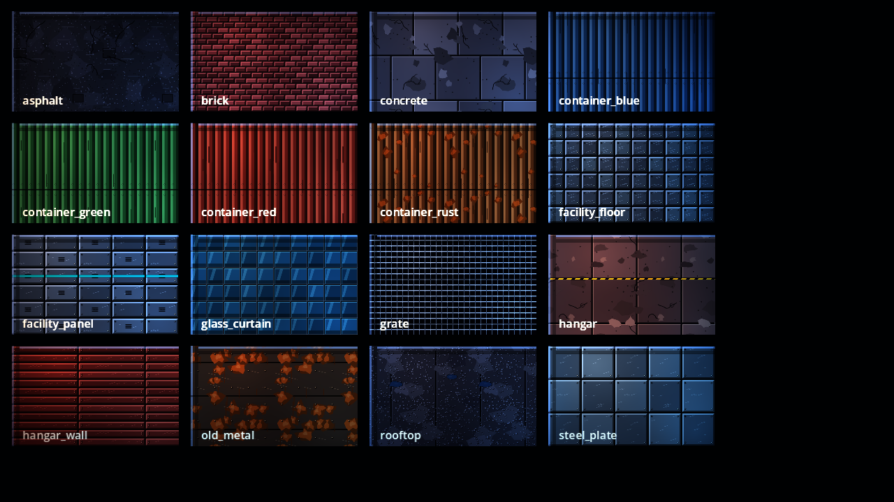
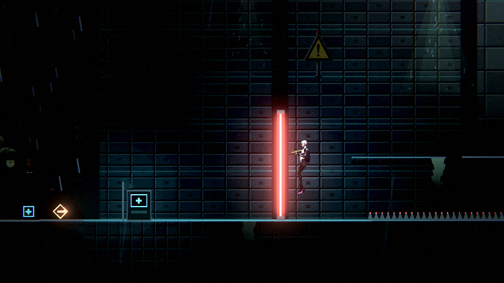
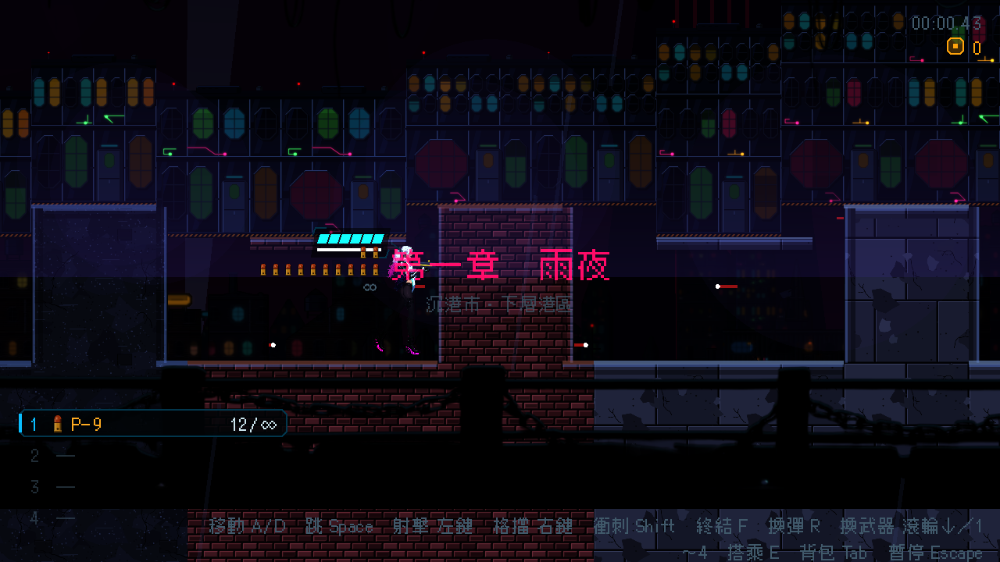

# [NE-108] 改用賽璐璐畫風重做地形材質

> 狀態：完成

## 內文

### 需求
道具與過場舞台已改成賽璐璐畫風（NE-62、63、65），但地形材質（柏油、磚牆、金屬板、混凝土…）還是寫實的高解析度 PBR，放在一起像「寫實地面上站著動漫道具」。把地形材質也改成同一畫風：平塗色塊、乾淨的深色接縫與描邊、硬邊的雙色陰影，仍然可以無縫平鋪、仍有法線與邊緣斜面。

### 來源
2026-10-03，使用者決定道具與場景改走賽璐璐畫風（與凜、肖像同一國）：「賽璐璐風格吧，然後是不是物件可以縮放成合適大小」。NE-62、63、65 驗證時發現地形與立面仍是寫實，風格不一致。設計見 `design/11-free-assets/DESIGN.md`。

### 驗收條件
- [x] 所有地形材質（目前 16 種）改為賽璐璐畫風，畫廊逐種看過
- [x] 每種材質仍可無縫平鋪，沒有明顯接縫或重複感；頂面與側邊的邊緣斜面保留
- [x] 每種材質仍有法線貼圖，受光與輪廓光表現正常
- [x] 第一章與第二章每個區段的地面「可以站的地方看得出來」，與背景分得開
- [x] 暗場可讀性量測不比換之前更差
- [x] 貼圖大小仍在檔案大小與總量上限內

### 測試流程
1. 開材質畫廊逐種檢查
2. 從頭玩第一章，確認每個區段的地面與牆面
3. 執行暗場可讀性量測與環境元件相關測試套件

---

# 跟其他票的關係

- Blocks：NE-66
- Blocked by：無
- Related：NE-58、NE-62

---

# Commit-1

## 內文

地形材質是寫實的照片材質，放在一起像「寫實地面上站著動漫道具」。
16 種地形材質（柏油、屋頂碎石、混凝土、磚牆、四色貨櫃、設施地板與牆板、帷幕玻璃、格柵、機庫地板與牆、舊鐵皮、鋼板）全部重畫成賽璐璐畫風：平塗色塊、乾淨的深色接縫與描邊、硬邊的亮暗兩色。每種都上下左右天生可無縫平鋪，法線隨圖形重算，頂面與側邊各有一條墨線、冷白亮邊與硬邊陰影，邊緣斜面保留。貨櫃與鏽蝕金屬的飽和度略降，不搶過角色。
驗收：材質畫廊逐種看過；第一章多個區段與第二章的實景截圖看過，可站的地面與背景分得開。暗場可讀性量測以同一台機器各量 5～7 次取平均、與換之前比：貨運站玩家對比 -0.37 → 0.13、設施入口 -0.72 → -0.25（變好），其餘持平；屋頂巷弄、第二章夾層區與電力室在換之前就低於門檻，數值沒有變化（單次量測的雜訊約 ±0.3，所以不看單次）。

### 測試結果

| 項目 | 結果 |
|---|---|
| 相關測試套件（環境元件、道具、過場動畫） | 通過 1299 / 1299 |
| 素材檢查（大小與總量） | 通過（環境素材 22.7 MB／60 MB，單檔最大 0.6 MB） |
| 執行 log | 無非預期的 ERROR |

### 截圖

