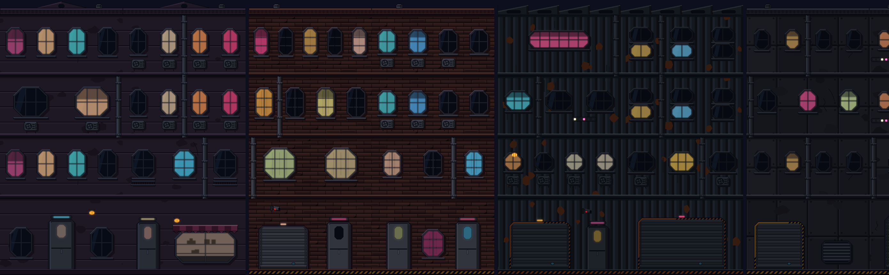
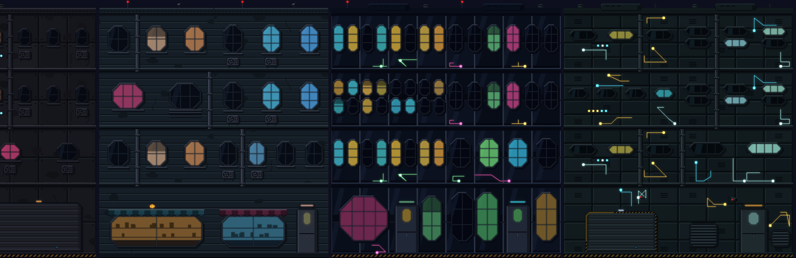
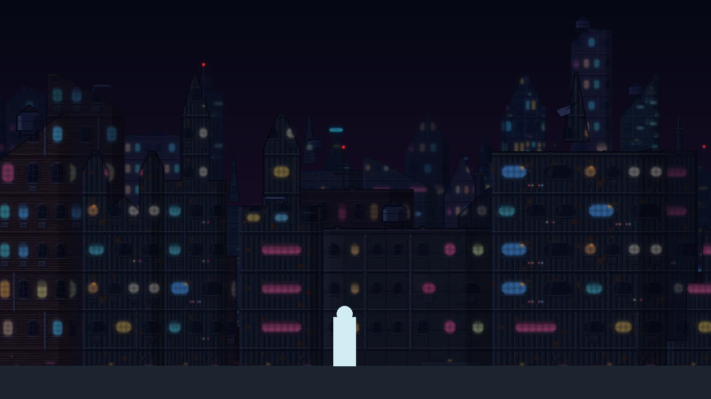
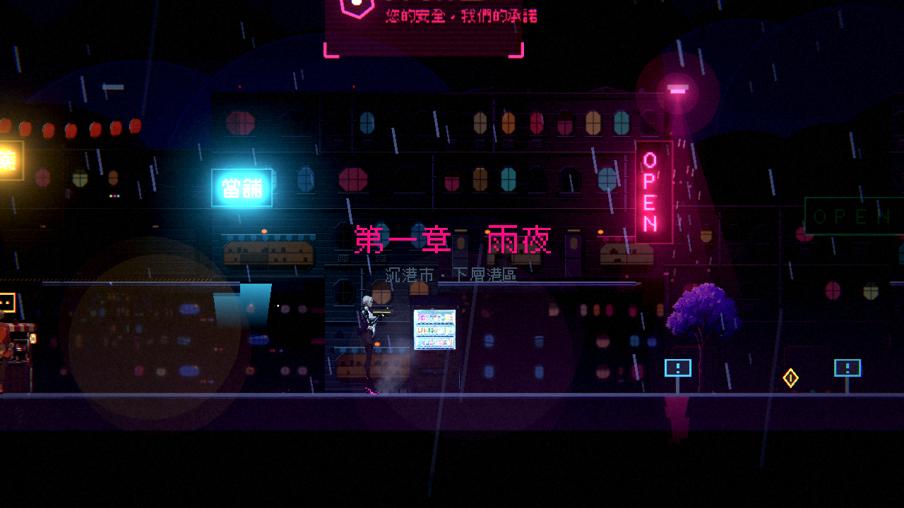

# [NE-109] 改用賽璐璐畫風重做建築立面與遠中景

> 狀態：完成

## 內文

### 需求
建築立面（公寓、磚造、倉庫、玻璃帷幕、設施牆面…）以及由立面組出的遠景、中景樓群，目前是寫實的 PBR 與模型渲染。改成賽璐璐畫風：平塗牆面、乾淨墨線的窗框與管線、硬邊陰影，窗光、霓虹與屋頂信標的動畫保留，並仍維持由遠到近越淡、越偏藍、越慢的層次。

### 來源
2026-10-03，使用者決定道具與場景改走賽璐璐畫風：「賽璐璐風格吧」。立面與樓群是第一章最大面積的背景，目前與賽璐璐的道具、凜和肖像風格不一致。設計見 `design/11-free-assets/DESIGN.md`。

### 驗收條件
- [x] 所有建築立面模組改為賽璐璐畫風，畫廊逐種看過
- [x] 窗光、亮窗閃爍、屋頂信標明滅與牆面裝飾（水管、冷氣機、電路走線、LED、攝影機）保留
- [x] 遠景與中景樓群改用新立面組出，仍左右無縫、層次清楚、不比角色搶眼
- [x] 立面仍有法線與自發光層，受光與霓虹光表現正常
- [x] 暗場可讀性量測不比換之前更差；貼圖大小在上限內

### 測試流程
1. 開立面畫廊逐種檢查
2. 從頭玩第一章，確認遠、中、近三層與視差
3. 執行暗場可讀性量測與環境元件相關測試套件

---

# 跟其他票的關係

- Blocks：NE-66、NE-112
- Blocked by：無
- Related：NE-59、NE-61

---

# Commit-1

## 內文

建築立面與遠中景是寫實的照片材質與模型渲染，與賽璐璐的道具、凜不一致。
7 種立面（公寓、磚造、倉庫、鐵捲門街屋、商店街、玻璃帷幕、設施牆面）全部重畫成賽璐璐畫風：平塗牆面、墨線的八角窗與窗格，水管、冷氣機、攝影機、陽台、電路走線與 LED 都保留；屋頂有鋸齒、山牆、階梯等輪廓並帶天線、水塔、碟型天線與信標。窗光、亮窗閃爍、紅色信標明滅照舊（每個樓層模組都有自發光層，紅色信標畫成純紅才會明滅），立面仍有法線與自發光層；倉庫立面的樓層種類從 4 種增加到 6 種。
遠景與中景樓群改用新立面組出：前後兩排、每棟有墨線外框與左亮右暗的硬邊陰影，輪廓有階梯、斜屋頂、人字、側塔、雙塔、針尖與斜切，屋頂雜物貼在屋頂線上；左右無縫、越遠越淡越偏藍，平均亮度與舊的相同（0.071 對 0.070／0.074），模擬畫面中角色與城市分得開。
驗收：立面與遠中景預覽逐種看過，實景截圖看過；暗場可讀性量測與換之前相比持平或更好（數值同 NE-108）。

### 測試結果

| 項目 | 結果 |
|---|---|
| 相關測試套件（環境元件、道具、過場動畫） | 通過 1299 / 1299 |
| 素材檢查（大小與總量） | 通過（環境素材 22.7 MB／60 MB，單檔最大 0.6 MB） |
| 執行 log | 無非預期的 ERROR |

### 截圖

