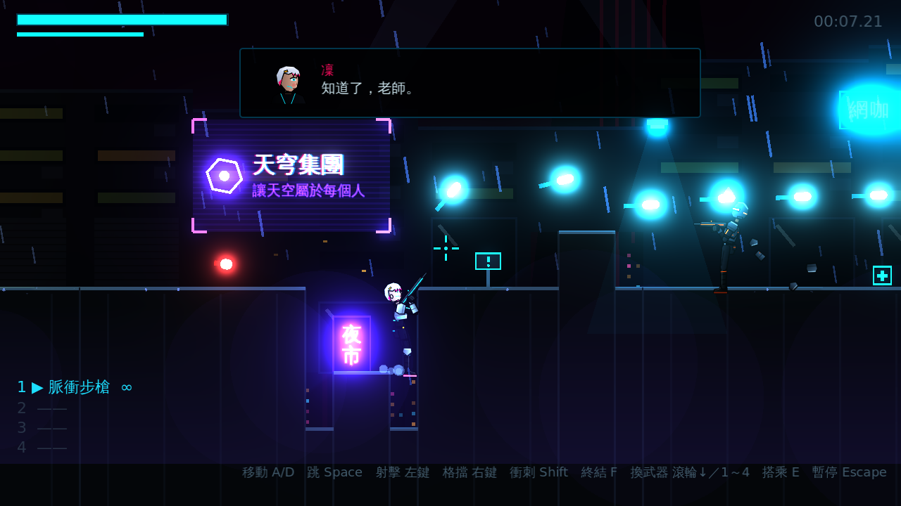
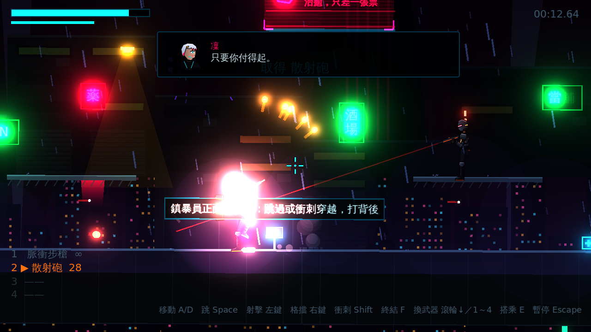
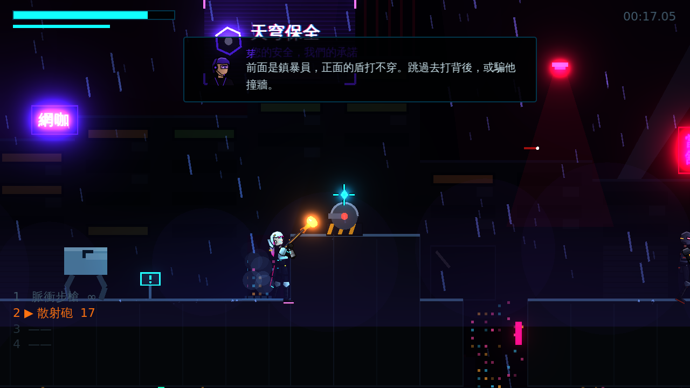
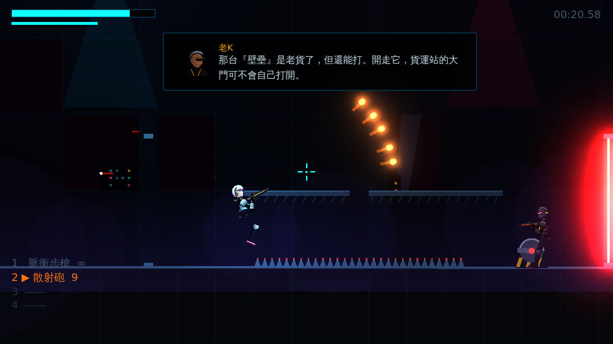
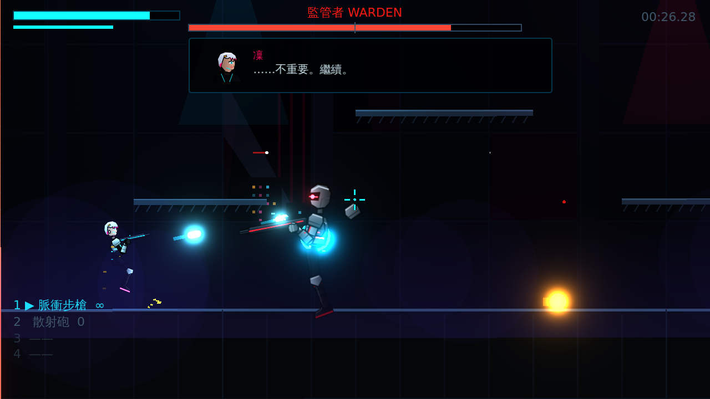
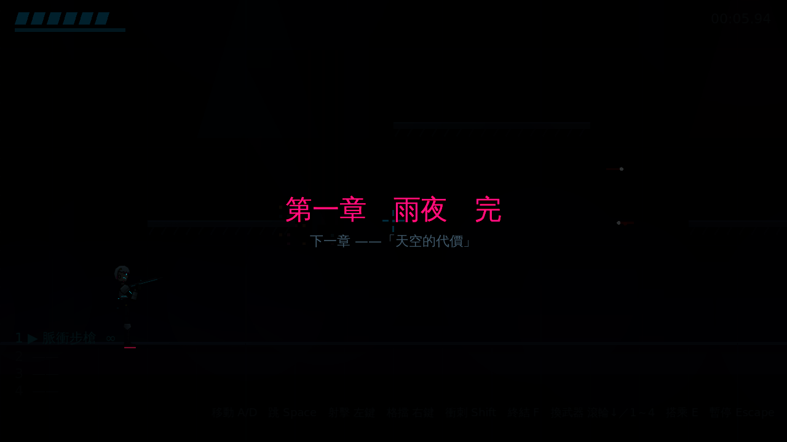

# [NE-10] 完成第一關完整流程

> 狀態：完成

## 內文

### 需求
以前面各票的成果重新設計並完成第一關：從開場過場、教學、霓虹市集、貨運站機甲段落、集團設施入口到頭目戰與結尾，可以完整遊玩。

### 來源
2026-10-02，使用者於開發對話中提出：「先做完整的第一關就好」「直接以可以遊玩的 Demo 為基準」「讓我驚艷」。

### 驗收條件
- [x] 第一關依序包含開場、教學、霓虹市集、貨運站（機甲）、集團設施入口、頭目戰、結尾與結算
- [x] 關卡配置配合新的角色比例與滑鼠操作
- [x] 每個區段至少登場一種新的敵人或機制，並有對應的教學提示
- [x] 檢查點分布合理，死亡後可從最近的檢查點繼續
- [x] 三種難度都能完整通關
- [x] 原有功能（設定、敗北圖鑑、暫停、結算）全部正常

### 測試流程
1. 以標準難度從開場玩到結算
2. 以輔助與硬核難度各玩到頭目戰
3. 執行完整測試套件，全部通過

---

# 跟其他票的關係

- Blocks：無
- Blocked by：NE-5、NE-6、NE-7、NE-8、NE-9
- Related：無

---

# Commit-1

## 內文

原本的關卡是舊比例下的短版垂直切片，沒有劇情串接，區段之間也沒有明確的節奏。

第一關重新設計成五個區段：屋頂巷弄（教學）、霓虹市集（散射砲、鎮暴員、監視蜂）、貨運站（機甲壁壘、砲台、自爆蟲、擲彈兵）、集團設施入口（室內、雷射柵欄、貫穿光束）、頭目機庫。開場過場、各區段的無線電對話、頭目登場過場、結尾過場與章節結算依序串起。關卡寬度加大以配合新的角色比例與滑鼠操作，設有五個檢查點；地圖改由區段產生器組合，並自動檢查每段的高低差與坑寬都在跳躍能力之內。

實測從開場一路打到結算；在每個檢查點站位復活；三種難度各打完頭目戰並進入結算；設定、圖鑑、暫停、結算畫面維持正常。

### 測試結果

| 項目 | 結果 |
|---|---|
| 自動測試 | 431 / 431 通過 |
| 五個檢查點各自復活 | 通過 |
| 輔助／標準／硬核頭目戰到結算 | 通過 |
| 關卡產生器跳躍可達性檢查 | 通過 |
| 原有畫面（設定、圖鑑、暫停、結算） | 通過 |

### 截圖

