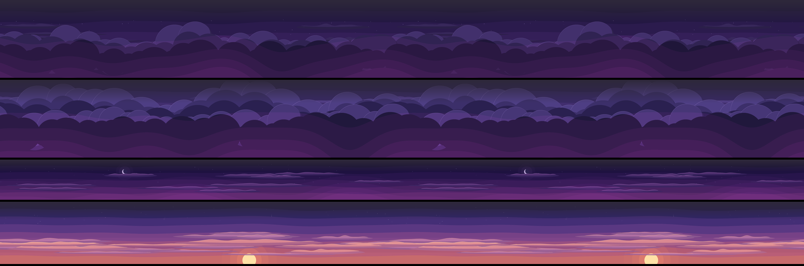
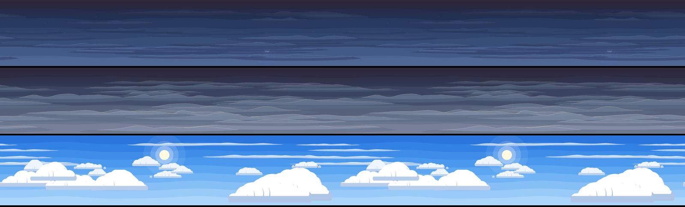
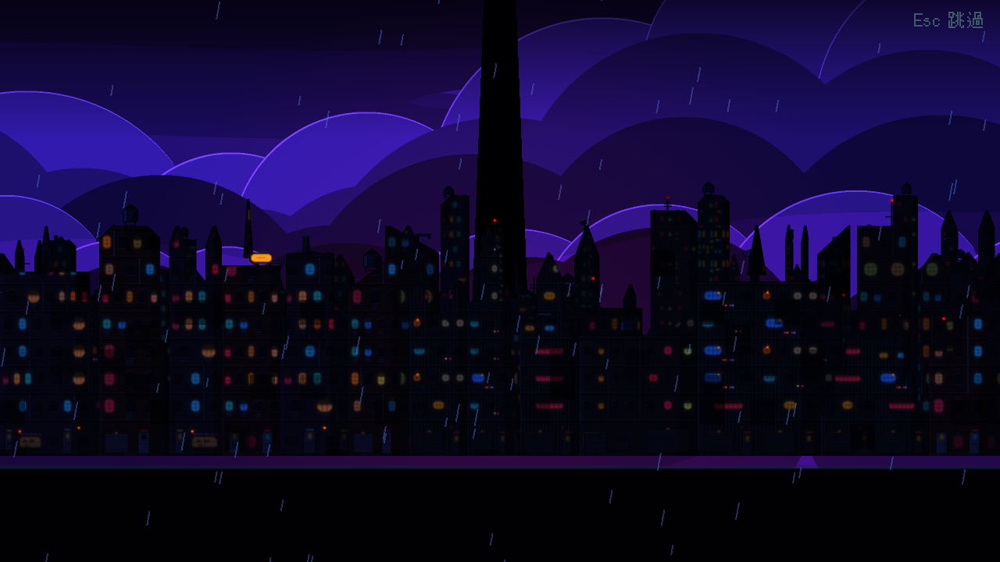

# [NE-111] 改用賽璐璐畫風重做天空與雲

> 狀態：完成

## 內文

### 需求
遊戲內與過場動畫的天空（暴雨雲、城市夜空、藍天與雲）是由 HDRI 全景照片加工的寫實版本，與賽璐璐畫風不一致。改成賽璐璐畫風的天空：平塗的雲層色塊、乾淨的雲邊、硬邊的光影，左右無縫、可慢速視差；夜空保持暗，不比角色搶眼。

### 來源
2026-10-03，使用者決定道具與場景改走賽璐璐畫風：「賽璐璐風格吧」。NE-60 的天空是照片加工，與新的畫風不一致。設計見 `design/11-free-assets/DESIGN.md`。

### 驗收條件
- [x] 遊戲內使用的所有天空（暴雨夜、城市夜空、其餘章節用到的）改為賽璐璐畫風
- [x] 過場動畫用的藍天與雲也改為賽璐璐畫風
- [x] 左右無縫，慢速視差時沒有接縫與模糊；貼圖不超過檔案大小上限
- [x] 夜空的亮度與色調與該區段的環境光一致，角色與背景仍清楚分離
- [x] 缺圖時仍退回程式天空並記錄路徑

### 測試流程
1. 逐一預覽所有天空
2. 從頭玩第一章，確認天空與視差
3. 執行暗場可讀性量測與環境元件相關測試套件

---

# 跟其他票的關係

- Blocks：NE-66、NE-112
- Blocked by：無
- Related：NE-60

---

# Commit-1

## 內文

天空是 HDRI 照片加工的寫實版本，與賽璐璐畫風不一致。
7 張天空（暴雨夜、城市夜空、黎明、薄霧黎明、煙霾、暴雨雲、過場用藍天）全部重畫成賽璐璐畫風：硬邊色帶漸層、平塗的雲（雲底較暗的第二色與亮邊）、星星、月亮與太陽、階梯式地平線光暈。左右天生無縫，檔名與尺寸不變，頂端仍淡出到遊戲內的漸層天空；缺圖時退回程式天空的行為不變。夜空平均亮度不高於舊圖（暴雨夜 0.21 → 0.15、暴雨雲 0.26 → 0.20），藍天因過場需要而更亮（0.53 → 0.69）。
驗收：預覽左右各重複兩次並放大接縫處，沒有看到接縫或模糊；第一章實景與兩個過場舞台（雨夜沉港、藍天縫隙）截圖看過；暗場可讀性量測持平（數值同 NE-108）。

### 測試結果

| 項目 | 結果 |
|---|---|
| 相關測試套件（環境元件、道具、過場動畫） | 通過 1299 / 1299 |
| 素材檢查（大小與總量） | 通過（環境素材 22.7 MB／60 MB，單檔最大 0.6 MB） |
| 執行 log | 無非預期的 ERROR |

### 截圖

