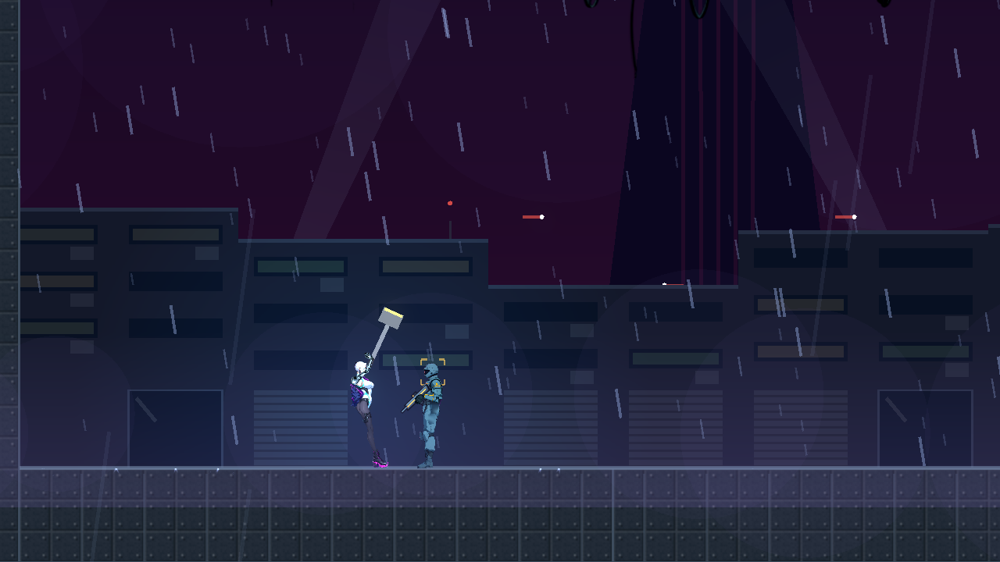
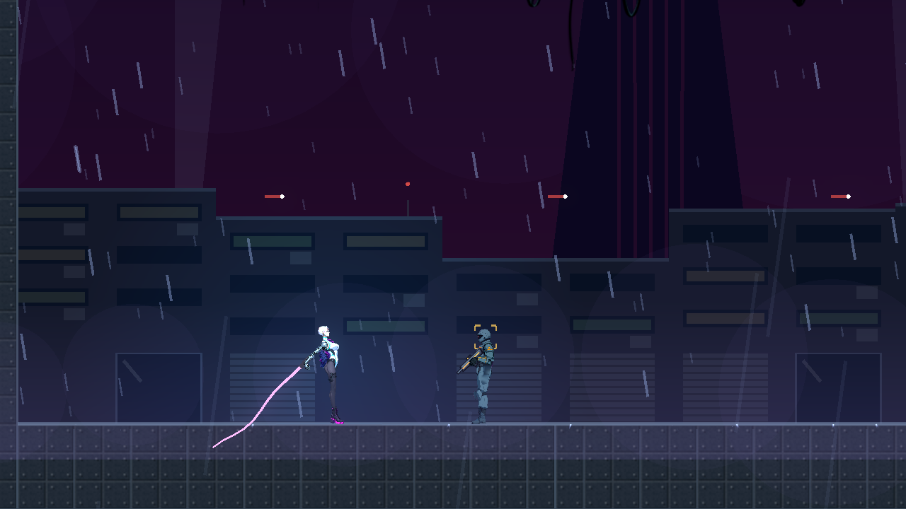
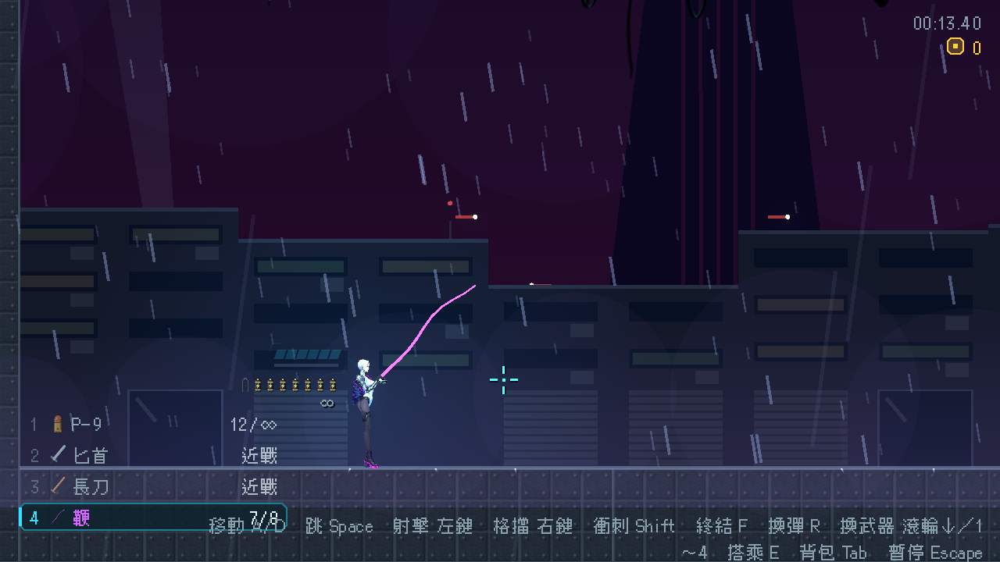

# [NE-117] 加入近戰與長距離近戰武器

> 狀態：完成

## 內文

### 需求
目前武器欄全是槍，近戰只有一個固定的短距離斬擊與終結技。要讓近戰也成為一種武器：可以撿、換、顯示在武器欄與背包，有短刃、長刀、重武器、長柄、鞭或鎖鏈等不同類型，包含攻擊距離很遠的近戰武器。強度靠攻擊速度（前搖、後搖）、威力、距離、範圍與消耗來平衡，不是單純某把比較強。

### 來源
2026-10-04，使用者說不一定每個武器都要是槍，可以給近戰武器或攻擊距離很遠的近戰武器，用攻擊速度、威力來平衡；設計見 `design/14-combat-variety/DESIGN.md`。

### 驗收條件
- [x] 近戰武器是資料：前搖、出招區間、後搖、判定形狀、距離、傷害、衝擊力、擊退、命中頓幀、消耗、連擊段數都能在資料裡調整，新增一把不改程式
- [x] 判定只在出招區間生效，一次揮砍對同一目標只算一次，揮空有後搖
- [x] 第一批至少三把：短刃（快、貼身）、長刀（標準）、長柄（距離長、近身有死角）；另有一把超長距離（鞭或鎖鏈）
- [x] 任兩把近戰武器在速度、威力、距離上有明顯取捨，沒有哪一把全面勝過其他
- [x] 近戰武器的衝擊力會依輕重讓敵人畏縮或硬直（沿用 NE-102 的分層），重武器能打出硬直
- [x] 武器欄、背包卡片與 HUD 能顯示近戰武器（沒有彈匣時的資訊），每把有一句說明
- [x] 角色有對應的持武器與揮砍動作，揮動有軌跡，命中有回饋，特效克制
- [x] 既有的槍械、格擋、完美反彈與終結技行為不變

### 測試流程
1. 逐把撿起並換上，對不同敵人揮砍，確認距離、速度與威力的差異
2. 對同一敵人比較各把的清敵效率，確認取捨成立
3. 揮空、連續揮砍、被打斷時確認後搖與判定正確

---

# 跟其他票的關係

- Blocks：無
- Blocked by：無
- Related：NE-102、NE-118、NE-101（近戰揮砍與終結技的特效在這張之後做）、NE-260

---

# Commit-1

## 內文

武器欄全是槍，近戰只有一個固定的短斬與終結技。
現在近戰是一種武器：和槍一樣撿起、用數字鍵或滾輪切換，顯示在武器欄、背包與撿取提示，每把有一句說明。手上拿近戰武器時，射擊鍵與近戰鍵都是揮擊，按住可連續出招；近戰鍵附近有破防敵人時仍是終結技，拿槍時近戰鍵維持原本的三段斬。
第一批五把：單分子匕首（短刃，三連刺、最快、要貼身）、熱能長刀（標準，三段連斬、第三刀能打出硬直）、液壓錘（重武器，前搖長、揮空破綻大、一擊硬直，每揮耗 1 格電）、離子戰戟（長柄，可朝準星刺，近身有死角）、單分子鞭（超長距離弧形，貼身打不到，每揮耗 1 格電）。重武器與鞭用電量限制連續使用，耗盡要充電，其他不消耗。
每把的前搖、出招區間、後搖、判定形狀（矩形或扇形）、距離、近身死角、傷害、衝擊力、擊退、命中頓幀、連擊段數與動作姿勢都在資料裡，新增一把只要加兩個資料檔。判定在出招區間內持續生效，同一目標一揮只算一次，揮空吃滿後搖。角色揮擊時依武器播放斜斬、劈砍、刺擊或橫掃動作，揮動有軌跡。
驗收：兩兩比較速度、威力、距離、衝擊力都各有勝負；匕首打不到 80 像素、戰戟與鞭有近身死角、鞭與戰戟能打到遠處；既有槍械與預設近戰的測試維持通過。

### 測試結果

| 項目 | 結果 |
|---|---|
| 近戰武器套件（資料、取捨、距離與死角、單次命中、電量、背包與武器欄） | 通過 68 / 68 |
| 受影響範圍（流程、既有近戰、環境、世界覆蓋、音效、武器覆蓋、背包與 HUD、回饋實驗室、骨架動作） | 新失敗 0（已知失敗與本票無關） |
| 資料驗證 | 0 錯誤 |
| 執行 log | 無非預期的 ERROR |

### 截圖

