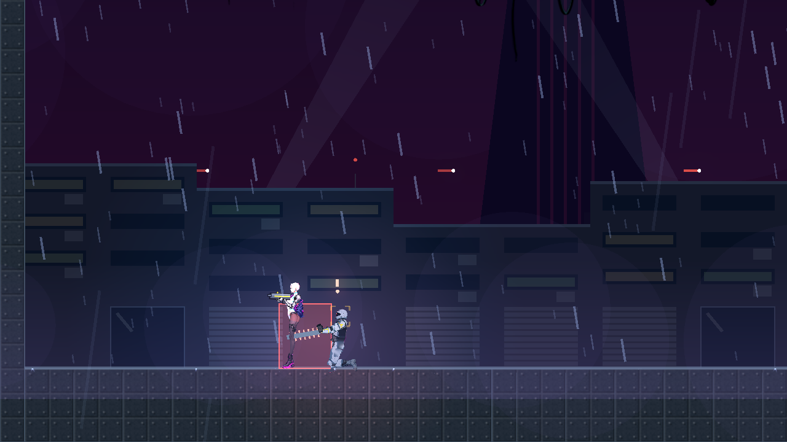
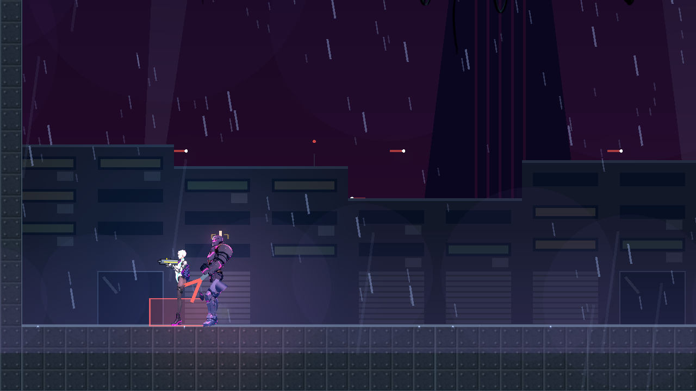
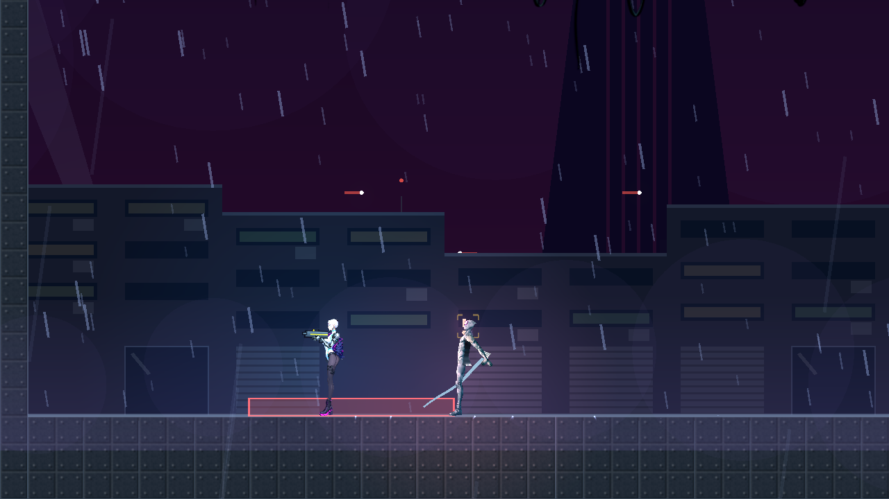
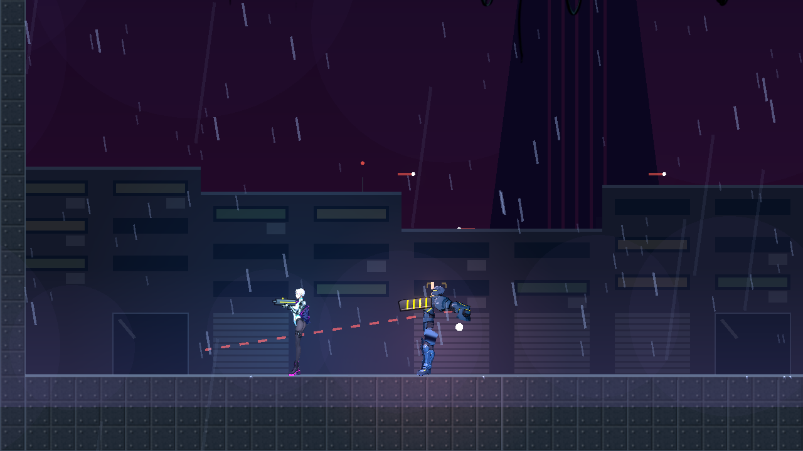
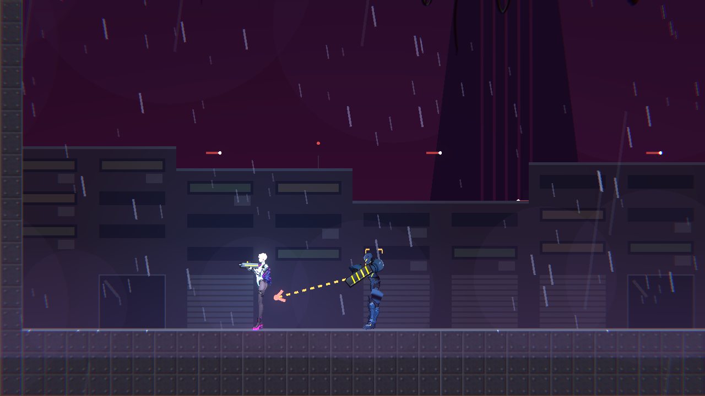
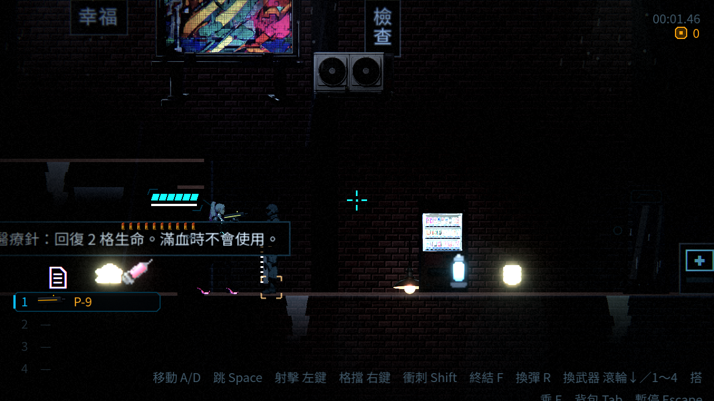
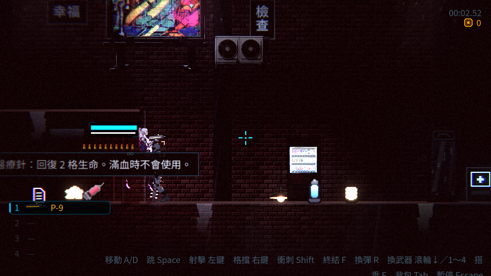
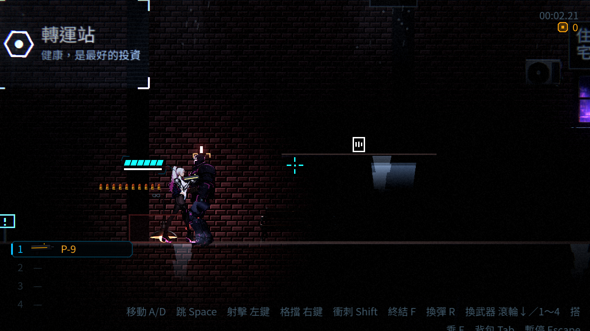
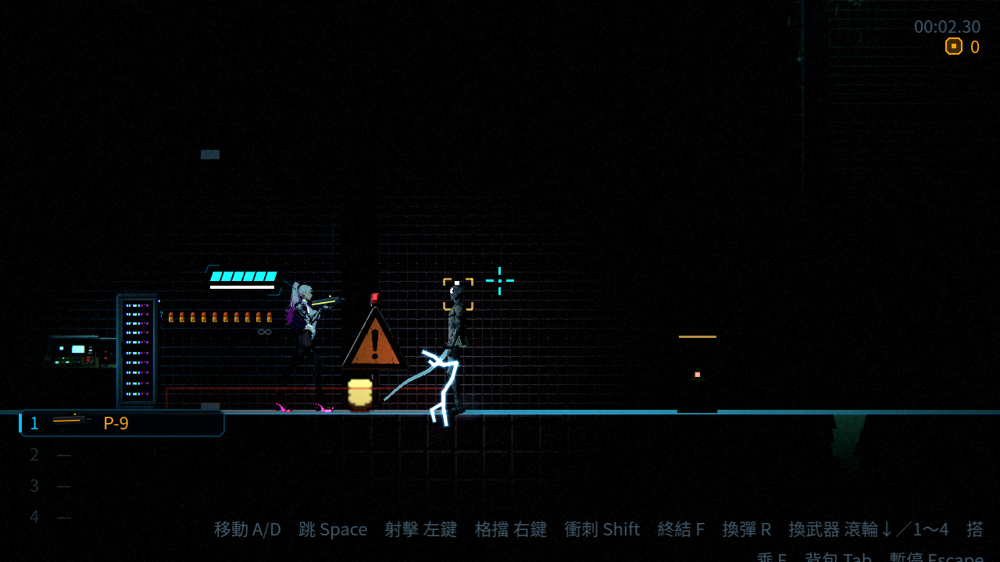
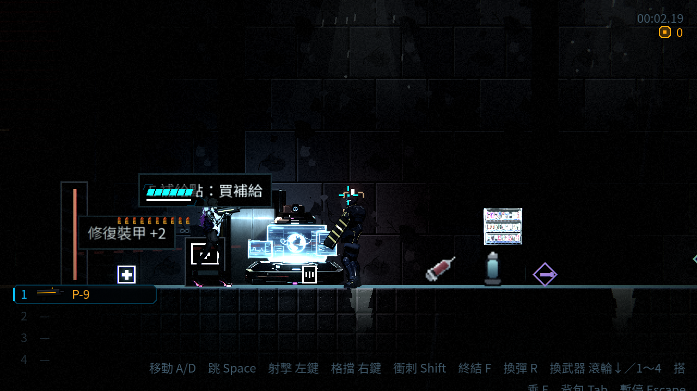

# [NE-118] 加入非槍械的敵人攻擊型態

> 狀態：審查中

## 內文

### 需求
敵人幾乎都拿槍射擊或貼身撞人。要加入更多、更怪誕的攻擊方式，貼合賽博龐克「每個人都想成為傳奇、把身體當舞台」的氣氛：先做第一批貼身與鎖鏈類攻擊（電鋸臂、液壓鉗、電擊棍、鎖鏈鐵鉤把玩家拉近、電漿鞭、迴旋刃），每種有自己的預兆、判定與玩家的應對方式；之後再挑干擾類與環境類。

### 來源
2026-10-04，使用者說敵人不一定要拿槍，可以用不同方式攻擊，有非常多種，賽博龐克情境下可以有多一點攻擊型態，怪誕的方式也可以；清單與設計要求見 `design/14-combat-variety/DESIGN.md`。

### 驗收條件
- [x] 至少四種新攻擊型態，各自有專屬動作與外觀：電鋸臂、液壓鉗或電擊棍、鎖鏈鐵鉤（把玩家拉近，打斷鎖鏈可解除）、電漿鞭或迴旋刃
- [x] 每種攻擊的預兆看得出攻擊的外型與範圍，不只靠紅色驚嘆號；預兆時間不短於現有最短預兆
- [x] 每種攻擊有明確的玩家應對（躲、擋、打斷、躲掩體），而且沒有一擊必殺
- [x] 判定只在出招動作的有效區間生效，與畫面動作對得上
- [x] 每種敵人的動作資料各自獨立，與其他敵人不共用；攻擊型態與數值是資料
- [x] 每種新攻擊有敗北圖鑑卡片與攻略
- [x] 新敵人放進章節名單的安排依 NE-97，不與其他章重複
- [x] 既有敵人的行為與數值不變，特效克制

### 測試流程
1. 用預覽工具逐一看每種攻擊的預兆、出招與收招
2. 進遊戲與每種敵人交戰，確認應對方式有效
3. 被鎖鏈拉近時確認可以打斷，且不會被卡進牆裡

---

# 跟其他票的關係

- Blocks：無
- Blocked by：無
- Related：NE-97（章節名單確認後才能放進關卡）、NE-99、NE-102、NE-103、NE-117

---

# Commit-1

## 內文

敵人幾乎都拿槍射擊或貼身撞人。
現在有四種非槍械攻擊的敵人，各有自己的預兆、判定與應對：
- 電鋸臂：衝上來空轉加速（鋸條越轉越亮），邊前推邊連割兩次，判定涵蓋整個身高。往後拉開、衝刺穿過去，或舉盾（每下耗盾）；完美格擋會讓牠暈眩。
- 液壓鉗：慢慢逼近、鉗口緩緩張開（預兆最長），猛夾腳邊的低矮範圍，一下兩點傷害。往上跳過去最安全；夾空後收招最長。
- 電漿鞭：保持中距離，長距離橫掃；預兆在地上畫出這一擊是頭高還是腳邊——頭高的蹲下、腳邊的跳起來，貼身就沒有威脅。
- 鎖鏈鐵鉤：預兆畫出鉤子要飛的路線，甩出鉤子；鉤中就把玩家往面前拖，拖到了再捅一下。可以衝刺掙脫、用子彈或近戰打斷鎖鏈中段（鉤子的主人暈眩）、舉盾擋下鉤子；鉤子碰牆會彈回，拖拉時撞牆就停，不會卡進牆裡。
預兆地上畫出的範圍就是判定範圍，判定只在出招區間，單次傷害不超過 2、沒有一擊必殺；預兆都不短於現有最短的 0.4 秒。每種有專屬動作、專屬特效資料與兩張敗北圖鑑卡片（攻擊與接觸）和攻略。
招式與數值在 EnemyData.strike 資料裡，同一個骨架行為（巡邏、靠近、預兆、出招、收招）共用，新增一種貼身武器只需要一個小腳本與一份資料。
驗收：預覽工具逐一看過預兆、出招與收招；測試涵蓋拉開距離、衝刺、跳過低判定、蹲下躲高判定、打斷鎖鏈、衝刺掙脫、牆擋鉤子、單次傷害上限。

### 測試結果

| 項目 | 結果 |
|---|---|
| 非槍械敵人攻擊套件 | 通過 97 / 97 |
| 受影響範圍（流程、既有近戰與敵人套件、骨架動作、敵人特效、圖鑑與背包畫面、音效、環境） | 新失敗 0（已知失敗與本票無關） |
| 資料驗證 | 0 錯誤 |
| 執行 log | 無非預期的 ERROR |

### 截圖

# Commit-2

## 內文

承接 NE-97 的唯一章節名單，電鋸臂、液壓鉗、電漿鞭與鎖鏈鐵鉤從第二章保留名單移入實際配置，第一章與舊 Demo 都不放這四種。沿用 Commit-1 的行為、動作、預兆、傷害與攻略；只替換既有遭遇，不增加敵人數量。

| 種類 | 生成格（欄／列） | 替換 |
|---|---|---|
| 電鋸臂 | 202／19 | 夾層後段精銳保全，距離狙擊手六格 |
| 液壓鉗 | 160／19 | 夾層精銳保全，距離迷彩獵手五格 |
| 電漿鞭 | 352／19 | 原 362 的精銳保全，避開 360 的維修機；纏絲仍有五格引入空間 |
| 鎖鏈鐵鉤 | 426／19 | 轉運站蝙蝠機移到地面，醫療針 428／19 保留 |

章節名單、實際 legend、生成資料與攻略卡片一起驗證。安全間距測試抓到初選的電鋸臂／電漿鞭位置與天花板生物／維修機過近，已調整位置，沒有降低門檻。四种圖鑑卡片與既有解鎖記錄保留。

### 測試結果

| 項目 | 結果 |
|---|---|
| 受影響測試（固定基準 aae089c8） | 20 組、36,245 項，0 新失敗、0 已知失敗，122 秒 |
| 合併 NE-223 後 | 任務地圖／第一章／第二章／非槍械攻擊共 1,904 項全通過，81 秒 |
| 既有攻擊與新章節配置 | StrikeEnemiesSuite 通過；新增第一遭遇安全空間及章節互斥檢查 |
| 產生器 | 重跑地圖逐位元相同，機關、補給與出入口保留 |
| 畫面 | 真實 level_02 生成的四種敵人，各自自然進入 windup 後截圖；非目標敵人隱藏以便配置審查 |
| 環境 | Godot 4.7 Forward+、llvmpipe 軟體 Vulkan；無 GPU 效能量測、無人工通關／試聽宣稱 |

本票剩餘章節配置已交付；兩章人工實戰與整體難度仍由 NE-97 的未勾條件保留。畫面中的既有角色素材／接合與整體暗場品質交各所屬票處理，未重畫素材。

### 截圖

