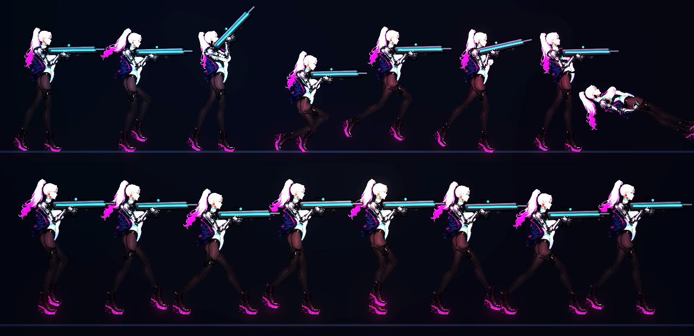

# [NE-119] 修正凜的動畫只看得到一條腿

> 狀態：完成

## 內文

### 需求
凜的動畫看起來只有一條腿：預覽與遊戲中，兩條腿都是深色絲襪，後腿與背景和另一條腿融在一起，站立、跑步、跳躍、蹲下時只看得到一條。要讓兩條腿在所有動作與光影下都能分辨，遠側與近側有明顯的明暗層次，腳與鞋子位置也對得上。

### 來源
2026-10-04，使用者發現凜的動畫只有一條腿，角色設計也很奇怪（設計哪裡奇怪待使用者說明後另開票）。

### 驗收條件
- [x] 確認原因：是零件缺失、骨架對應錯誤，還是遠側腿太暗而看不見，記錄在票上
- [x] 站立、跑、瞄準、蹲、跳、格擋、倒下的預覽中，兩條腿都清楚可辨
- [x] 近側與遠側腿有適當的明暗層次，在最暗與最亮的光影下都分得出來
- [x] 腳與鞋位置對得上，沒有懸空、陷入地面或交叉錯位
- [x] 不改變凜原本的外觀設定與其他動作的手感
- [x] 附修正前後的預覽截圖

### 測試流程
1. 用預覽工具看八種動作與各瞄準角度
2. 進遊戲在暗處與亮處跑動、蹲下，確認雙腿可辨

---

# 跟其他票的關係

- Blocks：無
- Blocked by：無
- Related：NE-71、NE-72、NE-106

---

# Commit-1

## 內文

凜的動畫看起來只有一條腿：兩條腿都是深色絲襪，遠側（後面）那條腿又被調暗到 62%，站著時兩條腿幾乎完全重疊，跑起來遠側腿幾乎看不見，腳底也沒有踩實地面而飄在空中。
原因是遠側腿的亮度調得太暗，再加上站姿的雙腳幾乎併在一起；零件本身沒有缺，骨架對應也沒有錯。現在遠側腿與腳的亮度調到與近側腿相同（受傷底層也只暗一點），站姿雙腳明顯分開並有重心的微小左右移動；跑步改用與敵人相同的落腳步行：踩在地上的腳貼著地面隨身體往後移，不滑，另一隻腳抬起前擺，膝蓋朝前彎，蹲下時腳底踩實。蹲下時槍口與準星的高度改成依實際的身體下沉量計算，與腳踩實後的新姿勢一致。
凜加入動畫稽核（站、跑、瞄準、蹲、格擋、受擊、後座、跳、落地、倒下四種），骨頭長度、手肘與膝蓋範圍、驅幹與頭傾斜、腳底與地面、握槍、角度跳動、倒下躺姿都在限制內。
驗收：稽核套件 270 項全數通過；連同電話亭、角色、骨架動作、姿勢、受擊、第二章與介面套件共 2202 項、0 失敗，格擋與反彈專項 10 項通過。依指示沒有跑完整測試套件。

### 截圖

