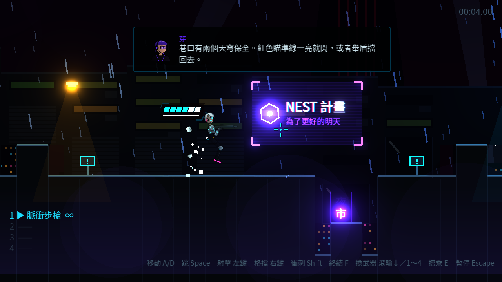
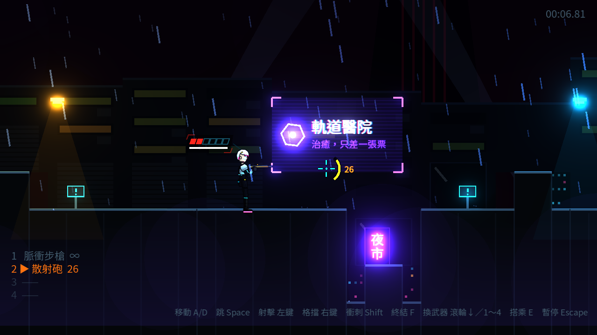
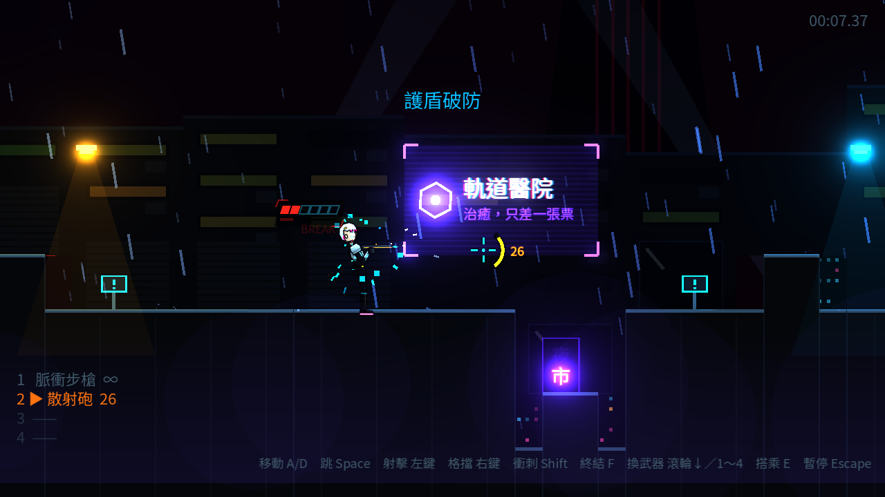

# [NE-11] 改用動態玩家介面

> 狀態：完成

## 內文

### 需求
生命、護盾、彈藥原本固定在畫面角落，戰鬥時視線要離開角色才看得到，平常又一直佔著畫面。改成跟著角色與準星的動態介面：平常淡出不擋畫面，數值變動或處於危險狀態時清楚顯示，並加強受傷、格擋、低彈藥的回饋。設計見 `design/05-dynamic-hud/DESIGN.md`。

### 來源
2026-10-03，使用者於開發對話中提出：「子彈跟血量、護盾的 UI，我希望可以做成 dynamic player ui」「看一下業界最佳實例……試著做一版好看一點的」。

### 驗收條件
- [x] 生命與護盾顯示在凜身旁並跟著移動，轉身時換到背側
- [x] 閒置約 2.5 秒後淡出；受傷、補血、格擋、護盾回復時立刻完整顯示
- [x] 低血量時常駐顯示並有脈動提醒；破防時護盾顯示破防狀態直到恢復
- [x] 受傷時看得出損失了幾格（殘影後碎掉），完美格擋有閃光回饋
- [x] 持有限彈藥武器時，準星旁顯示彈藥環與剩餘發數；低彈藥會變色提醒；換武器時顯示武器代號
- [x] 死亡與劇情過場時動態介面隱藏
- [x] 設定畫面可關閉「HUD 自動隱藏」，關閉後生命與護盾一律完整顯示，設定會保存
- [x] 原本的殘機、計時、武器欄、機甲耐久、頭目血條正常顯示

### 測試流程
1. 開始第一關，站著不動，確認生命與護盾標籤數秒後淡出
2. 被敵人擊中，確認標籤立刻出現、抖動，損失的格子先變白再碎掉
3. 按住格擋直到破防，確認護盾條變紅並顯示破防
4. 撿取散彈槍連續射擊，確認準星旁的彈藥環逐格減少、低彈藥時變色
5. 到設定畫面關閉「HUD 自動隱藏」，回到遊戲確認標籤不再淡出；重開遊戲後設定仍保留
6. 執行完整測試套件，全部通過

---

# 跟其他票的關係

- Blocks：無
- Blocked by：無
- Related：NE-6

---

# Commit-1

## 內文

生命、護盾固定在左上角，彈藥只在左下武器欄有一行數字，戰鬥時要把視線移開角色才看得到，平常又一直佔著畫面。
現在生命與護盾變成浮在凜頭部背側的全像標籤，轉身時會滑到另一側。閒置約 2.5 秒淡出，受傷、補血、格擋時立刻彈出。受傷時損失的格子先亮白再碎掉並抖動；低血量時紅色心跳脈動並常駐；破防時護盾條紅色閃爍並顯示 BREAK；完美格擋時護盾條閃光。持有限彈藥武器時，準星右側有弧形彈藥計量和剩餘發數，低彈藥變黃、最後幾發變紅、打空時顯示 EMPTY，換武器時準星旁短暫顯示武器代號。設定畫面新增「顯示」分頁，可以關閉 HUD 自動隱藏。
驗收方式：以自動截圖跑過閒置、受傷、低血量、破防四種情境，並以冒煙測試驗證淡出與彈出規則、低血量判定、彈藥環隨消耗更新與打空隱藏、設定切換即時生效。

### 測試結果

| 項目 | 結果 |
|---|---|
| 完整測試套件 | 通過 445 / 445 |
| 資料驗證 | 0 錯誤 |
| 執行 log | 無非預期 ERROR |

### 截圖

