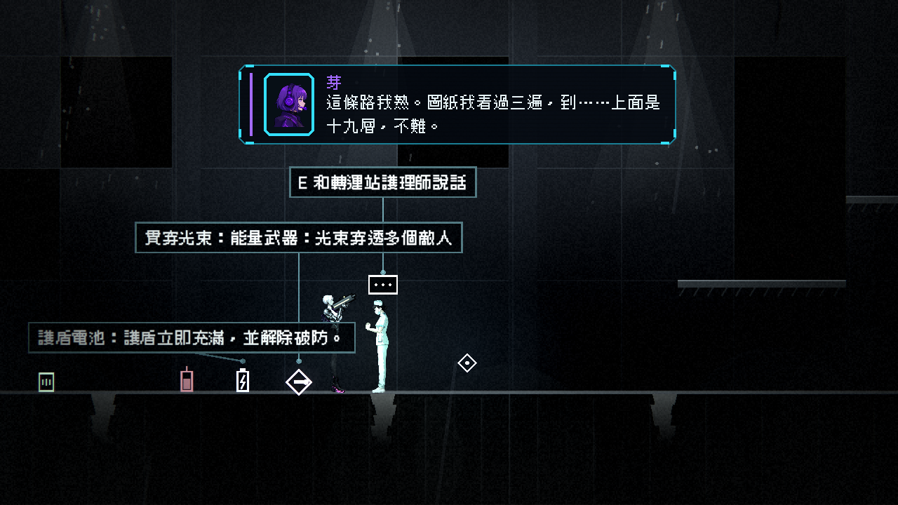
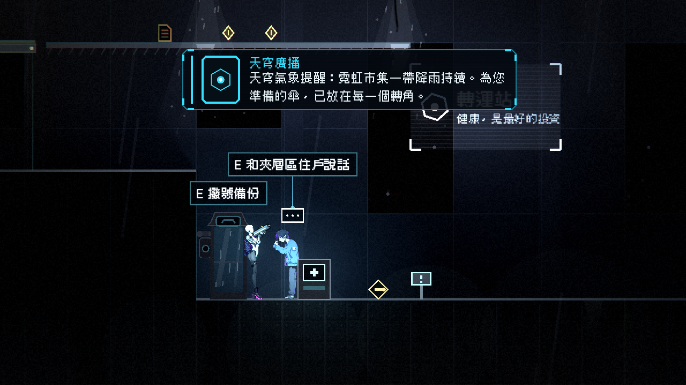

# [NE-120] 讓世界提示文字自動錯開不互相疊住

> 狀態：完成

## 內文

### 需求
關卡裡檢查點、補給站、武器拾取、開關與 NPC 的互動提示文字，在彼此靠近時會疊在一起，其中最明顯的是疊在 NPC 身上（住戶旁有補給站與拾取物、夜班工人旁有檢查點與拾取物、護理師旁有武器拾取、老陳旁有開關），玩家看不清哪個提示對應哪個東西。要讓同時出現的提示文字自動錯開，每個提示仍然清楚指向自己的物件。

### 來源
2026-10-04，NPC 場景內驗證（NE-85、86、87）發現提示文字互相疊住；搬動 NPC 位置要同時顧到「離敵人 8 格以上」的測試與劇情觸發格，不是根本解法。

### 驗收條件
- [x] 同一處有多個提示時，文字自動上下錯開，不重疊也不蓋住人物的臉
- [x] 每個提示與它對應的物件之間有清楚的指向（距離、細線或標記），一眼分得出屬於誰
- [x] 只有玩家進入互動範圍的提示才完整顯示，其餘淡出或縮成小標記
- [x] 目前第一章與第二章所有疊在一起的位置（住戶、夜班工人、護理師、老陳周圍）都不再疊住
- [x] 提示出現的距離與按互動鍵有效的距離一致，看到提示就按得動
- [x] 提示的數量變多時也不會每影格配置物件，效能不下降

### 測試流程
1. 逐一走到上述四個位置，確認提示不重疊且指向正確
2. 在同一處放三個以上的提示，確認自動排開
3. 走進與走出互動範圍，確認顯示、淡出與互動有效距離一致

---

# 跟其他票的關係

- Blocks：無
- Blocked by：無
- Related：NE-85、NE-86、NE-87

---

# Commit-1

## 內文

檢查點、補給站、武器拾取、開關與人物的提示文字靠在一起時會疊成一團，最明顯是疊在人物身上。
現在同時顯示的提示會自動錯開：先上下疊開，人物擋在上方時改往旁邊讓開，不蓋住人物的臉與頭上的對話泡泡；被推開的提示會滑到新位置，並拉一條細線指回自己物件上方的小圓點，一眼看出屬於誰。只有進入互動範圍的提示才顯示，離開就淡出，沒有提示顯示時不做任何排版運算。檢查點、補給站、開關與人物的提示，改成用「按互動鍵有效」的同一個範圍判斷，看到提示就按得動。
驗收：第二章住戶、護理師周圍的三個提示（撥號備份、武器說明、人物對話）排成階梯、互不重疊，且沒有蓋住人物與泡泡；第一章夜班工人、第二章老陳同樣不再疊住；自動測試涵蓋三個以上提示排開、人物避讓、離開範圍淡出與取消登記。

### 測試結果

| 項目 | 結果 |
|---|---|
| 完整測試套件（新增套件登記，自動升級為全跑） | 新失敗 0，已知失敗 10 維持不變 |
| 執行 log | 無 ERROR |

### 截圖

