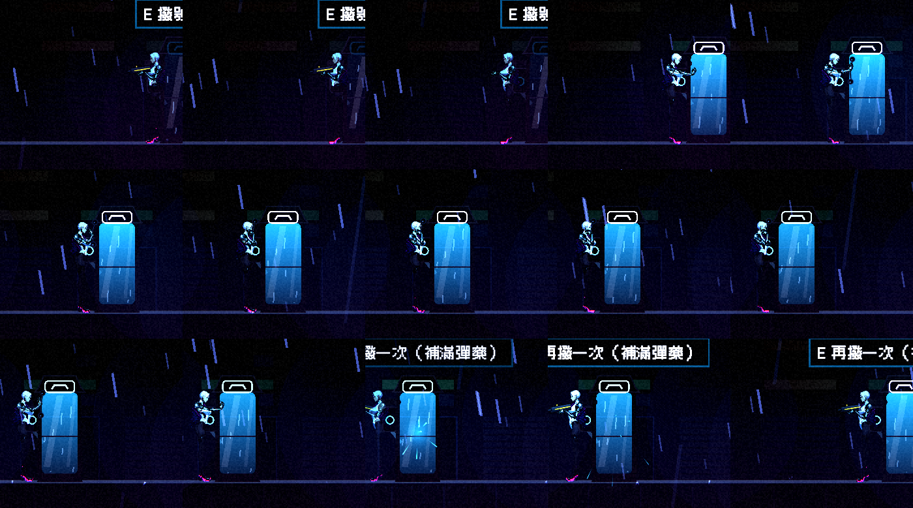
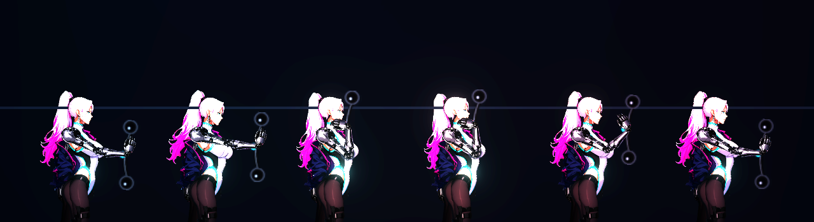

# [NE-121] 把檢查點改成電話亭並加入互動與動畫

> 狀態：完成

## 內文

### 需求
現在的檢查點是一根發光的柱子，走過去就啟動，沒有儀式感，也看不出它在世界裡是什麼。世界觀中，備份與復原的地方（錨點）是**老式公共電話亭**：拿起話筒撥給帳房，把現在的自己轉存一份；死後就在最近的亭子醒來；話筒裡永遠是沈望錄的標語「再來一次，沒關係」。

要把檢查點換成電話亭：玩家走近後按互動鍵拿起話筒才啟動，角色有對應的拿話筒、通話、掛上的動作，亭子本身有待機、啟動、已啟動的狀態與動畫。

### 來源
2026-10-03，使用者在戰鬥設計討論中決定「篝火用電話亭」，並確認改成按鍵互動、要有適配動畫；先開票放著，不立即實作。設計見 `design/15-combat-feel/DESIGN.md` 第 6 節與 `design/13-story-v2/WORLD.md` 的錨點說明。

### 驗收條件
- [x] 檢查點的外觀換成老式公共電話亭：玻璃帶雨痕、發光，未啟動與已啟動的光色與亮度不同
- [x] 玩家走近時出現一句提示（例如「撥號備份」），按互動鍵才會啟動；只是路過不會啟動
- [x] 啟動時角色做出拿起話筒、通話、掛上的動作，期間不能被打斷成怪異姿勢；通話時間短（約一秒內），不拖慢節奏
- [x] 啟動時話筒播放標語「再來一次，沒關係」的錄音音效（先用占位音效，內容留給之後的配音）
- [x] 啟動後行為與現有檢查點一致：記錄位置與武器配置，依難度回滿血，死亡後從這裡重來；已啟動的亭子可以再次互動（補滿彈藥、整備），不會重複扣東西
- [x] 從這個亭子重生時直接顯示為已啟動，亭子裡有重生的小演出（錨點的語音與狀態列沿用既有死亡畫面，不重複）
- [x] 手把與鍵盤都能互動，提示會依目前輸入裝置顯示正確的按鍵
- [x] 角色的動作以骨架動畫實作，與現有人形動畫器的姿勢、腳步與手持武器相容；握槍或持近戰武器時，拿話筒會先收起武器再放回，不出現武器穿過身體的畫面
- [x] 動作逐影格檢查：以骨架逐格播放並擷取畫面，確認拿起、通話、掛上每個階段的手臂、手持話筒與身體位置合理，沒有穿模、斷肢或姿勢跳變（本票的動作驗證以程式逐格擷取檢查為準，不需要人工驗收）
- [x] 既有的檢查點相關功能與測試不變

### 測試流程
1. 走過未啟動的亭子，確認不會啟動；走近，確認出現提示
2. 按互動鍵，確認角色拿起話筒、通話、掛上，亭子變為已啟動，並播放標語
3. 手持槍與近戰武器各做一次，確認武器的收起與放回
4. 死亡，確認從該亭子重生且亭子已是啟動狀態
5. 以骨架逐格播放整段動作並擷取畫面，逐格檢查姿勢

---

# 跟其他票的關係

- Blocks：無
- Blocked by：無
- Related：NE-6、NE-117

---

# Commit-1

## 內文

檢查點原本是一根發光的柱子，走過去就啟動，沒有儀式感，也看不出它在世界裡是什麼。
現在檢查點是老式公共電話亭：玻璃有反光與雨痕，頂上是發光的話筒招牌，外牆掛著電話機；待機時光色微弱而不穩定地閃，通話中明亮呼吸，已啟動穩定偏亮。路過不會啟動，走近出現一句提示「撥號備份」（鍵盤與手把都能按，按鍵依目前輸入裝置顯示），按互動鍵凜才會站到亭子旁撥號：先收起手上的武器（槍或近戰都一樣），伸手拿起話筒、放到耳邊通話、再放下掛上，約一秒多完成，期間短暫無敵不會被打斷成怪姿勢，結束後原本的武器放回。話筒是新畫的手持物，只在拿起到掛上之間出現在手上。
通話過程有拿起、三聲撥號音、話筒裡的錄音與掛上的聲音（錄音先用占位合成聲，之後換配音），同時顯示標語「再來一次，沒關係。」聲音與備份都跟著玩家動作的進度走，幀率再低也不會錯開。完成後記錄位置與武器配置、依難度回滿血、補滿所有武器的彈藥；已啟動的亭子可以再撥，補滿彈藥並重新備份，不會重複扣東西；通話中死亡就取消，不備份。從這個亭子重生時直接顯示為已啟動，並有來電鈴聲與招牌閃動的小演出。
驗收：新增電話亭測試 46 項全數通過（路過不啟動、按鍵撥號、面向亭子、通話時間線與標語、武器收起與放回、記錄位置與回血與補彈、第二次撥號、通話中死亡取消、重生為已啟動、空中不能撥、撥號動作逐格稽核），第二章的檢查點測試改成撥號才記錄也通過。撥號的骨架動作逐格播放並擷取，確認伸手、拿起、通話、掛上每個階段手臂與話筒位置合理，骨頭長度、手肘、驅幹、頭與單格角度跳動都在稽核限制內，附逐格截圖。相關的角色、骨架、NPC、受擊、姿勢套件跑完有一項失敗：老 K 的頭部發光層尺寸，是另一個正在重畫老 K 零件的繪圖流程修改到一半造成的，與這張票無關。依指示沒有跑完整測試套件。

### 測試結果

| 項目 | 結果 |
|---|---|
| 電話亭套件 | 通過 46 / 46 |
| 第二章檢查點測試 | 通過 |
| 相關套件（角色、骨架、NPC、受擊、姿勢） | 2851 / 2852（老 K 發光層尺寸，屬重畫零件中的 NE-90） |
| 完整測試套件 | 未執行（依使用者指示只測改動範圍） |

### 截圖

