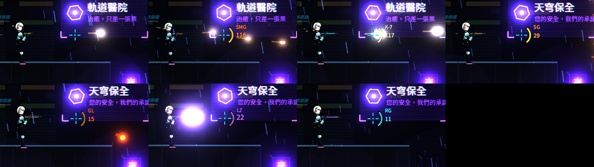

# [NE-12] 重整為實彈為主的武器陣容

> 狀態：完成

## 內文

### 需求
武器原本只有脈衝步槍、散射砲、貫穿光束三把，風格都偏能量武器。改成以實彈槍為主、少量能量武器的陣容，讓街頭傭兵的世界觀更踏實，也讓第一關每個區段都有新武器可拿。設計見 `design/07-weapons-inventory/DESIGN.md` 第 1 節。

### 來源
2026-10-03，使用者於開發對話中提出：「槍械我希望目前的都是射擊實彈的槍，大部分都是實彈，少部分光能／雷射」；確認採用 6 實彈＋2 能量。

### 驗收條件
- [x] 共有手槍、衝鋒槍、突擊步槍、霰彈槍、榴彈發射器、機甲加農砲 6 種實彈武器，與貫穿光束、電磁軌道砲 2 種能量武器
- [x] 實彈武器射出暖色曳光彈並拋彈殼；能量武器射出光束、不拋彈殼
- [x] 每把武器手上的外觀與武器種類一致
- [x] 第一關各區段依設計配置可撿取的武器
- [x] 撿取提示與武器欄顯示新的名稱與一句說明

### 測試流程
1. 從第一關開頭玩到頭目戰，依序撿到各區段的武器
2. 每把武器各射擊一段時間，確認彈道、手感、外觀符合類型
3. 執行完整測試套件，全部通過

---

# 跟其他票的關係

- Blocks：NE-13
- Blocked by：無
- Related：無

---

# Commit-1

## 內文

武器原本只有脈衝步槍、散射砲、貫穿光束三把，而且都偏能量武器，和街頭傭兵的世界觀不搭。
現在預設主武器是 P-9 手槍，第一關依區段可以撿到蜂鳴衝鋒槍（屋頂）、碎骨霰彈槍（市集）、K-7 突擊步槍與震爆榴彈發射器（貨運站）、貫穿光束（設施入口），以及頭目戰前的電磁軌道砲；機甲加農砲維持不變。實彈武器射出暖色曳光彈、拋彈殼，並有各自的槍聲；能量武器射出光束、不拋彈殼。貫穿光束有自己的槍械外觀（洋紅聚焦鏡片），不再和電磁砲共用。
驗收方式：以自動截圖讓凜依序使用 7 把玩家武器開火，確認外觀、彈道與彈藥環；冒煙測試檢查陣容是 6 實彈＋2 能量、預設武器是手槍、每把武器都有外觀與音效。

### 測試結果

| 項目 | 結果 |
|---|---|
| 完整測試套件 | 通過 472 / 472 |
| 資料驗證 | 0 錯誤 |
| 執行 log | 無非預期 ERROR |

### 截圖

