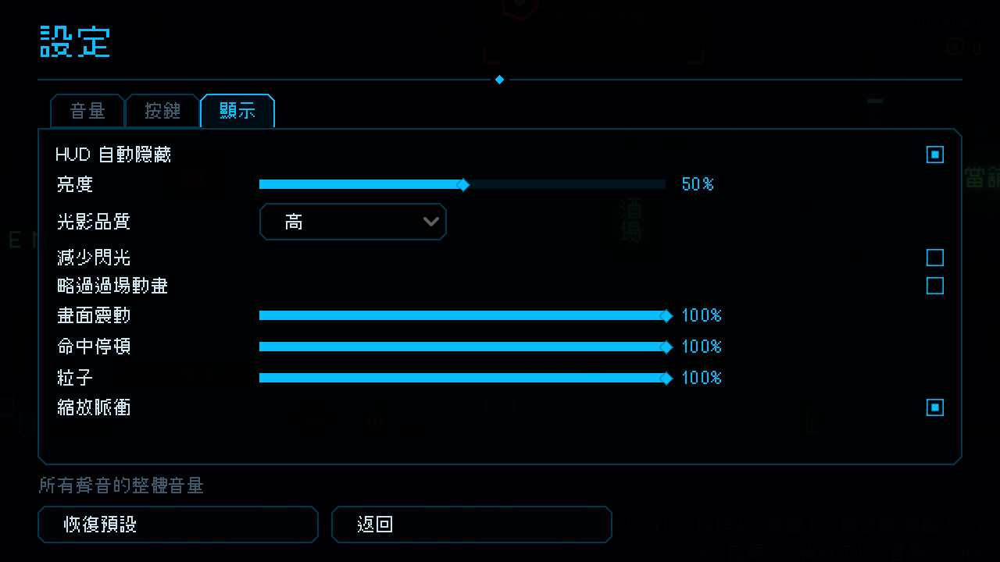

# [NE-132] 加入回饋縮放與無障礙設定

> 狀態：完成

## 內文

### 需求
設定頁只有「減少閃光」，無法調整畫面震動、命中停頓與粒子的強度。要加入這三項的滑桿與縮放脈衝開關，與「減少閃光」並存，讓怕暈的玩家能降低或關閉。

### 來源
2026-10-04，使用者要求處理打擊感；研究與設計見 `design/15-game-feel/RESEARCH.md`（第 3 節、第 5 節），母票 NE-130。

### 驗收條件
- [x] 設定頁新增畫面震動、命中停頓、粒子三個滑桿與縮放脈衝開關，每項有一句 tooltip
- [x] 震動 0% 時畫面震動與縮放脈衝完全關閉，後座保留約一半
- [x] 設定存檔、讀檔正確，損毀的設定值退回預設
- [x] 所有回饋事件都吃這些縮放，無遺漏

### 測試流程
1. 開設定頁調整各滑桿，到戰鬥中確認強度改變
2. 把設定檔改成不合法的值，確認退回預設

---

# 跟其他票的關係

- Blocks：NE-137、NE-146、NE-148
- Blocked by：NE-131
- Related：NE-130

---

---

# Commit-1

## 內文

設定頁只有「減少閃光」，怕暈或機器吃緊的玩家沒辦法降低畫面震動、命中停頓與粒子。
顯示分頁新增「畫面震動」「命中停頓」「粒子」三個 0～100% 的滑桿與「縮放脈衝」開關，各有一句說明，並與「減少閃光」並存。所有回饋事件與動態震動都乘上這些倍率：震動 0% 時畫面不震、縮放脈衝一律關閉，鏡頭後座仍保留一半；命中停頓 0% 時完全沒有停頓；粒子 0% 時不產生火花與餘燼。設定即時生效並自動存檔，設定檔裡損毀或超出範圍的值退回預設（100%、開啟）；「恢復預設」也會一併重設。
驗收：回饋套件新增設定檢查（預設值、震動依滑桿縮放、0% 不震且後座剩一半、脈衝在震動 0% 時關閉、損毀與越界值退回預設、重設），連同介面畫面套件共 184 項、0 失敗。依指示沒有跑完整測試套件。

### 截圖

