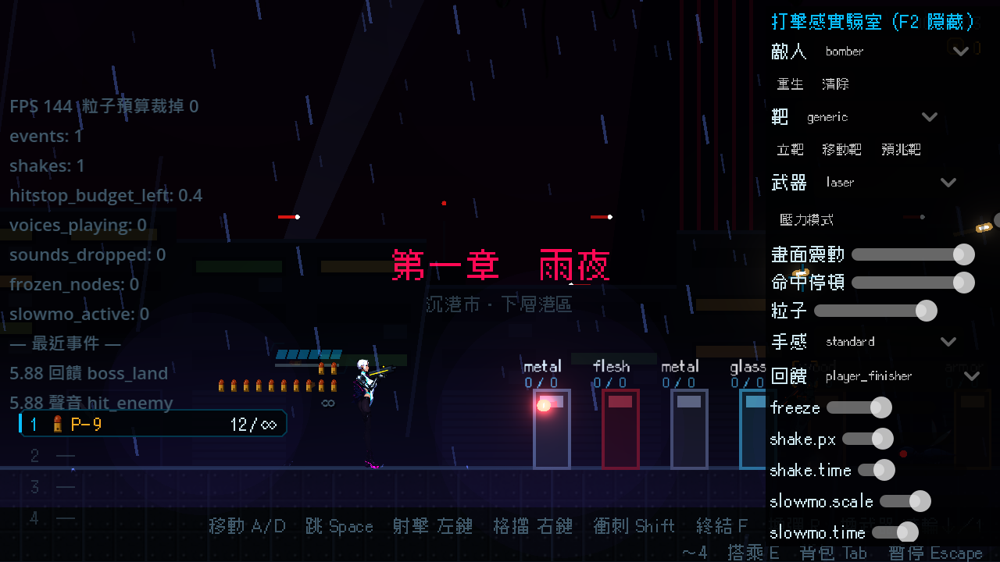

# [NE-133] 打擊感實驗室：沙盒場景

> 狀態：完成

## 內文

### 需求
調打擊感目前只能進關卡打到敵人才看得到，無法重複比較。要做一個獨立的實驗室場景，用真實的玩家、敵人、特效、聲音與鏡頭，讓開發者可以反覆測試同一個回饋。

### 來源
2026-10-04，使用者要求處理打擊感；研究與設計見 `design/15-game-feel/RESEARCH.md`（第 8 節），母票 NE-130。

### 驗收條件
- [x] 可由命令列開啟實驗室場景，匯出的遊戲版本不含它
- [x] 場地有材質靶、移動靶、預兆靶，以及人形、觸手、機械、飛行等真實敵人，每種都可一鍵重生
- [x] 可切換玩家武器、近戰與情境資料（壓力模式：一次多隻敵人）
- [x] 使用的就是遊戲正式的玩家與回饋系統，不是另一份仿製
- [x] 附場景截圖

### 測試流程
1. 開啟實驗室，逐一重生各種靶與敵人並攻擊
2. 切換武器與壓力模式

---

# 跟其他票的關係

- Blocks：NE-134、NE-149、NE-151
- Blocked by：NE-131
- Related：NE-130

---

---

# Commit-1

## 內文

調打擊感只能進關卡打到敵人才看得到，無法反覆比較同一個回饋。
現在有獨立的打擊感實驗室，從命令列開啟（`godot --path . res://tools/feel_lab/feel_lab.tscn`），遊戲的選單與關卡流程都進不去它，並由測試鎖定沒有任何遊戲檔案引用；專案目前還沒有匯出設定，匯出時請把 tools 資料夾排除。場地用的是正式的玩家、關卡、特效、聲音與鏡頭：右側面板可以重生任何一種真實敵人（清單由敵人資料夾自動產生，之後新增的敵人會自動出現，觸手類敵人做出來也一樣）、放八種材質的立靶、移動靶與預兆靶（紅光預兆、預兆音，接著朝玩家開火，測預兆與格擋）、切換玩家武器（彈藥無限）、開壓力模式（定時湧入一批敵人）、調回饋強度滑桿、單獨播放任一回饋或聲音事件、在準星位置播放材質命中；左側顯示診斷數字與最近事件時間軸。F2 隱藏面板。
驗收：實驗室套件 22 項（沒有遊戲檔案引用、不是主場景、建起真實玩家、所有敵人都能重生與清除、每種材質都有靶、移動靶會動、預兆靶先預告再開火、靶吃真實傷害打不死、所有武器可切換、壓力模式一次多隻、壞名稱不崩潰）、0 失敗；截圖為實驗室畫面。依指示沒有跑完整測試套件。

### 截圖

