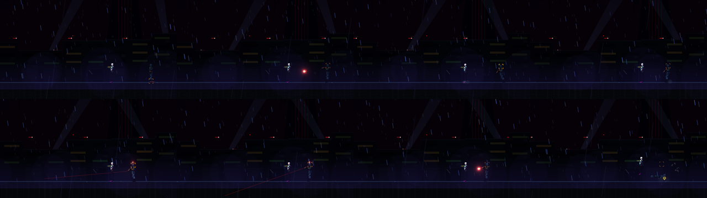

# [NE-137] 鏡頭系統升級

> 狀態：完成

## 內文

### 需求
鏡頭震動強度單位不直觀、沒有方向性，也沒有縮放與前瞻。要做依事件的鏡頭回饋：方向性阻尼彈簧、距離衰減、縮放脈衝（白名單）、瞄準加權前瞻、命中時微推進、頓幀結束後才震、疊加上限。

### 來源
2026-10-04，使用者要求處理打擊感；研究與設計見 `design/15-game-feel/RESEARCH.md`（第 3 節），母票 NE-130。

### 驗收條件
- [x] 各事件的震動以峰值像素與時間定義，依 F1 的對照表換算
- [x] 震動有方向性與距離衰減，同時事件疊加有上限
- [x] 縮放脈衝只用於白名單事件
- [x] 瞄準前瞻跟著準星，鎖定時固定
- [x] 頓幀期間鏡頭不抖，結束後才震
- [x] 「畫面震動」設定可關閉，符合無障礙

### 測試流程
1. 在實驗室逐一播放鏡頭事件並調參數
2. 開槍、近戰、爆炸時確認方向與強度合理
3. 執行鏡頭測試

---

# 跟其他票的關係

- Blocks：NE-139、NE-144
- Blocked by：NE-131、NE-132
- Related：NE-130

---

---

# Commit-1

## 內文

鏡頭震動沒有方向、不分遠近，也沒有縮放與瞄準前瞻。
現在震動有方向：開槍往後座方向來回、近戰沿揮擊方向、受傷沿被打的方向，並帶一點雜訊；震動來源離鏡頭超過約 240 像素開始衰減，最遠剩 25%；同時多個事件的位移有上限。縮放脈衝（命中時畫面先微微拉近再回復）只給格擋反擊、終結技、頭目死亡與頭目階段轉換這四個重要時刻，且受設定的「縮放脈衝」與「畫面震動」控制。有頓幀的事件，震動等頓幀結束才播，凍結中畫面不抖。鏡頭會往準星方向偏一點（垂直減半），講電話或死亡時固定不動。「畫面震動」設為 0% 時，震動與縮放脈衝都不會播。
驗收：回饋套件新增鏡頭檢查（方向性、距離衰減、疊加上限、縮放拉近與回復、白名單、開關、頓幀後才震），連同受擊、頭目與介面畫面套件共 374 項、0 失敗；遊戲內跑一遍敵人流程無錯誤。依指示沒有跑完整測試套件。

### 截圖

