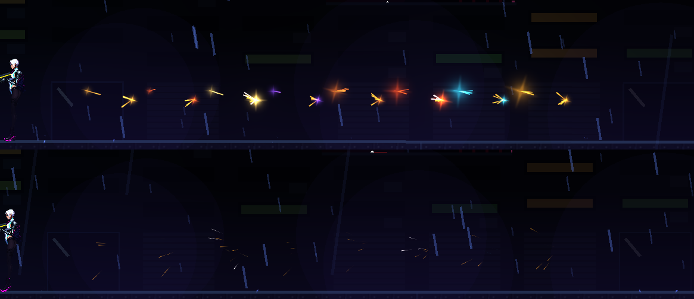

# [NE-139] 槍口與彈道回饋

> 狀態：完成

## 內文

### 需求
每把槍的槍口、後座與命中回饋差異不夠。要為各武器建立回饋資料：槍口火光變體與光、鏡頭與角色的後推、準星後座、連發節流、子彈軌跡與命中標記。

### 來源
2026-10-04，使用者要求處理打擊感；研究與設計見 `design/15-game-feel/RESEARCH.md`（第 1 節），母票 NE-130。

### 驗收條件
- [x] 各武器的回饋數值寫進資料（槍口、光、後座、震動、準星），不寫在程式
- [x] 連發的粒子與光不超過預算
- [x] 命中標記有命中、弱點、擊殺與被擋四種
- [x] 輕重武器的手感可明顯區分
- [x] 附各武器開火與命中的截圖

### 測試流程
1. 在實驗室逐把武器連發與單發
2. 對不同敵人確認命中標記

---

# 跟其他票的關係

- Blocks：NE-140、NE-148
- Blocked by：NE-131、NE-137、NE-138
- Related：NE-130

---

---

# Commit-1

## 內文

槍口閃光、光與火花的大小都寫死在程式裡，每把槍看起來差不多；命中標記也只有一種。
現在每把武器的槍口回饋寫在武器資料裡：閃光大小、火花數量、光的範圍與能量、鏡頭震動秒數，以及槍口特效的最短間隔。輕武器（手槍、衝鋒槍）小而快，重武器（霰彈、發射器、磁軌砲、機甲加農砲）閃光與光範圍大好幾倍、火花多、鏡頭後座與震動也更重；高速連發的衝鋒槍槍口特效每隔一小段才播，鏡頭後座照常，避免粒子與光爆量。鏡頭震動沿開槍反方向。準星的命中標記擴充成四種：命中（白色斜線）、弱點（更長的黃色斜線）、擊殺（紅色放大）、被擋（兩道灰色橫槓），近戰與子彈都會觸發。玩家與載具共用同一套槍口回饋。
驗收：回饋套件新增武器檢查（每把武器的槍口資料有效、重武器明顯大於輕武器、連發節流且鏡頭後座不受影響、間隔過後再播、弱點與被擋標記會顯示），連同戰鬥介面套件共 263 項、0 失敗；各武器開火的截圖如下（槍口閃光由小到大，並帶命中火花）。依指示沒有跑完整測試套件。

### 截圖

