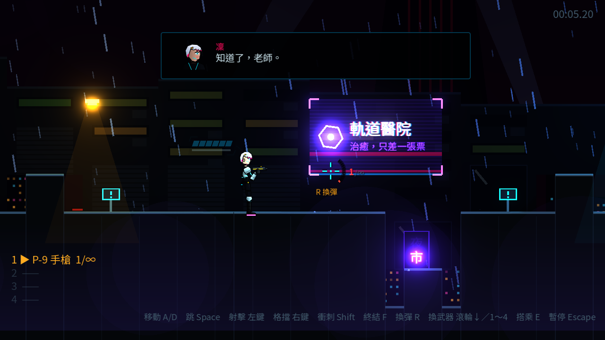
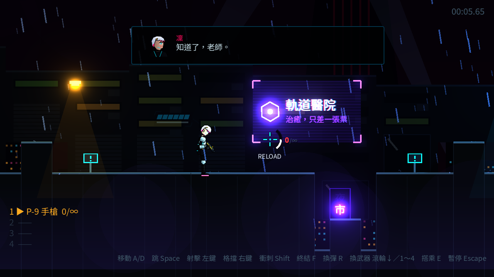

# [NE-13] 加入彈匣與換彈

> 狀態：完成

## 內文

### 需求
武器原本只有總彈量，打完就丟。改成彈匣＋備彈：預設主武器改為 12 發彈匣的手槍（備彈無限），需要換彈，讓射擊有節奏與取捨。設計見 `design/07-weapons-inventory/DESIGN.md` 第 2 節。

### 來源
2026-10-03，使用者於開發對話中提出：「預設給主角使用的是小槍，每射擊 12 槍會需要更換一次子彈」；確認採用彈匣＋有限備彈。

### 驗收條件
- [x] 預設主武器是手槍，彈匣 12 發、備彈無限
- [x] 每把武器有彈匣與備彈，按 R 換彈，彈匣打空時扣扳機會自動換彈
- [x] 換彈期間不能射擊，換武器會中斷換彈；換彈時手上的槍會壓低
- [x] 準星旁的彈藥環顯示彈匣與換彈進度，數字顯示彈匣／備彈，彈匣偏低時提示換彈
- [x] 彈匣與備彈都打光的武器自動切回手槍
- [x] 撿到已持有的武器補滿備彈，終結技回補備彈
- [x] 彈匣與備彈存進檢查點，重生後還原
- [x] Tab 與 Q 從換武器改給背包與醫療針，設定畫面可重新綁定換彈鍵

### 測試流程
1. 開始第一關，連續射擊手槍 12 發，確認自動換彈、換彈中無法射擊
2. 撿起衝鋒槍射到彈匣剩一半，按 R 換彈，確認備彈減少
3. 換彈中切換武器，確認換彈中斷
4. 通過檢查點後死亡，確認彈藥還原
5. 執行完整測試套件，全部通過

---

# 跟其他票的關係

- Blocks：NE-16
- Blocked by：NE-12
- Related：NE-11

---

# Commit-1

## 內文

武器原本只有總彈量，不需要換彈，射擊沒有節奏；預設武器也不是手槍。
現在每把武器有彈匣與備彈：預設的 P-9 手槍彈匣 12 發、備彈無限；撿到的武器有各自的彈匣大小、備彈上限與換彈時間（手槍最快、榴彈最慢）。按 R 換彈，彈匣打空時自動換彈；換彈期間不能射擊、槍口壓低，換武器會中斷換彈。準星旁的彈藥環改為顯示彈匣，數字顯示「彈匣／備彈」，換彈時弧形顯示進度並標示 RELOAD（能量武器為 RECHARGE），彈匣偏低時提示「R 換彈」。彈匣與備彈都打光時自動切回手槍並顯示 EMPTY；撿到已持有的武器補滿備彈，終結技回補備彈。左下武器欄也改成「彈匣／備彈」。Tab 與 Q 不再是換武器鍵，留給背包與醫療針；換彈鍵可以在設定畫面重新綁定（手把預設 R3）。舊版檢查點存的總彈量會自動換算成彈匣與備彈。
驗收方式：冒煙測試驗證手槍 12 發後自動換彈、換彈中不能射擊、手動換彈從備彈扣除、換武器中斷換彈、彈藥打光切回手槍、撿取補備彈、快照與舊版快照還原、R 鍵在遊戲中觸發換彈；並以自動截圖確認換彈提示與換彈中的畫面。

### 測試結果

| 項目 | 結果 |
|---|---|
| 完整測試套件 | 通過 484 / 484 |
| 資料驗證 | 0 錯誤 |
| 執行 log | 無非預期 ERROR |

### 截圖

