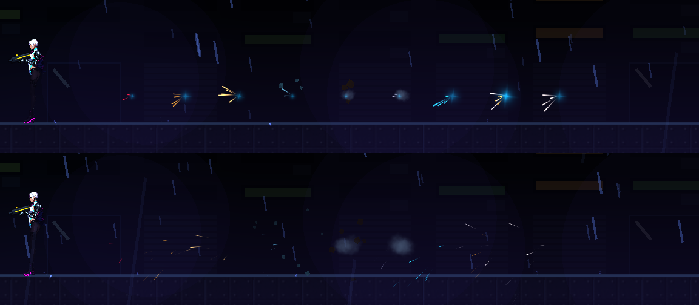

# [NE-140] 命中材質與命中點回饋

> 狀態：完成

## 內文

### 需求
打到金屬、肉身、玻璃或地形，回饋都一樣。要依命中物的材質查表，產生不同的火花、碎屑與聲音，並有跳彈與弱點的特別回饋。

### 來源
2026-10-04，使用者要求處理打擊感；研究與設計見 `design/15-game-feel/RESEARCH.md`（第 1 節），母票 NE-130。

### 驗收條件
- [x] 至少七種材質有各自的回饋，缺標籤退回通用
- [x] 聲音依材質改變
- [x] 弱點與跳彈有可辨識的回饋
- [x] 粒子數不超過預算
- [x] 附各材質命中的截圖

### 測試流程
1. 對各材質靶開槍
2. 執行材質回饋測試

---

# 跟其他票的關係

- Blocks：無
- Blocked by：NE-131、NE-139、NE-138
- Related：NE-130

---

---

# Commit-1

## 內文

打到金屬、肉身、玻璃或地形，火花與聲音都一樣。
現在命中會依命中物的材質查表，有肉身、裝甲、金屬、玻璃、木、混凝土、能量七種，各有自己的火花顏色與數量、碎屑或塵土、閃光與聲音；材質標籤缺漏或不認得時退回通用回饋並記錄位置。敵人、可破壞物與地形都帶材質（人形敵人多為裝甲、機械類為金屬、偽裝箱為木、箱子木、油桶金屬、玻璃牆玻璃、牆混凝土），近戰與子彈都吃這套。打中弱點會再疊上白色火花、大閃光與清脆的提示音；被擋下則是跳彈的白色火花與金屬彈音。連發與霰彈的粒子有預算，短時間內大量命中會縮減數量，每次命中仍至少保留一顆。
驗收：回饋套件新增材質檢查（資料無錯誤、至少七種、敵人資料的標籤都存在、缺標籤與不認得的標籤退回通用、每種材質與弱點跳彈都能播、預算縮減爆量），連同道具、敵人、受擊、突擊與重型敵人等套件共 773 項、0 失敗；各材質、弱點、跳彈的命中截圖如下。依指示沒有跑完整測試套件。

### 截圖

