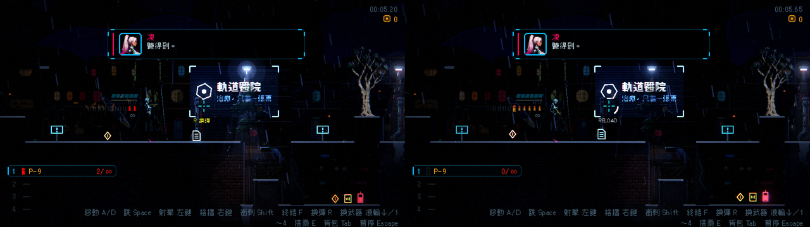

# [NE-141] 換彈、空槍與低彈量回饋

> 狀態：完成

## 內文

### 需求
換彈、空槍與彈藥不足缺少明確的回饋。要做空槍喀聲與準星搖動、低彈量提示、換彈三拍聲音、完成閃光，並可被衝刺或近戰取消。

### 來源
2026-10-04，使用者要求處理打擊感；研究與設計見 `design/15-game-feel/RESEARCH.md`（第 1 節），母票 NE-130。

### 驗收條件
- [x] 空槍有聲音與準星回饋，連按有節流
- [x] 低彈量時彈藥環變色、音高降低
- [x] 換彈有三拍聲音，完成有閃光；被取消時不播完成
- [x] 提示有一句 tooltip

### 測試流程
1. 打空彈匣並連按
2. 換彈中途衝刺取消

---

# 跟其他票的關係

- Blocks：無
- Blocked by：NE-131、NE-138
- Related：NE-130

---

---

# Commit-1

## 內文

彈匣打空還扣扳機沒有任何反應，快沒子彈也沒有提醒，換彈只有開始與結束兩個聲音。
現在彈匣與備彈都空時扣扳機會「喀」一聲、準星橫向抖一下，連按有 0.3 秒節流；彈匣剩不到四分之一但還沒空時，開火音高降低，準星旁出現「R 換彈」提示（按鍵跟著玩家的綁定）；換彈有三拍聲音（彈匣拔出、推入、上膛），完成時準星整圈亮一下、槍口小閃光；換彈中衝刺或近戰會取消換彈，被取消時不會播完成音效與閃光，也不會補彈。
驗收：回饋套件新增換彈檢查（沒在換彈時無可取消、取消後不補彈也不回報完成、重新換彈可完成一次、空槍節流與間隔後恢復、取消不宣告完成、完成才宣告、滿彈匣不算低彈量），連同彈藥列與戰鬥介面套件共 294 項、0 失敗。截圖為低彈量提示（左）與換彈進度（右）。依指示沒有跑完整測試套件。

### 截圖

