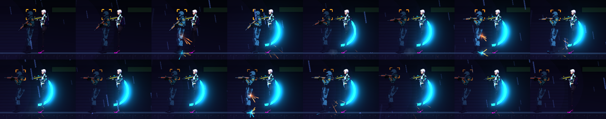

# [NE-142] 近戰三段化與取消窗口

> 狀態：進行中

## 內文

### 需求
近戰目前按下即命中，沒有前搖與收招，也沒有手感調整。要把近戰改成前搖、出招、收招三段資料，加上命中確認取消、輸入緩衝、前衝、一揮一命中與輕重斬。

### 來源
2026-10-04，使用者要求處理打擊感；研究與設計見 `design/15-game-feel/RESEARCH.md`（第 2 節），母票 NE-130。

### 驗收條件
- [x] 近戰資料定義前搖、出招、收招、判定集合、前衝與取消窗口
- [x] 揮空吃滿收招，命中可取消；一揮對同一目標只命中一次
- [x] 輸入緩衝可接續連段
- [x] 輕斬與重斬手感有明顯差異
- [x] 窗口與緩衝由測試鎖定
- [ ] 實驗室可調（等實驗室票）
- [x] 與近戰武器資料欄位對齊

### 測試流程
1. 在實驗室揮空與命中比較收招
2. 快速連按確認緩衝
3. 執行近戰測試

---

# 跟其他票的關係

- Blocks：NE-143、NE-144、NE-145、NE-147
- Blocked by：NE-131、NE-136
- Related：NE-130、NE-117

---

---

# Commit-1

## 內文

近戰按下去就立刻判定命中，沒有前搖與收招，揮空也沒有代價，也沒有連段。
現在近戰是三段資料：前搖（只有動作、不造成傷害）、出招（出招的瞬間往前衝並判定一次）、收招；數值寫在資料裡（時間、傷害、距離、前衝速度、擊退、移動倍率、取消窗口）。揮空要吃滿收招，期間不能衝刺或開槍；命中後只要等取消窗口就能接下一招、衝刺或射擊；一揮對同一個目標只命中一次；出招期間再按會緩衝，收招可取消時自動接下一段，連段依序是輕斬、輕斬、重斬，超過連段時間回到第一招。重斬前搖與收招都更長、傷害與擊退更大、前衝更遠、命中頓幀與震動更重，輕斬則快而輕。命中後的頓幀延到這一步結束才套用，避免在移動中途把玩家停用。
驗收：近戰套件新增 20 項（資料無錯誤與輕重差異、前搖不傷害、一揮只命中一次、揮空吃滿收招、命中提早取消、緩衝接續連段與重斬、連段視窗重置、揮空鎖定衝刺、壞資料退回預設），連同回饋、道具、頭目、敵人、突擊、戰鬥介面、電話亭與格擋反彈專項共 544 項、0 失敗。截圖為連按三下近戰的逐格（前搖、出招火花、收招；截圖情境裡軌跡方向與面向無關，之後軌跡票處理）。實驗室還沒有，所以「實驗室可調」這一條留到實驗室票。依指示沒有跑完整測試套件。

### 截圖

