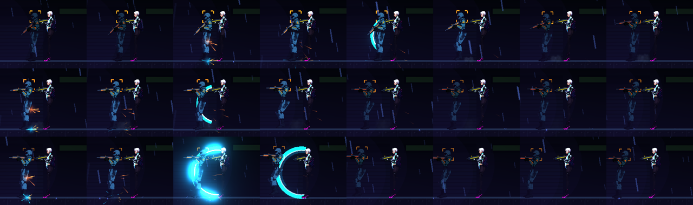

# [NE-143] 揮砍軌跡與殘影

> 狀態：完成

## 內文

### 需求
近戰缺少視覺軌跡。要做弧形揮砍軌跡與一兩格殘影，由武器資料指定，亮度在 HDR 泛光下有上限。

### 來源
2026-10-04，使用者要求處理打擊感；研究與設計見 `design/15-game-feel/RESEARCH.md`（第 2 節），母票 NE-130。

### 驗收條件
- [x] 軌跡持續約 80 到 120 毫秒，同時最多兩條
- [x] 峰值亮度有上限，不過曝
- [x] 不佔用粒子預算
- [x] 附軌跡截圖

### 測試流程
1. 在實驗室揮砍並檢查亮度與數量
2. 最亮的光影下確認不過曝

---

# 跟其他票的關係

- Blocks：無
- Blocked by：NE-142（已完成）
- Related：NE-130

---

---

# Commit-1

## 內文

近戰揮出去只有一道固定的青色半圓，沒有隨招式變化，也沒有軌跡的收尾。
現在每一招在資料裡定義揮砍軌跡：半徑、弧度、持續時間、線寬、峰值亮度與是否帶殘影。軌跡先快速掃出弧形再整條淡出，持續約 90 到 120 毫秒，輕斬細而短、重斬大而粗，並多帶一格較細較早的殘影；同時最多兩條，新的會擠掉最舊的；亮度有上限，資料超過上限或持續時間超出 80～120 毫秒範圍時資料檢查會報錯；軌跡是直接繪製的線條，不佔用粒子預算。軌跡方向也修正為跟著出招時的面向。
驗收：近戰套件新增軌跡檢查（持續時間範圍、亮度上限、同時最多兩條、時間到後消失），共 25 項、0 失敗；逐格截圖為輕、輕、重三段的軌跡（最亮的重斬也在亮度上限內，不過曝）。依指示沒有跑完整測試套件。

### 截圖

