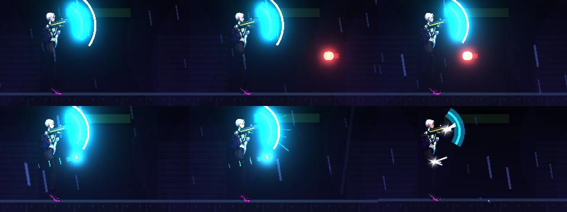

# [NE-144] 格擋與完美格擋回饋

> 狀態：完成

## 內文

### 需求
格擋與完美格擋的回饋不分層。要做窗口視覺提示、普通、完美、崩潰三級回饋、放開後再舉盾的窗口縮短，以及教學提示。

### 來源
2026-10-04，使用者要求處理打擊感；研究與設計見 `design/15-game-feel/RESEARCH.md`（第 2 節），母票 NE-130。

### 驗收條件
- [x] 窗口長度可調（0.14 到 0.22 秒）並有視覺提示
- [x] 三級回饋各有頓幀、鏡頭、視覺與聲音
- [x] 投射物被彈回時有軌跡
- [x] 提示一句講重點，有 tooltip

### 測試流程
1. 在實驗室對各種攻擊格擋與完美格擋
2. 執行格擋相關測試

---

# 跟其他票的關係

- Blocks：無
- Blocked by：NE-137、NE-136、NE-138、NE-142
- Related：NE-130

---

---

# Commit-1

## 內文

格擋與完美格擋的回饋不分層，也看不出完美格擋的窗口還剩多久，狂按盾就能一直彈。
現在盾面外側多一圈提示環，剛舉盾的完美格擋窗口內會隨剩餘時間收進盾面，收到盾上就是窗口結束；窗口長度可調，只吃 0.14 到 0.22 秒，超出會被夾住；放開盾後 0.35 秒內又舉盾，窗口縮短成一半，不能亂按。三級回饋各有頓幀、鏡頭、視覺與聲音：普通格擋（短頓幀、小震動、白色火花、金屬彈音）、完美格擋（較長頓幀、縮放脈衝、青色爆閃與反彈、清脆的彈音）、破防（大震動、青色爆散、低沉的破碎聲）。被彈回去的子彈拖著一道漸細的青色長尾。第一次格擋時提示一句「剛舉盾的一瞬間被打中＝完美格擋，可反彈子彈」。
驗收：回饋套件新增格擋檢查（窗口夾在 0.14～0.22、連按縮短、三級各有事件與聲音、彈回子彈換邊並帶拖尾標記），連同受擊、頭目、電話亭與格擋反彈專項共 474 項、0 失敗；原本格擋專項的時間點因為格擋多了短暫頓幀，等待影格數放寬（行為不變）。截圖為舉盾窗口環、完美格擋反彈與普通格擋。依指示沒有跑完整測試套件。

### 截圖

