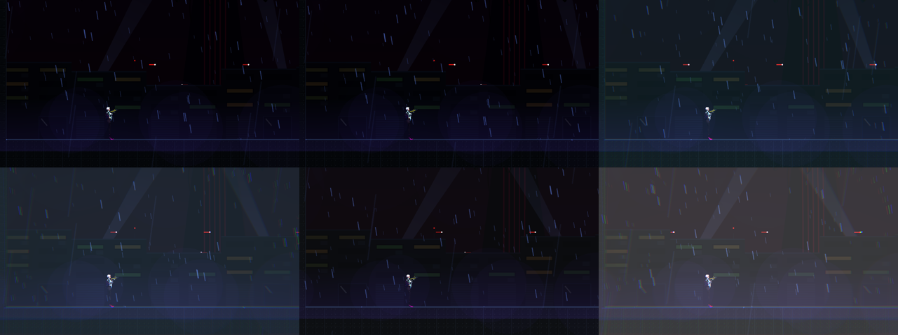

# [NE-146] 全螢幕效果與亮度預算

> 狀態：完成

## 內文

### 需求
受傷閃爍等全螢幕效果沒有統一的亮度與頻率規範。要做全螢幕效果層（色差、暗角、混色）、亮度預算與閃光頻率限制。

### 來源
2026-10-04，使用者要求處理打擊感；研究與設計見 `design/15-game-feel/RESEARCH.md`（第 5 節），母票 NE-130。

### 驗收條件
- [x] 全螢幕效果的峰值依規範，不過曝
- [x] 「減少閃光」會降階
- [x] 每秒明暗交替不超過三次
- [x] 診斷顯示亮度與頻率

### 測試流程
1. 在最亮與最暗的光影下觸發各效果
2. 開啟減少閃光比較

---

# 跟其他票的關係

- Blocks：無
- Blocked by：NE-131、NE-132、NE-136
- Related：NE-130

---

---

# Commit-1

## 內文

受傷時只有血量低的暗角，沒有統一的全螢幕效果，也沒有亮度與頻率的規範。
現在有全螢幕效果層：受傷（紅色疊色加暗角與色差）、完美格擋（青白疊色）、破防、擊殺（很淡的白）、頭目死亡（最強的白閃）五種，由回饋事件觸發，數值（顏色、峰值強度、色差、暗角、持續時間，強度隨時間平方衰減）寫在資料檔。所有效果都經過閃光防護：峰值強度有上限（0.3，資料超過時檢查會報錯），每秒最多三次明暗交替，超過的直接略過；開啟「減少閃光」會降到 25%，色差與暗角也一併降階。診斷數字（每秒閃光次數、峰值、被略過次數）已註冊給實驗室，達到頻率上限時顯示警示。
驗收：回饋套件新增檢查（效果資料無錯誤、峰值被夾住、每秒三次、第四次被略過並有警示、視窗過後恢復、減少閃光降階、效果真的寫進後製並衰減回零），共 418 項、0 失敗；截圖為各效果峰值（左上起：無、受傷、完美格擋、破防、擊殺、頭目死亡）。依指示沒有跑完整測試套件。

### 截圖

