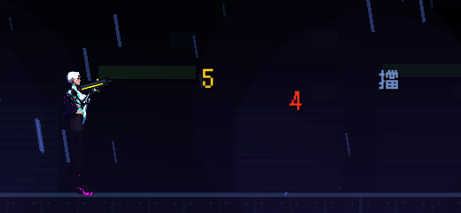

# [NE-148] 傷害數字與命中標記（可選）

> 狀態：完成

## 內文

### 需求
要不要顯示傷害數字是個取捨。要做池化的傷害數字，預設關閉，只顯示弱點、暴擊與被擋，並與命中標記不重複。

### 來源
2026-10-04，使用者要求處理打擊感；研究與設計見 `design/15-game-feel/RESEARCH.md`（第 5 節），母票 NE-130。

### 驗收條件
- [x] 設定可開關，預設關閉
- [x] 同目標短時間內的數字合併
- [x] 數字節點有池與上限，不每影格配置
- [x] 有 tooltip

### 測試流程
1. 開啟後對弱點與一般部位射擊
2. 連發確認合併

---

# 跟其他票的關係

- Blocks：無
- Blocked by：NE-139、NE-132
- Related：NE-130

---

---

# Commit-1

## 內文

要不要顯示傷害數字是個取捨，原本完全沒有。
現在設定頁顯示分頁有「傷害數字」開關，預設關閉（tooltip：打中弱點、重擊或被擋時顯示數字，預設關閉，一般命中看準星的標記就好）。開啟後只顯示三種：弱點（黃）、重擊（紅）、被擋（灰「擋」字），一般命中不顯示，與準星的命中標記不重複；同一個目標在 0.25 秒內的數字累加成一個（3＋2 顯示 5）；數字由固定 24 格的池畫出，不為每個數字建立節點，滿了就取代最舊的。
驗收：回饋套件新增數字檢查（預設關閉、關閉時不顯示、只顯示弱點重擊被擋、同目標合併、池上限且不建立節點、時間到消失、重設後恢復關閉），連同介面畫面套件共 525 項、0 失敗；截圖為弱點（合併成 5）、重擊與被擋。依指示沒有跑完整測試套件。

### 截圖

