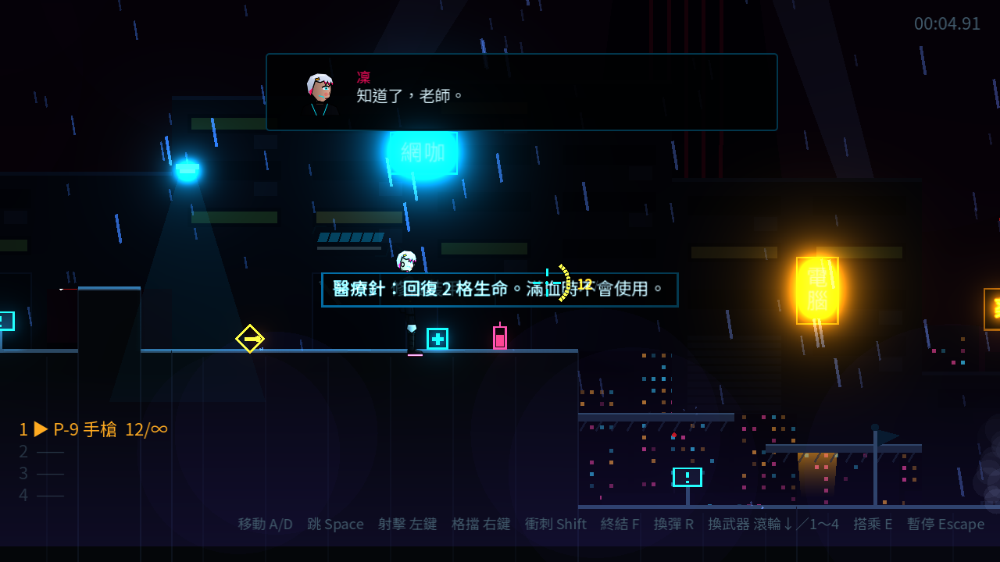
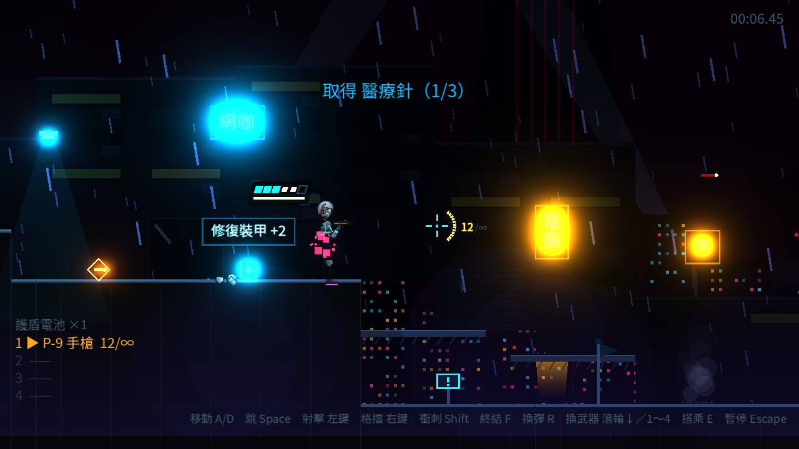

# [NE-14] 加入消耗品

> 狀態：完成

## 內文

### 需求
目前補血只有關卡中直接生效的補血道具，沒有可以留著用的東西。加入可攜帶的醫療針與護盾電池，讓玩家自己決定何時使用。設計見 `design/07-weapons-inventory/DESIGN.md` 第 3 節。

### 來源
2026-10-03，使用者於開發對話中提出：「按 Tab 會有背包的畫面」；確認背包要有消耗品分頁。

### 驗收條件
- [x] 關卡中可以撿到醫療針（回 2 格生命，上限 3）與護盾電池（護盾充滿並解除破防，上限 2）
- [x] 達到上限時撿不起來並提示
- [x] 按 Q 快速使用醫療針；滿血時不會使用
- [x] 消耗品數量存進檢查點，重生後還原

### 測試流程
1. 撿取醫療針直到上限，確認第 4 支撿不起來
2. 受傷後按 Q，確認回血且數量減少；滿血時按 Q 不會消耗
3. 執行完整測試套件，全部通過

---

# 跟其他票的關係

- Blocks：NE-16
- Blocked by：無
- Related：無

---

# Commit-1

## 內文

補血只有踩到就生效的補血道具，沒有可以留著關鍵時刻用的東西。
現在關卡中可以撿到醫療針（回 2 格生命，最多 3 支）與護盾電池（護盾立即充滿並解除破防，最多 2 個），第一關屋頂、市集、貨運站、設施入口與頭目戰前各有配置。撿取時跳出「取得 醫療針（1/3）」，達到上限時保留在原地並提示一次。按 Q（手把十字鍵上）快速使用醫療針，滿血時不會使用並提示「生命已滿」。左下角武器欄上方顯示攜帶的消耗品數量與快速鍵。消耗品數量存進檢查點，重生後還原。消耗品種類以資料檔定義，新增種類不需改程式。準星旁的彈藥環平常改用 HUD 青色，避免和低彈藥的黃色警示混淆。
驗收方式：冒煙測試驗證攜帶上限、快照還原與數量夾限、滿血不浪費、Q 鍵快速使用回血、護盾電池解除破防、檢查點保存消耗品；自動截圖確認關卡中的醫療針、拾取提示、HUD 數量與使用特效。

### 測試結果

| 項目 | 結果 |
|---|---|
| 完整測試套件 | 通過 495 / 495 |
| 資料驗證 | 0 錯誤 |
| 執行 log | 無非預期 ERROR |

### 截圖

