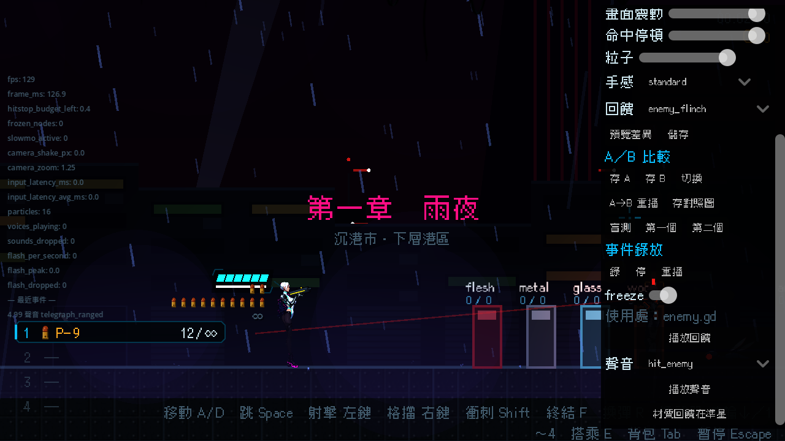

# [NE-150] 打擊感實驗室：A／B 與盲測

> 狀態：完成

## 內文

### 需求
比較兩組參數時需要快速切換與盲測。要做 A／B 兩槽、一鍵切換、依序重播與盲測統計。

### 來源
2026-10-04，使用者要求處理打擊感；研究與設計見 `design/15-game-feel/RESEARCH.md`（第 8 節），母票 NE-130。

### 驗收條件
- [x] A／B 兩槽可儲存目前參數，一鍵切換立即生效
- [x] 可依序重播同一事件
- [x] 盲測十次並統計，結果寫入使用者資料夾
- [x] 可存對照截圖

### 測試流程
1. 設定兩組不同參數並切換
2. 做一輪盲測

---

# 跟其他票的關係

- Blocks：無
- Blocked by：NE-134、NE-149
- Related：NE-130

---

---

# Commit-1

## 內文

比較兩組參數只能憑記憶，沒有快速切換，也沒有盲測。
實驗室新增「A／B 比較」：存 A、存 B 各把目前的回饋參數與手感預設存進一個槽，「切換」一鍵在兩組之間切換並立即生效；「A→B 重播」把選中的事件依序用 A、B 各播一次再回到原本的槽；「盲測」十輪，每輪隨機決定先播哪一組（玩家不知道），選「第一個」或「第二個」，全部答完後統計 A、B 各被選幾次，結果寫進使用者資料夾（user://feel_lab/blind_時間.json），沒答完不寫；「存對照圖」把目前畫面存到同一個資料夾。同一個種子的盲測順序一致，方便重現。
驗收：工具套件新增檢查（空槽與不存在的槽被拒絕、兩槽各存一組、一鍵切換立即生效、依序重播 A 再 B 並回到原槽、盲測十輪且需要兩槽、未完成不寫檔、同種子同順序、統計等於回答、寫出的檔案可讀回、無效答案被拒絕、有畫面時存截圖），連同實驗室與回饋套件共 571 項、0 失敗；畫面見附圖（實驗室面板的 A／B 與錄放區）。依指示沒有跑完整測試套件。

### 截圖

