# [NE-152] 重新檢視全角色的腿部與腳部零件分割

> 狀態：完成

## 內文

### 需求
敵人與 NPC 套上骨架後常常看起來少一條腿或多一條腿。檢查發現遠側腿被調暗到幾乎看不見，同時多個角色的腿部零件在 SAM 分割時沒有切乾淨：腳的零件裝了兩隻鞋（阿婆、護理師、夜班工人、老 K、老陳、狙擊手、監管者）、大腿零件裡有手或另一條腿的碎片（切割者、航、潛行者）、骨盆零件只有一角、小腿零件只剩一小片（回收員）。要重新檢視全部角色的骨盆、大腿、小腿與腳，用現有立繪重新切，不重新生圖，讓每個零件只包含一條腿的一段，兩條腿在站、跑、蹲、跳、倒下時都清楚分得出來。

### 來源
2026-10-04，使用者發現每個角色好像都少一隻腿，修過亮度與站姿後又覺得多一條腿，判斷是 SAM 分割不正確，要求重新檢視所有角色零件，特別是腳。

### 驗收條件
- [x] 全部 20 個角色的腳零件只含一隻鞋，小腿零件只含一條小腿，大腿零件沒有手、衣襬或另一條腿的碎片
- [x] 骨盆零件完整，不是只有一個角落
- [x] 零件邊緣乾淨、沒有孔洞或碎片，法線與發光層同步更新
- [x] 站、跑、蹲、跳、倒下的預覽中兩條腿都清楚分得出來，腳底貼地
- [x] 動畫稽核與角色、NPC 相關測試通過
- [x] 附修正前後的零件總覽與預覽截圖

### 測試流程
1. 看全角色腿部零件總覽（骨盆、大腿、小腿、腳各一欄）
2. 全角色預覽站姿與跑步
3. 執行動畫稽核與角色套件

---

# 跟其他票的關係

- Blocks：NE-88
- Blocked by：無
- Related：NE-90、NE-119、NE-106

---

# Commit-1

## 內文

先處理看得見的部分：遠側腿被調成 62% 亮度，深色褲子的角色（狙擊手、切割者、精銳保全、重裝機槍手、鎮暴員、芽）遠側腿幾乎和背景融在一起。現在依零件本身的亮度調整遠側與近側腿的亮度，讓深色腿也看得出來；八位 NPC 的站姿雙腿分開幅度加大。零件本身的分割問題下一段處理。

### 截圖

# Commit-2

## 內文

腿部零件的問題是：側面立繪裡兩條腿並排、兩隻鞋都在圖上，分割時把兩隻鞋切進同一個腳零件（阿婆、護理師、夜班工人、老 K、老陳、狙擊手、監管者等），大腿零件夾著手、衣襬或另一條腿的碎片（切割者、航、潛行者），骨盆只剩一個角落，回收員的小腿只剩 95×40 的一小片。遊戲裡前後兩條腿共用同一組貼圖，所以每個零件只能是「一條腿的一段」。
現在 19 個角色（凜原本就只有一條腿與一隻靴，沒有動）都改成只取「最靠近鏡頭、沒被擋住的那條腿」：在立繪上點出近側腿的大腿、小腿、鞋，另外點出遠側腿與另一隻鞋，只切近側那一條；手或前臂擋在大腿前面的地方，用旁邊布料的顏色補起來（手擋住的缺口太大、補出來像一塊板子的角色，改成留一個小缺口，手垂下時剛好蓋住）。鞋與褲管的分界不一定是水平的（深色高筒靴、白襪、拖鞋），所以腳踝切線逐個角色手動指定，鞋底平整貼在腳零件最底邊，支點在腳踝。阿婆的圍裙與老 K 的大衣下襬是掛在腿上的衣物，改成跟著腿的貼圖走，不會憑空消失；重裝機槍手與監管者兩條大腿重疊成一大塊，改成指定大腿的左右範圍取下。
結果：每個角色的腳零件都只有一隻鞋，小腿零件只含一條小腿（回收員的小腿從一小片變成完整的 136×327），大腿零件沒有手與另一條腿的碎片，骨盆完整。零件尺寸與支點隨之改變（骨頭長度與關節位置沒有動）：例如夜班工人腳零件 211×178 變 186×132，老 K 小腿 233×321 變 203×213，狙擊手腳 178×165 變 143×172。法線與發光層同步重做；亮度改成依零件實際亮度算（近側目標約 0.2、遠側約 0.15，近側最多乘 2、遠側最少 0.62、遠側不超過近側的 0.8 倍），寫進角色規格，重建不會被蓋掉；深色褲子與靴子的角色兩條腿都看得出來，淺色角色維持原本的遠側 0.62。
站姿特寫、跑步八個時間點、八種動作（站、跑、瞄準、蹲、跳、格擋、倒下、硬直）逐個角色看過：兩條腿分得清楚、腳底貼地。另外在流程文件新增「兩條腿、兩隻鞋：只切近側那一條」一章，記錄怎麼挑點、怎麼切腳踝、亮度怎麼算。
**已知限制**：重裝機槍手的膝甲零件支點離零件較遠（既有，不影響腿），凜的馬尾有一個空隙（設計）；鎮暴員與重裝機槍手的大腿上方各有一塊較亮的髖部護板，是立繪原本的髖甲，不是多出來的零件，但跑步時會跟著大腿擺動，看起來比身體其他部分亮一些，之後可以把它改掛到骨盆；監管者的大腿上方因為手臂與護臂擋住，留有缺口，由骨盆與軀幹蓋住。依使用者指示，沒有跑完整測試套件，只跑動畫稽核、NPC 動畫、NPC、角色與姿勢套件。

### 測試結果

| 項目 | 結果 |
|---|---|
| 腳零件只含一隻鞋、小腿與大腿各只含一條腿（20 個角色） | 通過（逐個角色看零件總覽） |
| 零件檢查（孔洞、碎片、發光層、法線、支點） | 20 個角色只剩 2 項：重裝機槍手膝甲支點、凜的馬尾空隙，皆非腿部分割問題 |
| 站姿、跑步、八種動作預覽 | 兩條腿都分得清楚、腳底貼地 |
| 動畫稽核、NPC 動畫、NPC、角色、姿勢套件 | 1249 項、0 失敗 |
| 完整測試套件 | 依使用者指示未執行 |

### 截圖

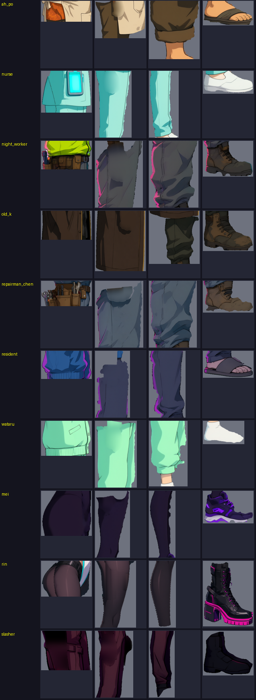

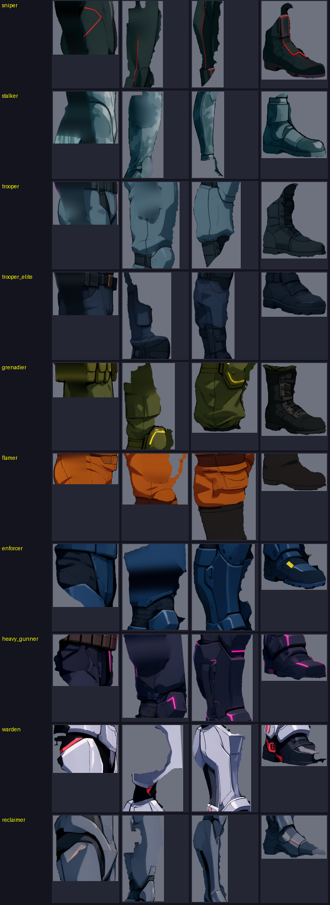

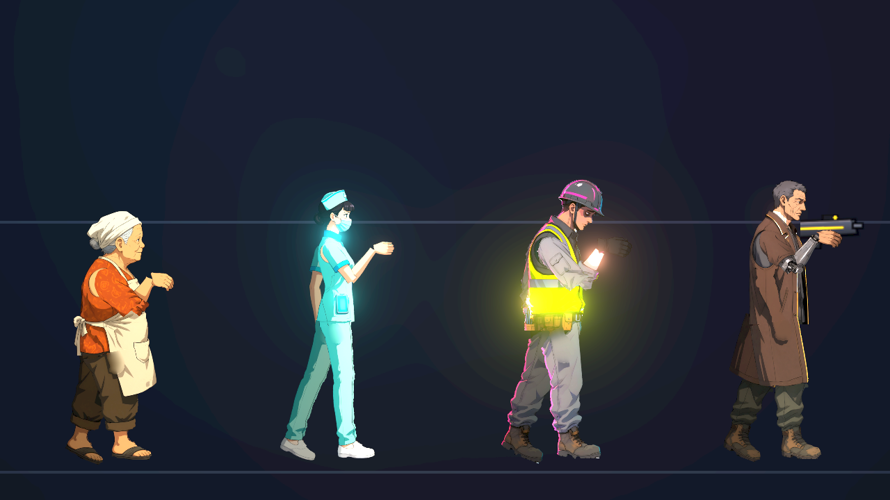

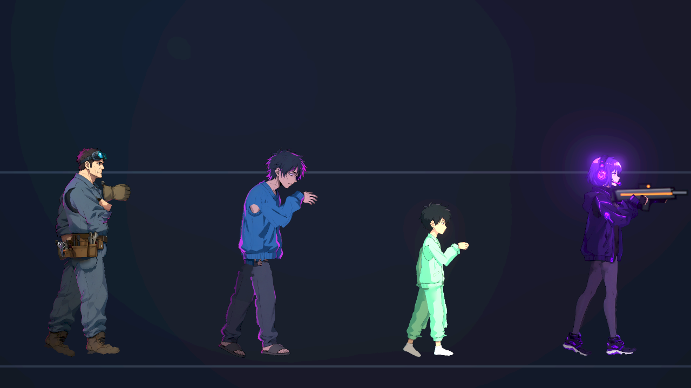

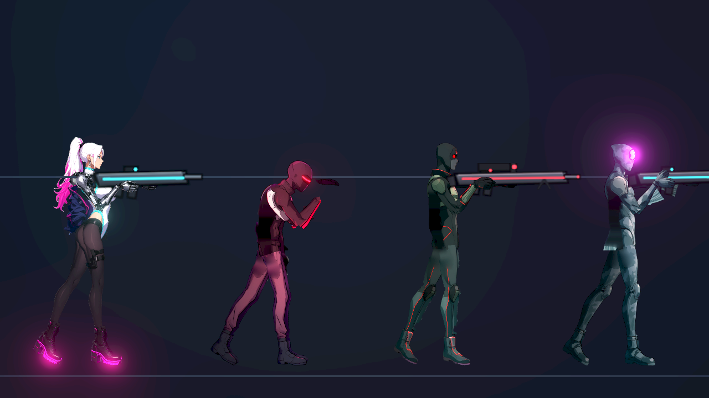

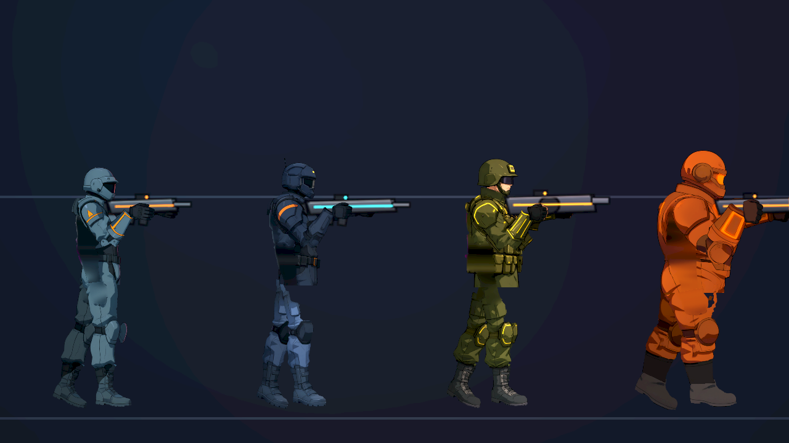

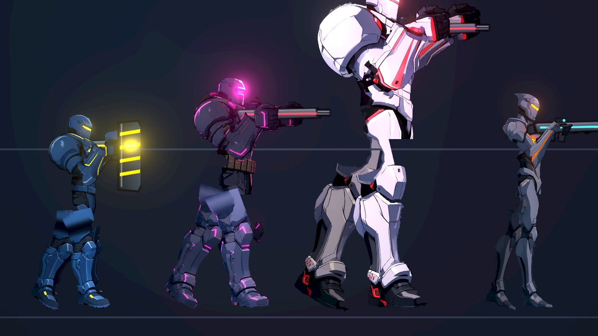

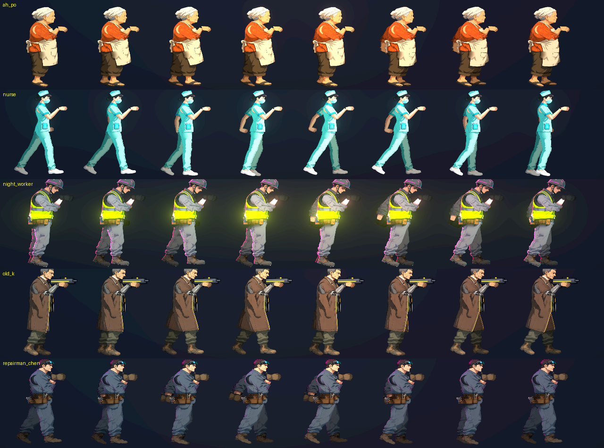

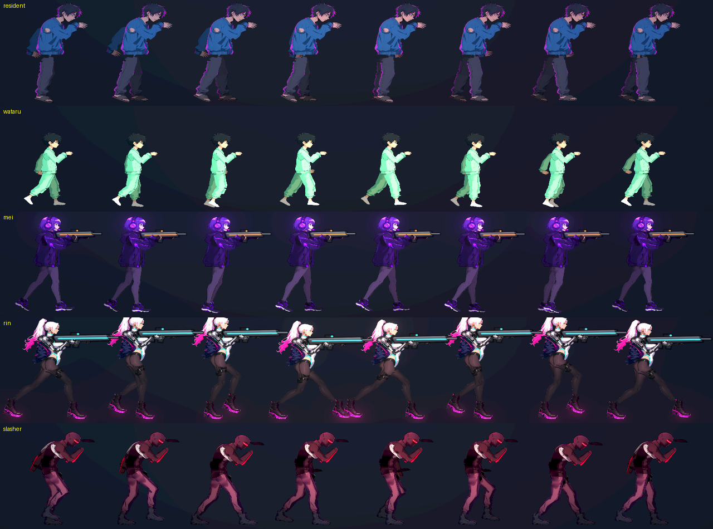

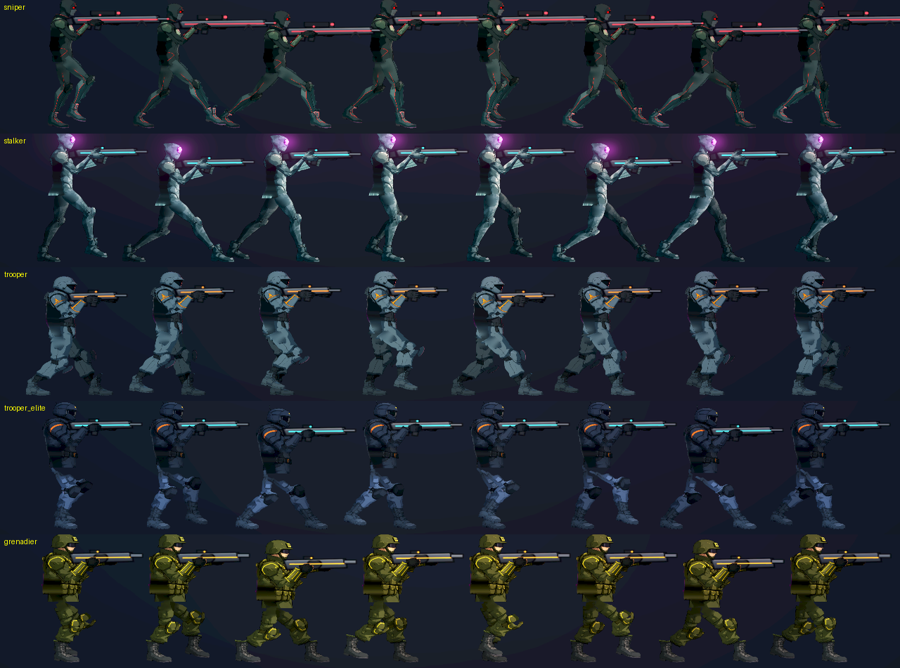

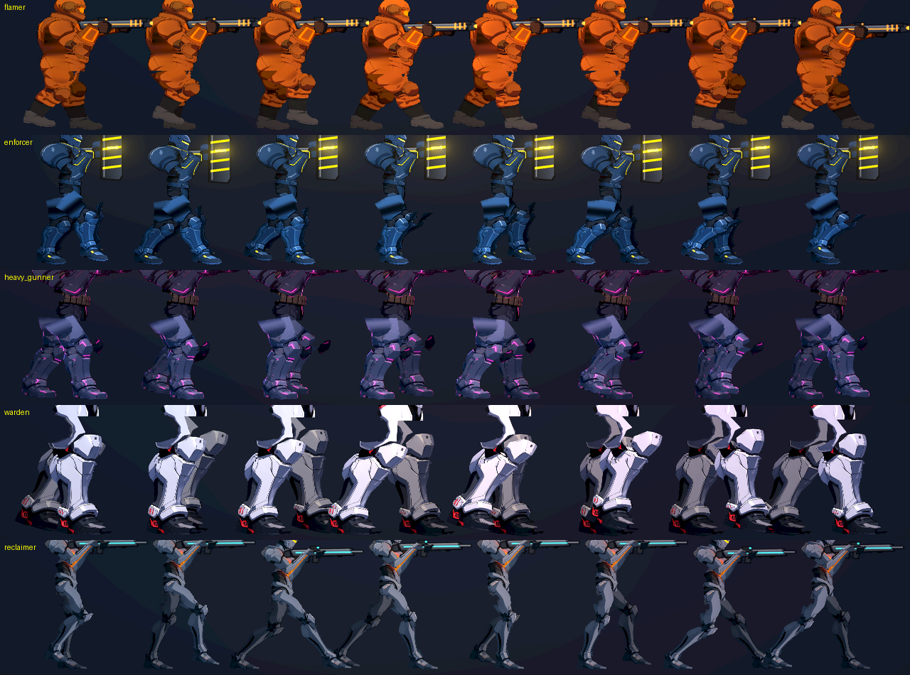

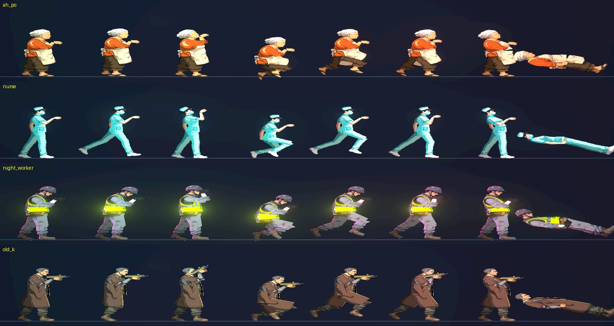

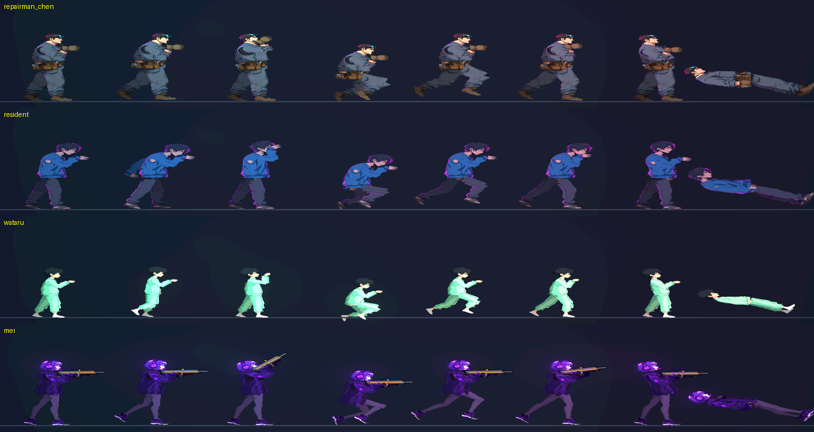

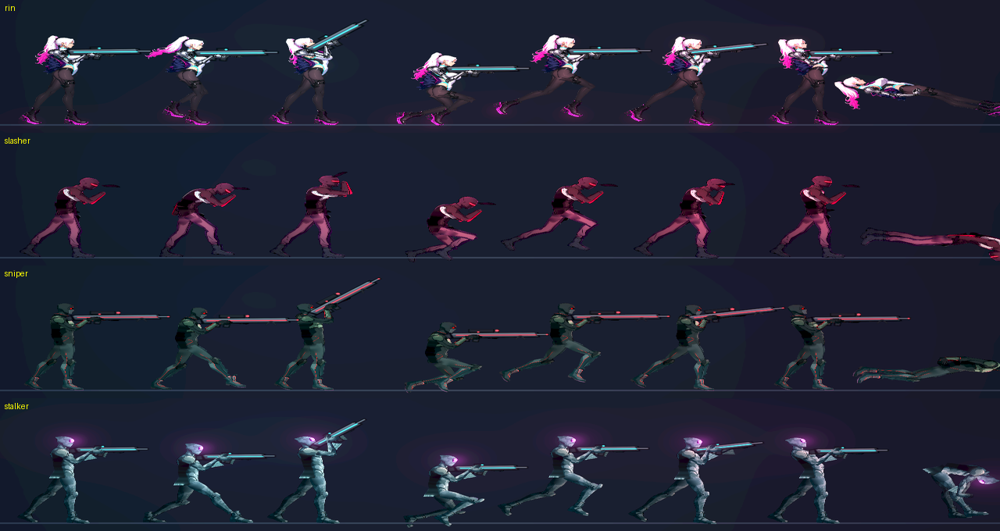

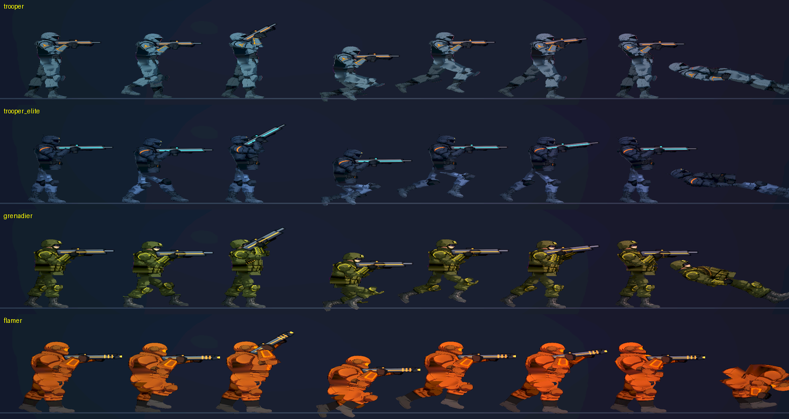

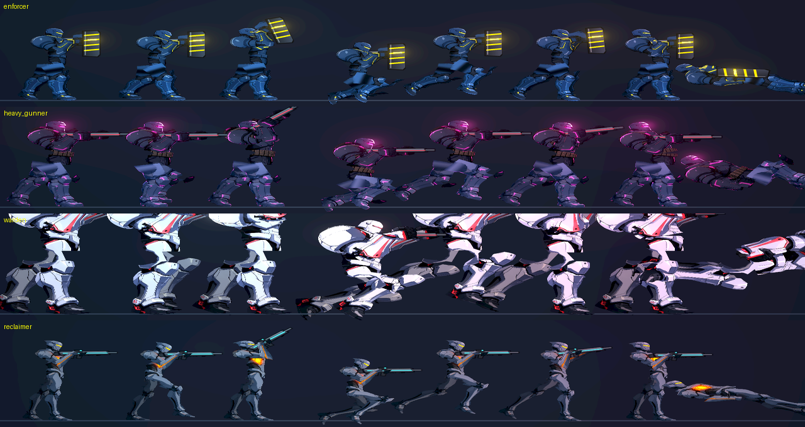

---

---

# Commit-3

## 內文

重新切完後逐一檢查全部 20 個角色的預覽（站、跑、瞄準、蹲、跳、格擋、硬直、倒下，NPC 另有坐、說話、揮手），兩條腿都分得清楚，腳底貼地。精銳保全與重裝機槍手的近側腿被提亮得偏藍，和黑色上半身不搭，亮度上限改成近側 1.5 倍、遠側 1.2 倍。預覽工具新增亮場景模式，並讓大體型角色（重裝機槍手、監管者）的預覽可以縮小，不再被框裁掉。
已知的小問題（留給 NE-153 的檢視清單逐項看）：鎮暴員與重裝機槍手大腿上方有一塊偏亮的髖甲，跑步時跟著大腿擺動；監管者大腿上方有缺口，由骨盆與軀幹蓋住，站姿看得出一點縫；火焰兵髖部有小缺口；精銳保全骨盆底邊是平的。
驗收：動畫稽核、NPC、角色、姿勢、骨架動作、死亡與受擊反應套件共 2607 項、0 失敗。截圖見 NE-153 的各模型預覽。
