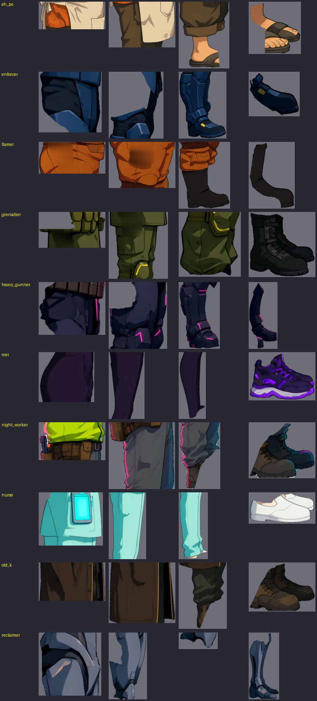
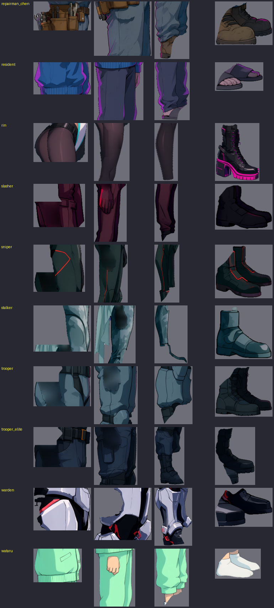

# [NE-152] 重新檢視全角色的腿部與腳部零件分割

> 狀態：進行中

## 內文

### 需求
敵人與 NPC 套上骨架後常常看起來少一條腿或多一條腿。檢查發現遠側腿被調暗到幾乎看不見，同時多個角色的腿部零件在 SAM 分割時沒有切乾淨：腳的零件裝了兩隻鞋（阿婆、護理師、夜班工人、老 K、老陳、狙擊手、監管者）、大腿零件裡有手或另一條腿的碎片（切割者、航、潛行者）、骨盆零件只有一角、小腿零件只剩一小片（回收員）。要重新檢視全部角色的骨盆、大腿、小腿與腳，用現有立繪重新切，不重新生圖，讓每個零件只包含一條腿的一段，兩條腿在站、跑、蹲、跳、倒下時都清楚分得出來。

### 來源
2026-10-04，使用者發現每個角色好像都少一隻腿，修過亮度與站姿後又覺得多一條腿，判斷是 SAM 分割不正確，要求重新檢視所有角色零件，特別是腳。

### 驗收條件
- [ ] 全部 20 個角色的腳零件只含一隻鞋，小腿零件只含一條小腿，大腿零件沒有手、衣襬或另一條腿的碎片
- [ ] 骨盆零件完整，不是只有一個角落
- [ ] 零件邊緣乾淨、沒有孔洞或碎片，法線與發光層同步更新
- [ ] 站、跑、蹲、跳、倒下的預覽中兩條腿都清楚分得出來，腳底貼地
- [ ] 動畫稽核與角色、NPC 相關測試通過
- [ ] 附修正前後的零件總覽與預覽截圖

### 測試流程
1. 看全角色腿部零件總覽（骨盆、大腿、小腿、腳各一欄）
2. 全角色預覽站姿與跑步
3. 執行動畫稽核與角色套件

---

# 跟其他票的關係

- Blocks：NE-88
- Blocked by：無
- Related：NE-90、NE-119、NE-106

---

# Commit-1

## 內文

先處理看得見的部分：遠側腿被調成 62% 亮度，深色褲子的角色（狙擊手、切割者、精銳保全、重裝機槍手、鎮暴員、芽）遠側腿幾乎和背景融在一起。現在依零件本身的亮度調整遠側與近側腿的亮度，讓深色腿也看得出來；八位 NPC 的站姿雙腿分開幅度加大。零件本身的分割問題下一段處理。

### 截圖

