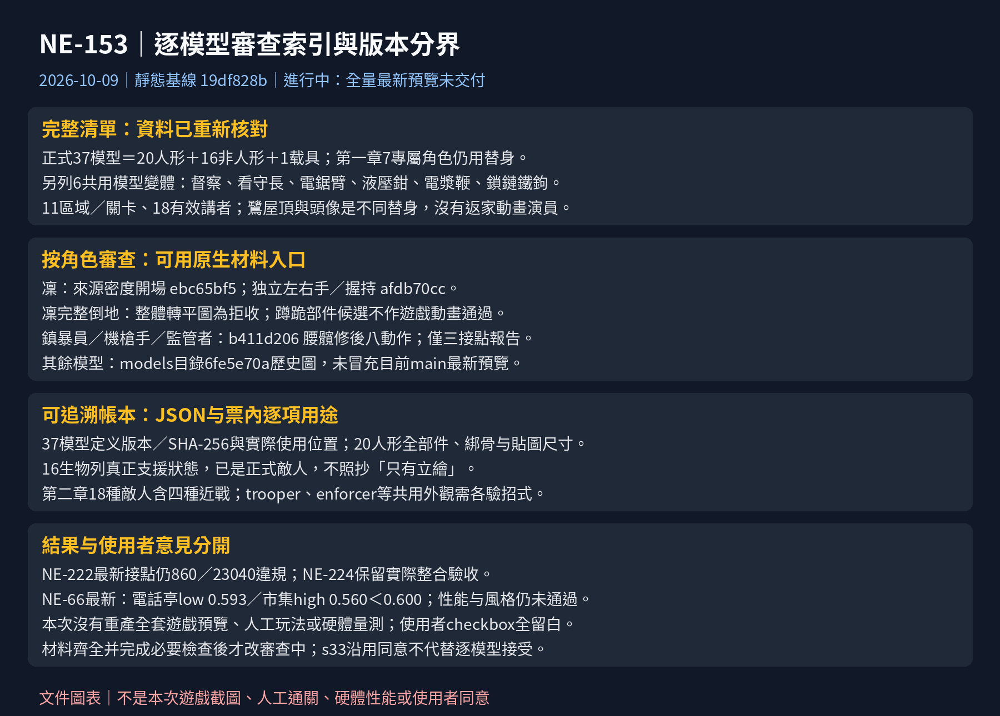

# [NE-153] 全部模型檢視清單（使用者驗收）

> 狀態：進行中

## 內文

### 需求
依目前程式、角色／生物資料、地圖實際配置、過場與通訊列出完整模型清單，每個模型寫名稱、類型與使用位置。上游角色、骨架、關卡／過場與光影基線穩定合入後，重新產生站、跑、蹲、跳、倒下與 NPC 姿勢的最新預覽，供使用者逐項審查；非人形則以它真正支援的狀態檢查，不假造人形動作。每項使用者勾選代表本人接受外觀與動作，執行者不得代勾。

### 來源
2026-10-04 使用者要求所有模型都附預覽、說明用途與 checklist；2026-10-08 Session 7 指示補入最新角色與第一章專屬角色、重新核對使用位置、準備審查材料且不替使用者驗收。

### 驗收條件
- [ ] 每個模型都有最新預覽圖與名稱、骨架類型、使用處（本次已核對清單；最新全量預覽等待上游合入）
- [ ] 使用者逐項檢查並打勾（下方每一項預設未勾選；未勾選不等於已發現缺陷）
- [ ] 檢查中發現的問題都已另開票或在對應票處理（歷史問題與已有票見下方；尚未完成本次畫面檢查）

### 本次來源與預覽版本（2026-10-09）

目前整合基線 `19df828b`；角色與配置仍沿用已核對的`dfacf916`內容，SHA-256重核一致，正式模型仍為 **37個：20人形、16非人形、1載具**，開發用test_creature另列。第一章七個待專屬外觀的角色仍使用替身；另列督察、看守長及第二章四種近戰敵人，共六個共用模型變體。NE-97／NE-118已更新配置：舊Demo不再配置探照無人機與狙擊手，第二章採18種敵人新名單；共用模型不等於相同招式，使用處已逐項重新核對。

**下方37張models目錄圖片均為6fe5e70a的歷史圖，不是最新預覽。** 凜另有NE-222已交付的局部原生對照，三名重甲另有NE-181腰髖修後預覽，見下表與各模型項目；它們有各自的版本及覆蓋範圍，不偽裝成當前main的全部件／全動作通過。NE-222最新袖口／腕／肘報告仍860／23040違規，蹲跪部件仍為候選，完整仰躺／俯臥未交付。NE-79／80／81新增NE-224最終整合相依，NE-90仍進行中；NE-218仍待辦。

本次新增[可追溯資料索引](images/NE-153-review-20261009.json)：37模型的使用處、定義版本／SHA-256，20人形的全部件與綁骨、diffuse／normal／glow貼圖實際尺寸／支點／SHA-256，16生物實際狀態，以及11關卡／區域、18有效講者與載入中動畫演員。它是靜態帳本，不代表人體、逐格接點、渲染、操作或效能已通過。

NE-17的`484085b6`已記錄使用者「同意沿用定稿並修復」；只接受繼續沿用s33，不代替本票逐模型／逐動作接受。Session5的NE-66`19df828b`已更新目前第一章三檔及有效站立探針，第一章低檔電話亭玩家0.593、高檔市集0.560均未達0.600；第二章十點low／high探針通過，但使用grunt探針，不能代表實際18種敵人全部通過。性能仍阻塞、風格未批准；第一章ST-9／10過場仍進行中。按既有指示不在上游改圖期間重產全套預覽；狀態保留進行中，全套最新材料與必要檢查交付後才改審查中。

### 已交付原生材料的閱讀入口

以下均沿用上游原檔；本次已實看，沒有重拍或重跑上游測試。按角色進入下方清單審查，使用者接受欄仍留白。

| 角色／用途 | 可審查材料與版本 | 工程看圖結果與限制 | 使用者意見 |
|---|---|---|---|
| 凜／開場站姿 | [來源密度開場](images/NE-222-source-density-opening/ch1_c01_open_07.png)，ebc65bf5；1920×1080、Godot4.7.2／RTX4070SUPER／Forward+ | 已站著對話；衣物與臉可讀，非最新握持版本或完整動作驗收 | 定稿沿用已同意；本票動作未接受 |
| 凜／左右手與握持 | [原生修前修後](images/NE-222-hand-attachments-comparison.png)，afdb70cc；空手、步槍、手槍與電話 | 獨立人手／機械手與握點已交付；最新接點報告仍失敗，不能給全通過 | 留白 |
| 凜／倒地 | [整體轉平拒收圖](images/NE-222-death-rotation-rejected.png)，6029f21c | 完整輪廓入鏡但仍是拒收版本，不能替代仰躺／俯臥的整段動畫 | 使用者已拒絕轉平做法 |
| 鎮暴員／八動作 | [腰髖修後](images/NE-181-after-enforcer.png)，b411d206 | 已看圖；圖偏暗，僅作局部修後版索引；腰髖報告不覆蓋其他接點／脫甲 | 留白 |
| 重裝機槍手／八動作 | [腰髖修後](images/NE-181-after-heavy_gunner.png)，b411d206 | 同上；液壓鉗另有專屬動作與判定，不能以機槍姿勢代表它 | 留白 |
| 監管者／八動作 | [腰髖修後](images/NE-181-after-warden.png)，b411d206 | 同上；看門狗仍是人形替身，不能當四足通過 | 留白 |
| 場景／光影探針 | [目前第一章三檔](images/NE-66-followup-three-tiers.png)、[未達標點](images/NE-66-followup-readability-issues.png)，19df828b；640×360原生樣本、Godot4.7／Forward+／llvmpipe | 已看；電話亭low／市集high仍未達標，第二章grunt探針不代表18種實際敵人。軟體渲染不能代表硬體性能或風格已接受 | 風格確認未取得 |

使用位置區分：第一章傘9個ch1_*區域，level_01舊Demo，level_02第二章。載入中動畫過場只表示Story有該演員資料，不以此推定每条正式路線都播過。只存在敵人資源而沒有當前配置的，不沿用舊「第一／三章已登場」說法。

### 最新預覽交付規格

| 類型 | 每個模型的最新材料 | 記錄 |
|---|---|---|
| 人形玩家／敵人 | 站、跑、蹲、跳、倒下；加瞄準、格擋、受擊、脫甲與專屬攻擊；遊戲倍率＋過場倍率 | 基線 commit、角色 id、骨架、姿勢、取樣時間、生成命令、原圖與問題編號 |
| NPC | 站、坐、靠、蹲、說話、聆聽、揮手與實際工作循環；主要角色也附人形動作列 | 各循環起始／峰值／結束；現有程序不代替使用者同意 |
| 零件式生物 | 角色資料定義的狀態、移動／預兆／出招／受擊／死亡（死亡未列為動畫狀態者看敵人實際死亡） | 不套人形站／蹲／跳；附實際攻擊／碰撞／暗場畫面 |
| 鏈式生物／蠕行生物 | 真正待機、移動、攻擊、受擊、斷肢或死亡狀態；逐格連續輪廓 | 列使用的預覽模式、敵人實際流程與地圖配置 |
| 載具 | 外觀、移動、射擊、上下車、受擊／毀壞及玩家比例 | 不稱骨架人形模型 |

輸出放在 `pm/Nest-Egg/images/NE-153-<角色>-<姿勢或情境>.png`，不得用舊圖改名冒充。每個項目附「生成版本／工程看圖結果／使用者意見」三欄；本次完整最新版本及逐項驗收意見未取得；凜已取得沿用定稿的同意，詳見上方紀錄。正式系統廣播／錄音／童聲的圖另依用途審查，不當作待補人物專屬圖已完成。

### 問題對應與歷史證據

| 角色／情境 | 歷史問題與核對結果 | 已有對應／歷史圖 |
|---|---|---|
| 凜 | 開場已站姿、外套與左右手已局部交付；最新接點860／23040仍失敗、蹲跪候選與仰躺／俯臥未交付；1.15倍不改回1.4 | NE-222、NE-71；[最新失敗報告](images/NE-222-hand-attachments-joint-report.json) |
| 鎮暴員、重裝機槍手、監管者 | 腰髖修復已交付審查中，三接點34560次零違規；其餘接點、脫甲／裝備與實際整合不在該報告範圍 | NE-79／80／81／90／224；NE-181「修正…大腿與腰部零件」b411d206；[腰髖報告](images/NE-181-joint-report.json) |
| 老 K | 坐姿大衣下襬硬長方形，NE-90 仍列未處理 | NE-90；須最新 NPC 坐姿再看 |
| 火焰兵／精銳保全／切割者 | 歷史切邊、髖部缺口與程式刀刃；NE-89 已有專屬動作交付，不能照舊說法判定仍缺功能 | NE-77／74／89／90；本次尚未實看複驗 |
| 第一章 7 個新角色 | 專屬外觀尚未交付；場景與頭像替身需分開核對 | NE-218；見下面逐項表 |
| 暗場辨識與頭靠燈 | BG-13／NE-213 已有工程修正，需接最新光影再看；主觀風格尚未同意 | NE-66／71／88；[NE-213 歷史修前後](images/NE-213-lamp-before-after.png) |

main 有兩張不同標題的 NE-181；本表指的是素材修正票，保留已發布編號、不任意重編。歷史問題不假稱本次新複現，已交付局部修正按真正覆蓋範圍沿用，不當作全角色通過。

### 測試流程
1. 上游穩定後記錄角色、關卡／過場、光影三組合入 commit，依最新清單產生全部預覽。
2. 執行者逐張看圖，記錄工程結果與問題；遊戲內效果接 NE-71／NE-88 矩陣，人工操作與實機效能另記。
3. 使用者逐項看過，在下方勾選或填意見；本次不代勾。

---

## 一、玩家（1）

檢查：站、跑、蹲、跳、倒下；另看瞄準、格擋、受擊、武器與裝甲。本節圖片皆為 6fe5e70a 歷史預覽，最新預覽尚未產生。

- [ ] **凜（`rin`）** — 人形專屬骨架 `humanoid_tall`。
  使用：玩家；第一章傘9區域、第二章與舊Demo回歸；載入中動畫過場：`ch1_c01_open`、`ch1_c09_wake`、`ch1_c14_home`、`cut_c1_shop`、`cut_c2_hangar`、`cut_c3_terminal`、`cut_c4_dawn`、`cut_c6_corridor`、`cut_c7_elevator`；頭像講者：`rin`。

  歷史補充預覽：承接 NE-17 `152ea056`（Godot 4.7.2／Forward+／RTX 4070 SUPER，NE-222 修復前）。工程結果：已看圖，倒下格右側輪廓有裁切，需本票補拍完整輪廓；不將它當完整死亡動作驗收。使用者意見：`484085b6` 已同意沿用定稿並修復；本票逐動作接受未取得。最新局部來源密度／左右手／拒收倒地的圖與覆蓋限制见上方閱讀入口，不以這組修復前圖當最新。

  

  

  

## 二、人形敵人與頭目（11）

檢查：站、跑、蹲、跳、倒下；另看瞄準、格擋、受擊、武器與裝甲。本節圖片皆為 6fe5e70a 歷史預覽，最新預覽尚未產生。

- [ ] **天穹保全（`trooper`）** — 人形專屬骨架 `trooper`。
  使用：敵人 `chainsaw_arm`：level_02；敵人 `grunt`：level_01；敵人 `sweeper`：ch1_street、ch1_vault、ch1_warehouse。

  最新版本／工程結果：未產生／未複驗；使用者意見：未提供。

  

- [ ] **精銳保全（`trooper_elite`）** — 人形專屬骨架 `trooper_elite`。
  使用：敵人 `elite_grunt`：level_02。

  最新版本／工程結果：未產生／未複驗；使用者意見：未提供。

  

- [ ] **狙擊手（`sniper`）** — 人形專屬骨架 `sniper`。
  使用：敵人 `sniper`：level_02。

  最新版本／工程結果：未產生／未複驗；使用者意見：未提供。

  

- [ ] **火焰兵（`flamer`）** — 人形專屬骨架 `flamer`。
  使用：敵人 `flamer`：level_02。

  最新版本／工程結果：未產生／未複驗；使用者意見：未提供。

  

- [ ] **擲彈兵（`grenadier`）** — 人形專屬骨架 `grenadier`。
  使用：敵人 `mortar`：level_01。

  最新版本／工程結果：未產生／未複驗；使用者意見：未提供。

  

- [ ] **鎮暴員（`enforcer`）** — 人形專屬骨架 `enforcer`。
  使用：敵人 `ch1_inspector`：ch1_street、ch1_vault；敵人 `chain_hook`：level_02；敵人 `collector_brute`：ch1_street、ch1_vault、ch1_warehouse；敵人 `collector_gunner`：ch1_street、ch1_vault、ch1_warehouse；敵人 `shield_rusher`：level_01。

  最新全量版本／工程結果：未產生／未複驗（局部腰髖版已交付，見下方）；使用者意見：未提供。

  [上游腰髖修後八動作](images/NE-181-after-enforcer.png)：b411d206局部交付；本次已看，偏暗圖片及三接點報告不作全部件／全動作通過。使用者接受仍留白。

  

- [ ] **重裝機槍手（`heavy_gunner`）** — 人形專屬骨架 `heavy_gunner`。
  使用：敵人 `heavy_gunner`：level_02；敵人 `hydraulic_claw`：level_02。

  最新全量版本／工程結果：未產生／未複驗（局部腰髖版已交付，見下方）；使用者意見：未提供。

  [上游腰髖修後八動作](images/NE-181-after-heavy_gunner.png)：b411d206局部交付；本次已看，偏暗圖片及三接點報告不作全部件／全動作通過。使用者接受仍留白。

  

- [ ] **切割者（`slasher`）** — 人形專屬骨架 `slasher`。
  使用：敵人 `slasher`：level_02。

  最新版本／工程結果：未產生／未複驗；使用者意見：未提供。

  

- [ ] **迷彩獵手（`stalker`）** — 人形專屬骨架 `stalker`。
  使用：敵人 `plasma_whip`：level_02；敵人 `stalker`：level_02。

  最新版本／工程結果：未產生／未複驗；使用者意見：未提供。

  

- [ ] **監管者（`warden`）** — 人形專屬骨架 `warden`。
  使用：敵人 `custodian`：level_02；敵人 `warden`：level_01；敵人 `watchdog`：ch1_warehouse；載入中動畫過場：`cut_c2_hangar`；頭像講者：`warden`。

  最新全量版本／工程結果：未產生／未複驗（局部腰髖版已交付，見下方）；使用者意見：未提供。

  [上游腰髖修後八動作](images/NE-181-after-warden.png)：b411d206局部交付；本次已看，偏暗圖片及三接點報告不作全部件／全動作通過。使用者接受仍留白。

  

- [ ] **回收員（`reclaimer`）** — 人形專屬骨架 `reclaimer`。
  使用：敵人 `reclaimer`：level_02；載入中動畫過場：`cut_c6_corridor`；頭像講者：`reclaimer`。

  最新版本／工程結果：未產生／未複驗；使用者意見：未提供。

  

## 三、人形 NPC（8）

檢查：站、跑、蹲、跳、倒下；另看站／坐／靠／蹲／談話／聆聽／揮手／工作循環。本節圖片皆為 6fe5e70a 歷史預覽，最新預覽尚未產生。

- [ ] **芽（`mei`）** — 人形專屬骨架 `mei`＋NPC 動畫器。
  使用：頭像講者：`mei`；按可操控角色規格製作；不據此宣稱第二玩家已可選。

  最新版本／工程結果：未產生／未複驗；使用者意見：未提供。

  

- [ ] **航（`wataru`）** — 人形專屬骨架 `wataru`＋NPC 動畫器。
  使用：載入中動畫過場：`cut_c1_shop`；頭像講者：`wataru`、`lamp`。

  最新版本／工程結果：未產生／未複驗；使用者意見：未提供。

  

- [ ] **老K（`old_k`）** — 人形專屬骨架 `old_k`＋NPC 動畫器。
  使用：NPC `ch1_old_k`：ch1_pawnshop、ch1_pawnshop_dawn；載入中動畫過場：`ch1_c01_open`、`ch1_c14_home`、`cut_c1_shop`、`cut_c4_dawn`；頭像講者：`old_k`。

  最新版本／工程結果：未產生／未複驗；使用者意見：未提供。

  

- [ ] **麵攤阿婆（`ah_po`）** — 人形專屬骨架 `ah_po`＋NPC 動畫器。
  使用：NPC `ah_po`：level_01；頭像講者：`ah_po`。

  最新版本／工程結果：未產生／未複驗；使用者意見：未提供。

  

- [ ] **夜班工人（`night_worker`）** — 人形專屬骨架 `night_worker`＋NPC 動畫器。
  使用：NPC `ch1_egret`：ch1_rooftop；NPC `night_worker`：level_01；頭像講者：`worker`。

  最新版本／工程結果：未產生／未複驗；使用者意見：未提供。

  

- [ ] **護理師（`nurse`）** — 人形專屬骨架 `nurse`＋NPC 動畫器。
  使用：NPC `ch1_ali_lounge`：ch1_lounge；NPC `ch1_ali_stall`：ch1_stall；NPC `nurse`：level_02；頭像講者：`nurse`、`ali`。

  最新版本／工程結果：未產生／未複驗；使用者意見：未提供。

  

- [ ] **維修員老陳（`repairman_chen`）** — 人形專屬骨架 `repairman_chen`＋NPC 動畫器。
  使用：NPC `repairman_chen`：level_02；頭像講者：`chen`。

  最新版本／工程結果：未產生／未複驗；使用者意見：未提供。

  

- [ ] **住戶（`resident`）** — 人形專屬骨架 `resident`＋NPC 動畫器。
  使用：NPC `resident`：level_02；頭像講者：`resident`、`egret`。

  最新版本／工程結果：未產生／未複驗；使用者意見：未提供。

  

## 四、非人形正式敵人（16）

全數已有外觀資料、敵人資源與行為，不再分類為「只有立繪」。其中浮標蟲、打撈臂、雲蛇、雲母、蜂群目前未見第一、二章地圖配置；已實作不等於已在章節登場。圖片皆為歷史預覽。

- [ ] **監視蜂（`drone`）** — 零件式生物（PartCreature）。
  使用：敵人 `drone`：ch1_street、ch1_vault、ch1_warehouse、level_01。

  資料狀態：`idle`、`hover`、`lock`、`dive`、`climb`；需另看實際受擊與死亡。

  最新版本／工程結果：未產生／未複驗；使用者意見：未提供。

  

- [ ] **探照無人機（`searchlight_drone`）** — 零件式生物（PartCreature）。
  使用：敵人 `searchlight_drone`：level_02。

  資料狀態：`idle`、`patrol`、`spot`、`alarm`、`unpowered`、`reboot`；需另看實際受擊與死亡。

  最新版本／工程結果：未產生／未複驗；使用者意見：未提供。

  

- [ ] **維修機（`repair_drone`）** — 零件式生物（PartCreature）。
  使用：敵人 `repair_drone`：level_02。

  資料狀態：`idle`、`follow`、`channel`；需另看實際受擊與死亡。

  最新版本／工程結果：未產生／未複驗；使用者意見：未提供。

  

- [ ] **自爆蟲（`bomber`）** — 零件式生物（PartCreature）。
  使用：敵人 `bomber`：level_01。

  資料狀態：`idle`、`chase`、`fuse`；需另看實際受擊與死亡。

  最新版本／工程結果：未產生／未複驗；使用者意見：未提供。

  

- [ ] **電擊犬（`shock_hound`）** — 零件式生物（PartCreature）。
  使用：敵人 `shock_hound`：level_01。

  資料狀態：`idle`、`prowl`、`circle`、`growl`、`pounce`、`recover`；需另看實際受擊與死亡。

  最新版本／工程結果：未產生／未複驗；使用者意見：未提供。

  

- [ ] **哨戒砲台（`turret`）** — 零件式生物（PartCreature）。
  使用：敵人 `turret`：level_01。

  資料狀態：`idle`、`track`、`lock`；需另看實際受擊與死亡。

  最新版本／工程結果：未產生／未複驗；使用者意見：未提供。

  

- [ ] **偽裝箱（`mimic`）** — 零件式生物（PartCreature）。
  使用：敵人 `mimic`：level_01。

  資料狀態：`idle`、`dormant`、`shake`、`lunge`、`recover`、`exposed`、`shake_open`；需另看實際受擊與死亡。

  最新版本／工程結果：未產生／未複驗；使用者意見：未提供。

  

- [ ] **纏絲（`tangle_wire`）** — 鏈式生物（ChainCreature）。
  使用：敵人 `tangle_wire`：level_02。

  資料狀態：`idle`、`hidden`、`warn`、`lash`、`retract`、`dead`；需另看實際受擊與死亡。

  最新版本／工程結果：未產生／未複驗；使用者意見：未提供。

  

- [ ] **打撈臂（`salvage_arm`）** — 鏈式生物（ChainCreature）。
  使用：敵人 `salvage_arm`：已有資源與行為，未見現行地圖配置。

  資料狀態：`idle`、`alert`、`walk`、`sweep_windup`、`sweep`、`slam_windup`、`slam`、`dead`、`exposed`；需另看實際受擊與死亡。

  最新版本／工程結果：未產生／未複驗；使用者意見：未提供。

  

- [ ] **浮標蟲（`buoy_worm`）** — 鏈式生物（ChainCreature）。
  使用：敵人 `buoy_worm`：已有資源與行為，未見現行地圖配置；敵人 `buoy_worm_small`：已有資源與行為，未見現行地圖配置。

  資料狀態：`idle`、`walk`、`swell`、`spit`、`dead`；需另看實際受擊與死亡。

  最新版本／工程結果：未產生／未複驗；使用者意見：未提供。

  

- [ ] **雲蛇（`cloud_serpent`）** — 蠕行生物（WormCreature）。
  使用：敵人 `cloud_serpent`：已有資源與行為，未見現行地圖配置。

  資料狀態：`idle`、`lurk`、`rumble`、`erupt`、`dive`、`dead`；需另看實際受擊與死亡。

  最新版本／工程結果：未產生／未複驗；使用者意見：未提供。

  

- [ ] **雲母（`cloud_jelly`）** — 鏈式生物（ChainCreature）。
  使用：敵人 `cloud_jelly`：已有資源與行為，未見現行地圖配置。

  資料狀態：`idle`、`drift`、`charge`、`discharge`、`dead`；需另看實際受擊與死亡。

  最新版本／工程結果：未產生／未複驗；使用者意見：未提供。

  

- [ ] **井道蝙蝠機（`shaft_bat`）** — 零件式生物（PartCreature）。
  使用：敵人 `shaft_bat`：level_02。

  資料狀態：`idle`、`hover`、`lock`、`dive`、`climb`、`glide`、`turn`、`dizzy`、`dead`；需另看實際受擊與死亡。

  最新版本／工程結果：未產生／未複驗；使用者意見：未提供。

  

- [ ] **攀牆者（`wall_gecko`）** — 零件式生物（PartCreature）。
  使用：敵人 `wall_gecko`：level_02。

  資料狀態：`idle`、`crawl`、`hang`、`windup`、`leap`、`land`、`dead`；需另看實際受擊與死亡。

  最新版本／工程結果：未產生／未複驗；使用者意見：未提供。

  

- [ ] **吊軌砲（`rail_cannon`）** — 零件式生物（PartCreature）。
  使用：敵人 `rail_cannon`：level_02。

  資料狀態：`idle`、`slide`、`track`、`lock`、`dead`；需另看實際受擊與死亡。

  最新版本／工程結果：未產生／未複驗；使用者意見：未提供。

  

- [ ] **蜂群（`swarm_bee`）** — 零件式生物（PartCreature）。
  使用：敵人 `swarm_bee`：已有資源與行為，未見現行地圖配置。

  資料狀態：`fly`、`buzz`、`sting`、`recover`、`dead`；需另看實際受擊與死亡。

  最新版本／工程結果：未產生／未複驗；使用者意見：未提供。

  

## 五、載具（1）

- [ ] **壁壘 MK-II（Bulwark，`bulwark`）** — 程式繪製載具；已核對舊 level_01 第 168 欄、第 19 列有配置，沒有獨立零件式角色圖。
  檢查外觀、移動、射擊、受擊／毀壞、上下車與玩家比例。

  最新版本／工程結果：未產生／未複驗；使用者意見：未提供。

  

## 六、第一章待專屬外觀（7 個角色／敵人）

這些是實際使用的角色，現在借用上述模型，不另算成已完成的獨立模型。下表沒有專屬最新預覽，故不附替身圖冒充；NE-218 合入後必須補齊並加入正式預覽清單。

| 使用者接受 | 名稱／id | 當前類型／外觀 | 使用位置／頭像 | 專屬預覽與問題 |
|---|---|---|---|---|
| ☐ | 鷺／egret | 屋頂人形night_worker；resident頭像替身；沒有動畫演員配置 | ch1_rooftop談話及第一章通訊；不列ch1_c14_home | NE-218尚未交付 |
| ☐ | 阿梨／ali | 場景人形nurse與nurse頭像替身；診間動畫僅凜演員 | ch1_lounge／ch1_stall、診間談話；nurse頭像 | NE-218尚未交付 |
| ☐ | 燈／lamp | 通訊人物；沒有 lamp 骨架 | 第一章通訊；wataru 頭像 | NE-218 尚未交付 |
| ☐ | 清掃兵／sweeper | 人形 trooper 替身 | ch1_street／ch1_warehouse／ch1_vault | NE-218 尚未交付 |
| ☐ | 收帳人槍手／collector_gunner | 人形 enforcer 替身 | ch1_street／ch1_warehouse／ch1_vault | NE-218 尚未交付 |
| ☐ | 收帳人打手／collector_brute | 人形 enforcer 替身 | ch1_street／ch1_warehouse；ch1_vault 事件增援 | NE-218 尚未交付 |
| ☐ | 看門狗／watchdog | 人形 warden 替身；目標為四足模型 | ch1_warehouse 頭目 | NE-218 尚未交付 |

使用者逐項接受（專屬最新預覽交付後由使用者勾選）：

- [ ] 鷺（egret）
- [ ] 阿梨（ali）
- [ ] 燈（lamp）
- [ ] 清掃兵（sweeper）
- [ ] 收帳人槍手（collector_gunner）
- [ ] 收帳人打手（collector_brute）
- [ ] 看門狗（watchdog）

## 七、共用外觀的其他敵人變體與開發模型

| id／名稱 | 類型／使用位置 | 審查方式 |
|---|---|---|
| ch1_inspector／收帳人·督察 | enforcer 人形，空手斬擊；街道與倉庫深處 | 共用模型外觀審查之外，另驗專屬斬擊／預兆與判定 |
| custodian／看守長 | warden 人形；level_02 | 和監管者分開驗實際招式、預兆、死亡與劇情 |
| chainsaw_arm／電鋸臂 | trooper人形＋專屬電鋸；level_02 202／19 | 預兆、前推連割、受擊／死亡与裝備接點；NE-118已配置 |
| hydraulic_claw／液壓鉗 | heavy_gunner人形＋專屬鉗；level_02 160／19 | 低位判定、鉗口、裝甲底層与死亡；不當機槍姿勢通過 |
| plasma_whip／電漿鞭 | stalker人形＋專屬鞭；level_02 352／19 | 高低預兆、甩鞭、受擊與死亡 |
| chain_hook／鎖鏈鐵鉤 | enforcer人形＋專屬鉤鏈；level_02 426／19 | 甩鉤、拉扯、斷鏈、护盾與判定／死亡 |
| test_creature／開發用觸手生物 | ChainCreature；沒有正式 EnemyData 或現行關卡配置 | 開發工具測試模型，不要求使用者把它當正式角色驗收 |
| system／billboard／voice／child | 正式系統、看板、錄音與童聲頭像；無獨立人形模型 | 依敘事用途確認，NE-218 要求錄音／系統圖是否需要專屬圖仍由上游與使用者決定 |

---

# 跟其他票的關係

- Blocks：無
- Blocked by：無（本次清單與問題索引可獨立交付；全量最終預覽按本次指示等待三組上游基線）
- Related：NE-71、NE-88、NE-90、NE-98、NE-99、NE-152、NE-218、NE-222

---

# Commit-1

## 內文

重新核對 37 個正式模型的名稱、骨架／生物類型、敵人資源、實際地圖配置、過場與頭像用途；把九種舊稱「只有立繪」的生物改為目前真實實作狀態，指出五種尚無現行地圖配置，不照抄舊章節位置。加入第一章七個待專屬外觀的角色與兩個共用模型變體，歷史問題對應已有票。

本次交付清單校正、逐模型審查欄位與文件圖表。37 張現有模型圖均標示歷史版本；另承接上游 NE-17 現行凜預覽與沿用同意；沒有在上游素材尚未穩定時重產整套圖，也沒有把使用者勾選填滿。狀態保留進行中，未交付全套最新預覽前不改審查中。

### 測試結果

| 項目 | 結果 |
|---|---|
| 正式模型清單 | 20 人形＋16 非人形＋1 載具；每個都有名稱、類型、核對後使用位置與歷史圖 |
| 角色／生物資源與地圖引用 | 程式／資料靜態核對；不冒充已進遊戲或已手玩 |
| 模型圖版本 | 37 張歷史圖皆為 6fe5e70a；另承接 NE-17 的兩張現行凜預覽，已看圖，死亡格裁切需補拍；最新全量修後預覽未產生 |
| 文件、圖表與引用 | 數量／名稱／使用位置／圖片引用與文件預覽核對 |
| tools/run_tests_changed.sh | 文件及 pm 圖表差異，未選遊戲套件；沒有宣稱遊戲測試通過 |
| 人工操作／實機性能 | 未執行／未量測 |
| 使用者逐項同意 | 本票未取得；NE-17 已取得沿用 s33 並修復的同意，範圍分開記錄 |

### 截圖

---

# Commit-2

## 內文

依最新角色資料及地圖，重新校正37個正式模型的使用位置，納入第二章四種近戰共用模型變體，移除舊章節敵人配置與鷺返家動畫的誤列。補上每個模型定義版本／雜湊、20人形全部件綁骨和貼圖尺寸的可追溯帳本，以及凜、三名重甲已交付局部修後證據的閱讀入口與工程看圖限制。舊37張圖持續標示歷史，拒收图與候選不當最新正式預覽。

本次交付資料／證據索引更新；上游素材與動作仍在製作，不重產全套模型圖。本票保持進行中，最新全量預覽及使用者逐項接受均維持未勾選。

### 檢查結果

| 項目 | 結果 |
|---|---|
| 程式／資料基線 | 19df828b；角色／配置與dfacf916的SHA-256一致，37正式模型、7待專屬角色、6共用模型變體；11區域／關卡、18有效講者 |
| 資料帳本 | 20人形404個掛載部件、249份diffuse與272份normal／glow的路徑、宣告／實際尺寸及綁骨引用核對，靜態不一致0；37模型定義／圖片版本與SHA-256、16生物狀態亦核對。不當人体、逐格接點或Godot實際載入通過 |
| 最新局部證據 | 凜開場／握持／拒收倒地、三名重甲特寫／八動作、最新19df828b三檔與未達標點已看；原檔保留、來源与覆蓋范围分開 |
| 文件／圖表／圖片引用 | 清單數量、名稱、使用處、引用、JSON與PNG內容核對；使用者勾選全部保留空白 |
| tools/run_tests_changed.sh 19df828b | 本票文件／圖表／靜態結果，未選遊戲套件；另針對新合入的探針執行明確ReadabilityTargetsSuite，結果另列 |
| 合併回歸：ReadabilityTargetsSuite | 本 Session 於Godot 4.7.stable.official.5b4e0cb0f執行CPU headless／Dummy音訊，134 checks、0 failures、0 known failures；共享鎖下必要匯入exit 0。這驗證探針程式，不替代圖中未達可讀性門檻的兩個場景 |
| 最新37模型完整預覽 | 未產生；NE-222／218／79／80／81／90及NE-224最終整合尚未交付 |
| 人工操作／硬體性能／本票使用者逐項接受 | 未執行／未量測／未取得 |

### 文件圖表與可追溯資料

[37模型與部件靜態帳本](images/NE-153-review-20261009.json)

新合入19df828b後重新核對角色／地圖／故事來源hash，內容一致。雲端現有Godot4.7與軟體Vulkan已確認可用，取代本輪初查只有4.6.3的環境限制；指定版本匯入與CPU回歸不代表Forward+實機性能或人工玩法。

[本 Session 探針回歸原始日誌](images/NE-153-merge-tests.log)
