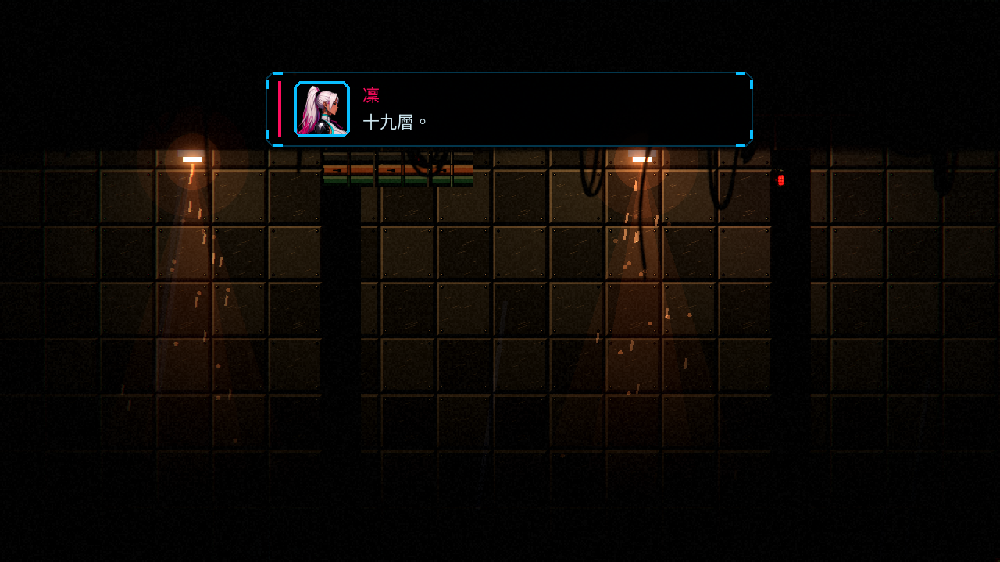
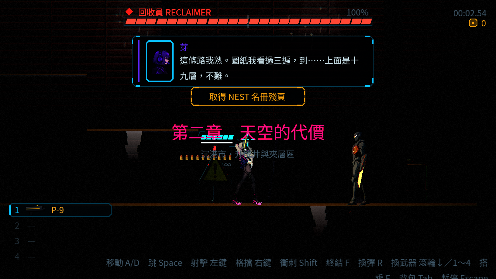
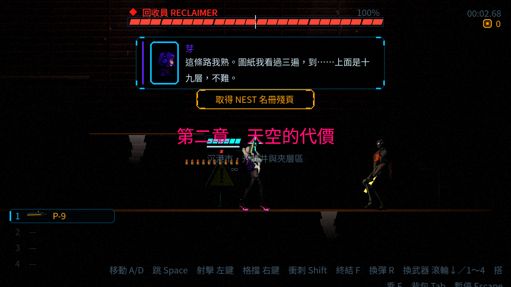

# [NE-154] 音效與音樂全面升級（母票）

> 狀態：進行中

## 內文

### 需求
遊戲目前所有聲音都是程式合成的簡單波形，每把槍、每種敵人聽起來都一樣，也沒有背景音樂。要把槍械、受擊、角色、機關、介面換成 CC0 錄音素材，加上場景背景音樂與環境音，並做一個能試聽、調整的音效實驗室。這張票只負責整體進度，實際工作在子票。

### 來源
2026-10-04，使用者要求處理整個遊戲的音效（所有槍械、受擊音效、場景 BGM），素材用 CC0，並做音效實驗室；設計見 `design/16-audio/DESIGN.md`。

### 驗收條件
- [x] 子票 NE-155～NE-164 全部完成
- [x] 整個遊戲沒有任何一處音效或音樂的授權不明，授權登記完整
- [ ] 遊戲從主選單玩到第二章結束，槍聲、受擊聲、腳步、機關聲、介面聲與場景音樂都是正式素材
- [x] 任何素材遺失時遊戲不崩潰，且 log 指出遺失的檔案與引用位置
- [x] 完整測試套件通過

### 測試流程
1. 從主選單開始玩一遍第一章與第二章
2. 預期：各場景音樂不同，戰鬥與頭目戰會切換，每把槍聽起來不同
3. 開音效實驗室確認可以逐項試聽

---

# 跟其他票的關係

- Blocks：無
- Blocked by：無
- Related：NE-155、NE-156、NE-157、NE-158、NE-159、NE-160、NE-161、NE-162、NE-163、NE-164、NE-138、NE-165～NE-171、NE-174～NE-177、NE-179、NE-180、NE-188～NE-191、NE-196～NE-200

---

# Commit-1

- 日期：2026-10-08（Asia/Taipei）。狀態維持「進行中」；交付本 Session 的獨立音訊修正與驗證證據，整體通關尚有下述等待條件。
- 沿用 NE-155～164 成果，不重做子票。原基準 `28ef95c7`，最新整合基準 `319eaf87`（ST-3 選項／存檔／死亡畫面）；後者已 rebase，保留其所有程式與圖檔。
- 實際發現並修正舊第二章退化：`level_02` 的回收者 arena 入口在 hangar、頭目位置在 tower_white，光影 override 不宣告 reclaimer_arena 區段，故真正的 boss_started 取到 `boss_warden`。僅補 `data/audio/music.json.map.levels.level_02.boss = boss_reclaimer`。修前已記錄 [配置區段／修改時間交接](attachments/NE-154/music-config-scope.md)，不覆寫其他第一章配置。正式曲目、選擇、加工、音量、淡入淡出、快取不變，未動地圖／事件產生器、角色動畫或 VFX。
- 新增正式關卡 arena → 頭目生成 → boss_started 整合測試；第一章舊入口仍播看守者曲。修前 225 checks／1 failure，修後 225 checks／0 failures；錯誤可重現，不以純 resolver 或實驗室代替關卡串接。
- [正式來源與關卡圖](attachments/NE-154/coverage.json)：11 份 LevelData／layout 的 SHA256、每區段四種狀態的實際 resolver 結果；129 個音效 id 中 125 個為檔案，四個通用換彈／空彈聲為既有合成退回。八把正式槍械的發射與五類操作均取正式檔案；bank／music 驗證錯誤及 failed_files 均空。授權／275 正式檔／147 實驗室位置與更多雙章場景材料沿用 [NE-196 審查頁](attachments/NE-196/index.html)。缺檔、壞格式、半組變體、失效加速檔、錯 cue 以既有故障 fixture 驗證，未刪正式資源。
- 聲音證據：[可播放前後／場景對照](attachments/NE-154/index.html)、[原始時間與事件](attachments/NE-154/playback.json)、[範圍與重現](attachments/NE-154/README.md)。七段為真實混音器錄音：新第一章倉庫 combat、保留的舊第一章 combat／boss、舊第二章 combat／boss，以及第二章頭目修前／ST-3 合入後修後對照。直接定位、高生命、跳過過場，combat 明確叫用現有敵人的 alert；boss 經正式 arena 觸發，未手動發送 boss_started。不是完整試玩，不能據此勾整體通關或聲音喜好。
- 環境：Godot 4.7；Forward+ 以共享鎖及 llvmpipe 軟體 Vulkan 取得真實畫面。無硬體 GPU／音訊輸出，因此無人工試聽結論，不擅自調換已選素材。正常速度聲音由 60 FPS 上限的無頭 Master 混音器錄製；渲染慢，截圖不作音畫同步結論。捕捉及正式關卡測試的 ObjectDB 警告具體數量見 README／原始 log，未宣稱零洩漏。
- 測試：受影響集以固定基準 `tools/run_tests_changed.sh 28ef95c7` 選到 41 組、38,711 checks／0 new／0 known（239 秒），涵蓋本次 JSON 與整合測試差異，沒有在 commit 後誤跑空集合。最新 rebase 整合版完整套件由單一 runner 執行 `SHARDS=8 tools/run_tests_parallel.sh`：76 組、45,363 checks／0 new／0 known（197 秒）；[摘要](attachments/NE-154/tests/parent-merged-full-summary.txt) 與八份 shard log 皆附。測試期間沒有另一套測試、匯入、截圖或生成工作，覆蓋 rebase 後所有受影響套件。
- 曾在兩套平行測試與匯入重疊時，完整套件有三項失敗（爆炸額外 11.76 ms／6 ms、ducking 恢復、壓力模式生成）。未改門檻或 known_failures；失敗 [摘要](attachments/NE-154/tests/parent-full-final-summary.txt) 保留。三個相關套件在 rebase 後同一程序重驗 734 checks／0 failures，爆炸增量 1.39 ms；壓力套件另次 69 checks／0 failures。這些診斷不取代最新完整套件結果。
- 推送前再次 fetch，已 rebase 到 `4d380e5e`；新增遠端變更僅 NE-222 的骨架技能文件／票／圖片，沒有音訊、遊戲程式、資料或測試差異。核對文件合併與 diff check；上述完整測試的遊戲版本與合併後相同。
- CI：GitHub Actions API 403 Forbidden，依指示停止，不重試、不繞過；不將本地測試宣稱為 CI 通過。
- 等待條件：正式主選單入口仍是 ch1_pawnshop，九個新第一章區域的 portal／next_level 圖沒有第二章出口；保留的舊 level_01 才有 next_level → level_02。等待 Session 3 最終序章／第一章事件與正式第二章入口合入，再由主選單完整驗收；本次清楚區分新第一章與舊第二章抽查。使用者的實際試聽（單發微調變體、連射尾音、落腳、電話重疊、12 秒通關／死亡短曲樂句）仍保留未勾，不代替使用者同意。

修前與修後為真實 Reclaimer 場景；畫面有直接進入關卡的章名與對話提示，不代表章節通關。截圖說明場景，聲音使用上方播放器驗收。

