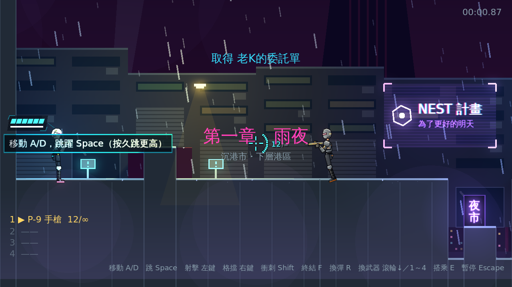
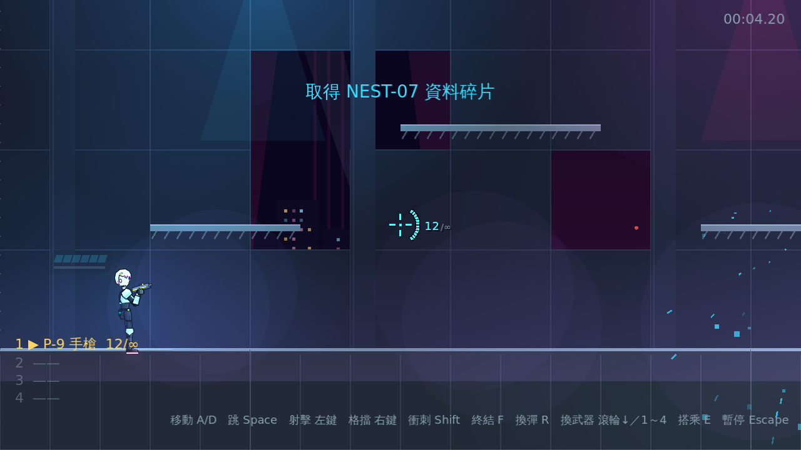
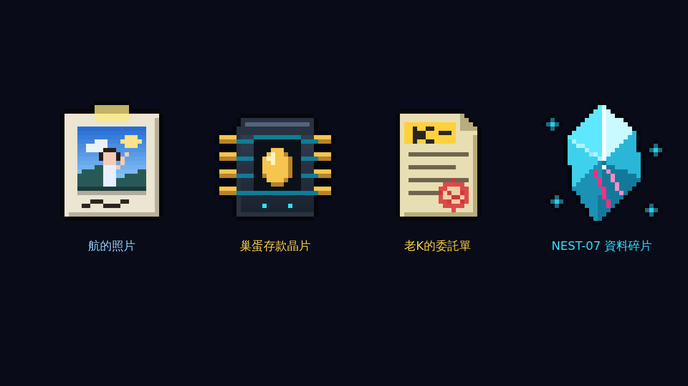

# [NE-15] 加入劇情道具收集

> 狀態：完成

## 內文

### 需求
劇情中的關鍵物品（航的照片、NEST-07 資料碎片等）目前只出現在台詞裡。改成可以收集、可以在背包裡查看說明的劇情道具，強化敘事。設計見 `design/07-weapons-inventory/DESIGN.md` 第 4 節。

### 來源
2026-10-03，使用者於開發對話中提出：「按 Tab 會有背包的畫面」；確認背包要有劇情道具分頁。

### 驗收條件
- [x] 劇情道具以資料檔定義名稱、說明與圖示，新增道具不需改程式
- [x] 第一章依劇情取得航的照片、巢蛋存款晶片、老K的委託單、NEST-07 資料碎片
- [x] 取得新道具時跳出提示
- [x] 重開關卡或從檢查點重生時，已取得的道具依進度保留

### 測試流程
1. 開始新遊戲，確認開場後持有照片、存款晶片、委託單
2. 擊敗頭目後確認取得資料碎片
3. 執行完整測試套件，全部通過

---

# 跟其他票的關係

- Blocks：NE-16
- Blocked by：無
- Related：NE-9、NE-31

---

# Commit-1

## 內文

劇情中的關鍵物品只出現在台詞裡，玩家沒有實際「帶著」它們。
現在劇情道具以資料檔定義名稱、說明、圖示與取得時機，新增道具不需改程式。第一章：航的照片與巢蛋存款晶片開局就持有；老K的委託單在開場過場結束時取得；NEST-07 資料碎片在擊敗頭目時取得。取得時畫面上方跳出「取得 道具名稱」（開局持有的不跳提示）。道具跟著本輪進度：重開關卡或從檢查點重生都保留，開始新遊戲才重置。四個道具各有 32×32 的像素圖示，可用同名 PNG 替換成手繪版。
驗收方式：冒煙測試驗證資料檔完整、開局持有的道具、重複與未知道具被安全拒絕、開場過場結束取得委託單、重開關卡保留道具、擊敗頭目取得碎片、新一輪重置，以及資料目錄載入器略過壞檔與重複 id；自動截圖確認兩次取得提示與四個圖示。

### 測試結果

| 項目 | 結果 |
|---|---|
| 完整測試套件 | 通過 531 / 531 |
| 資料驗證 | 0 錯誤 |
| 執行 log | 無非預期 ERROR |

### 截圖

