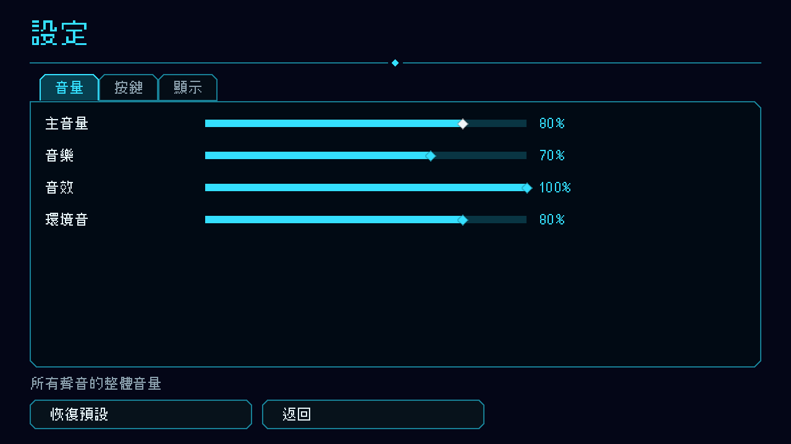

# [NE-160] 建立背景音樂系統

> 狀態：完成

## 內文

### 需求
遊戲沒有背景音樂，設定選單也沒有音樂音量。要有獨立的音樂匯流排與音量設定、兩軌交叉淡化的串流播放、依關卡與狀態（平靜、戰鬥、頭目）切換、暫停與過場時的處理，所有曲目與對應都由資料指定。

### 來源
2026-10-04，使用者要求處理整個遊戲的音效（所有槍械、受擊音效、場景 BGM），素材用 CC0，並做音效實驗室；設計見 `design/16-audio/DESIGN.md`。

### 驗收條件
- [x] 設定選單有音樂與環境音兩條音量滑桿，有 tooltip，音量存檔並在下次啟動套用
- [x] 曲目串流播放，不整首載入記憶體
- [x] 換曲目時交叉淡化，淡化時間由資料指定
- [x] 進入戰鬥（附近有警戒中的敵人）切到戰鬥曲目，離開後延遲幾秒才切回，不會來回跳
- [x] 頭目戰開始切頭目曲目，擊敗後切回；死亡與通關播短 sting
- [x] 暫停與背包開啟時音樂變悶且變小，關閉後平滑還原
- [x] 過場動畫期間音樂壓低
- [x] 曲目遺失或格式錯誤時記錄具體位置並維持靜音，不崩潰
- [x] 曲目、cue、對應表由資料指定，新增曲目不改程式
- [x] 切換畫面與重新開始時不留下播放中的舊曲（無記憶體累積）

### 測試流程
1. 打開設定選單調整音樂音量，重開遊戲確認保留
2. 走進有敵人的地方，確認切到戰鬥音樂，清完後切回
3. 暫停遊戲確認音樂變悶，繼續後還原

---

# 跟其他票的關係

- Blocks：NE-161、NE-162
- Blocked by：無
- Related：NE-154

---

# Commit-1

## 內文

遊戲沒有背景音樂，設定選單也沒有音樂音量。
現在有完整的音樂系統：獨立的音樂匯流排，設定選單多一條「音樂」音量滑桿（與「環境音」一起，都有說明，音量存檔）。曲目串流播放、不整首載入；換曲目時兩軌交叉淡化，淡化時間由資料指定；離開某首曲目再回來時從原本的位置接著播。關卡內有三種狀態：平靜、戰鬥、頭目——玩家附近（約 26 格內）有警戒或出招中的敵人就切到戰鬥曲，附近都沒有之後再等 4 秒才退回平靜，避免來回跳；頭目戰開始切頭目曲，擊敗後切回；死亡播短曲，主選單與通關畫面各有自己的曲目。曲目與 cue 的對應由資料指定，從具體到一般：關卡 id、光影設定 id、預設；某狀態沒有 cue 時，頭目退回戰鬥、戰鬥退回平靜。暫停與背包開啟時音樂與環境音變悶（低通）且小聲，過場動畫時壓低，都是平滑漸變。曲目遺失、無法載入或資料格式錯誤時，log 指出 cue、曲目與檔案位置，維持靜音，遊戲不崩潰；切換畫面時舊曲淡出，不會殘留。
目前還沒有放入實際曲目（下一張票 NE-161 挑選並配置），所以實機上暫時沒有音樂；系統用測試用的曲目驗證。
驗收：新增音樂測試套件 52 項通過（對應優先順序與回退、資料檢查、播放與交叉淡化與音量、位置記憶、缺檔容錯、關卡內戰鬥切換與遲滯與遠處敵人不觸發、頭目與死亡與選單與通關、暫停與過場的音色、音樂音量滑桿與匯流排）。

### 測試結果

| 項目 | 結果 |
|---|---|
| 音樂測試套件 | 通過 52 / 52 |
| 完整測試套件 | 通過 9963 / 9974（11 項與 main 相同的既有失敗） |
| 資料驗證 | 0 錯誤 |
| 執行 log | 無新增 ERROR |

### 截圖

