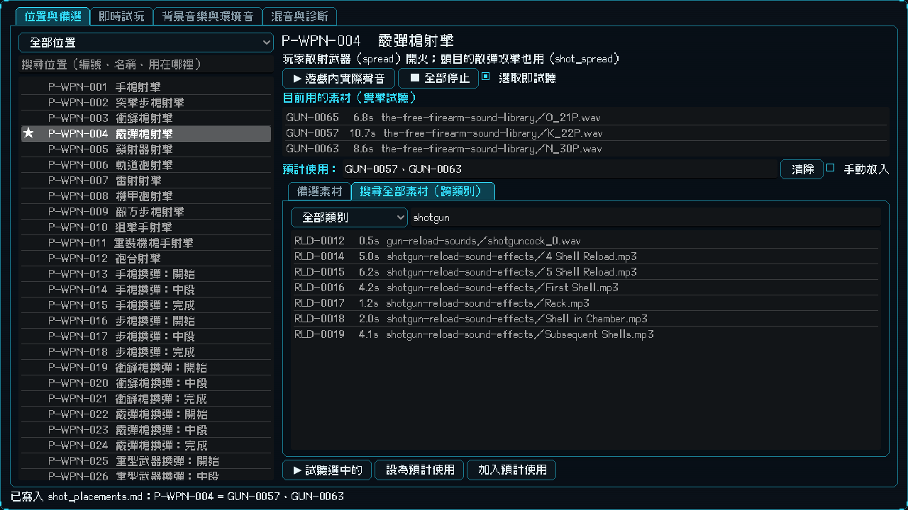
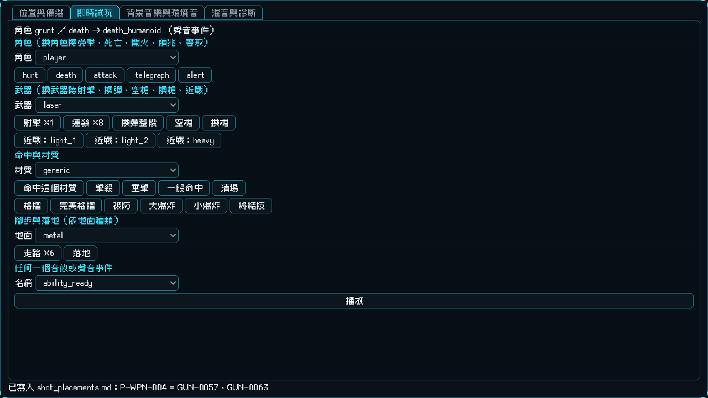
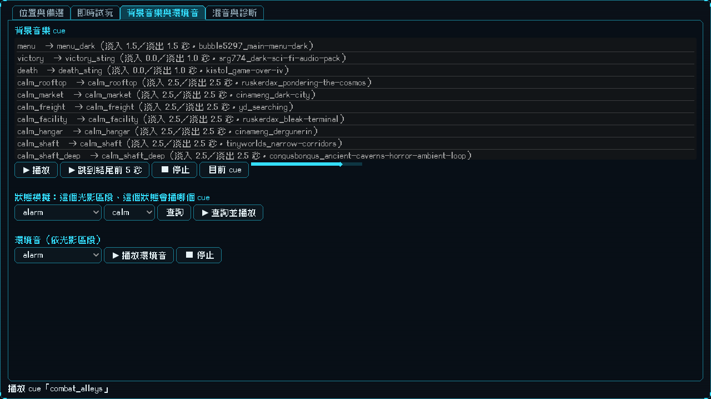
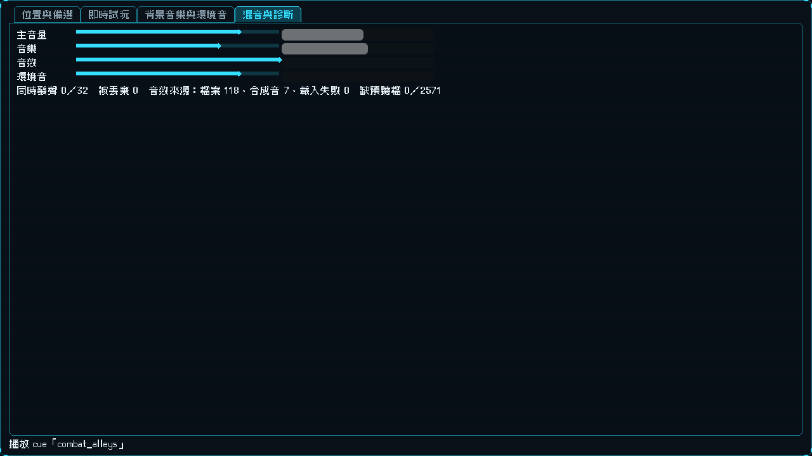

# [NE-162] 建立音效實驗室

> 狀態：完成

## 內文

### 需求
調音效時要一直進遊戲打一遍才聽得到。要有一個獨立的實驗室，可以選角色、武器、材質、曲目，一鍵播放對應的聲音，看到每個聲音用哪個檔案、授權是什麼，調整音量後寫回資料。另外要能直接挑聲音：每個位置列出它的備選素材（含編號），可以試聽，也可以搜尋整個素材目錄、跨類別挑到別的聲音；挑的結果與「手動放入」的勾選要和位置清單文件即時連動。

### 來源
2026-10-04，使用者要求處理整個遊戲的音效（所有槍械、受擊音效、場景 BGM），素材用 CC0，並做音效實驗室；設計見 `design/16-audio/DESIGN.md`。

### 驗收條件
- [x] 可以從命令列開啟，主選單與遊戲流程進不去
- [x] 即時試玩：選玩家或任何敵人，播放受擊、死亡、攻擊、預兆、警戒；選地面種類播放腳步與落地
- [x] 武器分頁：選武器，播放單發、連發、整段換彈、空槍、換槍，以及近戰招式
- [x] 即時試玩：選命中材質播放命中回饋，並可播放擊殺、重擊、格擋、完美格擋、破防、爆炸、終結技
- [x] 背景音樂：列出所有 cue，可播放與交叉淡化，可模擬「某個光影區段與狀態（平靜、安全、戰鬥、頭目）」會選到哪個 cue，可跳到迴圈尾端試接縫
- [x] 環境音：選光影區段播放它的環境音層
- [x] 每個位置顯示聲音來源（音效檔或合成音）、授權包與授權、最長時長，缺檔或載入失敗會標示；可播放任何音效或聲音事件
- [x] 混音與診斷：各匯流排音量與靜音，即時音量表，同時發聲數與被丟棄數，音效來源統計與缺預聽檔數量
- [x] 音效位置的音量微調、音樂 cue 的音量與淡入淡出秒數：拖動立刻生效，可預覽差異並驗證後寫回資料，寫入前備份
- [x] 數值超出範圍或資料路徑不存在時指出位置，不寫入
- [x] 位置分頁：列出所有位置（編號、名稱、用在哪裡、目前素材、預計使用、手動放入勾選），可依域篩選與搜尋
- [x] 選一個位置會列出它的備選素材（含素材編號），逐一試聽，按一下就能設為「預計使用」
- [x] 可以搜尋整個素材目錄（編號、類別、標籤、素材包），跨類別試聽並設為任何位置的預計使用
- [x] 試聽的音量與長度和套用後一致（預聽檔與正式加工同一套響度標準）
- [x] 每個位置有「手動放入」勾選，勾了之後工具套用時略過該位置
- [x] 在實驗室改預計使用或勾選，立刻寫回位置清單文件（只改那一格，其餘內容不動）
- [x] 位置清單文件被外部編輯後，實驗室在約一秒內自動重新載入並提示
- [x] 預聽檔不存在時提示怎麼產生，不崩潰
- [x] 每個按鈕與欄位有 tooltip

### 測試流程
1. 以命令列開啟實驗室
2. 依序切換各分頁，選不同角色、武器、曲目試聽
3. 調整一個音量，預覽差異並儲存，重開確認生效
4. 在位置分頁挑一個位置，試聽備選並設為預計使用，打開位置清單文件確認那一格已更新
5. 用外部編輯器改位置清單的一格，確認實驗室自動更新

---

# 跟其他票的關係

- Blocks：無
- Blocked by：NE-156、NE-160、NE-163
- Related：NE-154、NE-157、NE-158、NE-159、NE-161、NE-164、NE-133

---

# Commit-1

## 內文

調音效時要一直進遊戲打一遍才聽得到，也沒辦法精確選每個位置要用哪個聲音。
現在有音效實驗室（命令列開啟：`godot --path . res://tools/sound_lab/sound_lab.tscn`，遊戲流程進不去）。**位置與備選**分頁：左邊 143 個位置可依域篩選與搜尋（★ 表示已填預計使用、✓ 表示已手動放入）；選一個位置，右邊顯示它在遊戲裡的用途、聲音來源（音效檔或合成音、授權包與授權、最長時長，缺檔會標示）、目前用的素材、預計使用、30 個備選素材（含素材編號、時長、素材包與檔名，點一下就試聽，可多選）；另一個頁籤可以搜尋整個素材目錄（編號、素材包、檔名、槍種等說明），跨類別挑到任何位置。按「設為預計使用」或「加入預計使用」，或直接輸入編號，都會立刻寫進位置清單文件（只改那一格）；「手動放入」勾選同樣寫回。位置清單文件被外部編輯器改過，實驗室約一秒內偵測到並重新載入、提示，實驗室的寫入也不會蓋掉別處的外部修改。拖動「音量微調」立刻聽到效果，可預覽差異、儲存到音效庫（先備份成 .bak）。
**即時試玩**分頁：選玩家或任何敵人播放受擊、死亡、開火、預兆、警戒；選武器播放射擊、連發、換彈整段、空槍、換槍與近戰；選命中材質、擊殺、格擋、爆炸；選地面播放腳步與落地；也能播放任何音效或聲音事件，旁邊顯示實際解析到的名稱與來源。**背景音樂與環境音**分頁：所有 cue 可播放與交叉淡化，可跳到結尾前 5 秒聽迴圈接縫，可模擬某個光影區段與狀態會選到哪個 cue，可調 cue 的音量與淡入淡出秒數並預覽、儲存；選光影區段播放環境音層。**混音與診斷**分頁：各匯流排音量與靜音、即時音量表、同時發聲數與被丟棄數、音效來源統計、缺預聽檔數。每個按鈕與欄位都有 tooltip，沒有預聽檔時提示怎麼產生。
驗收：實驗室測試套件 48 項通過（遊戲流程進不去、所有控制項有 tooltip、位置挑選寫回文件並可從磁碟重讀、多選與加入、輸入編號略過不存在的編號、勾選手動放入、跨類別挑選、外部修改偵測與合併、缺預聽檔提示、即時試玩各查表、cue 模擬與接縫、音量與 cue 數值預覽），音效測試套件另有寫回工具檢查（預覽不寫入、範圍驗證、備份、只改指定欄位、壞路徑不憑空建立），連同音樂測試共 5330 項通過。

### 測試結果

| 項目 | 結果 |
|---|---|
| 實驗室測試套件 | 通過 48 / 48 |
| 音效與音樂測試套件 | 通過 5282 / 5282 |
| 完整測試套件 | 通過 26630 / 26641（11 項為 main 上就有的失敗與不穩定檢查：角色零件法線貼圖缺一張、檢查點存檔與還原、顯示設定關閉、擊殺終結技計數與重擊倒下速度會隨影格時序偶爾失敗；沒有新增，沒有腳本錯誤，結束時沒有資源洩漏） |
| 資料驗證 | 0 錯誤 |

### 截圖

