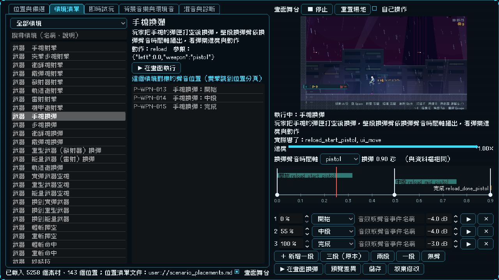
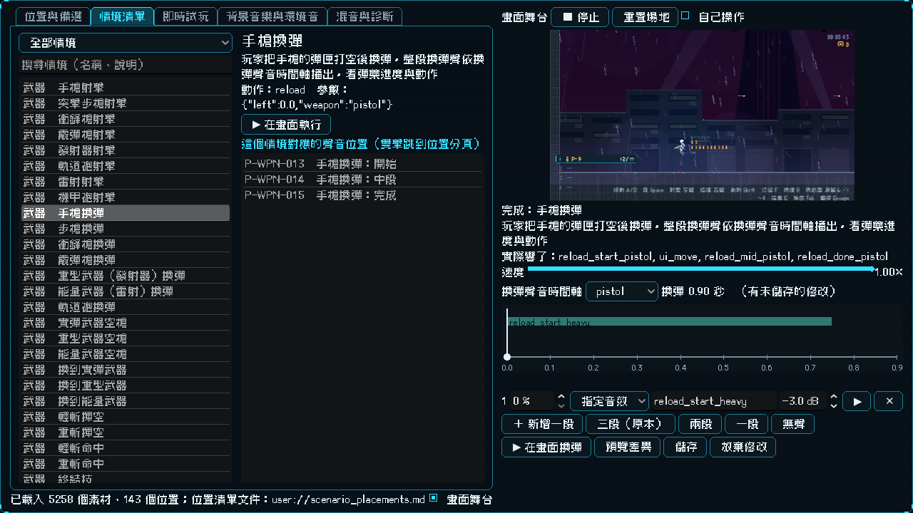
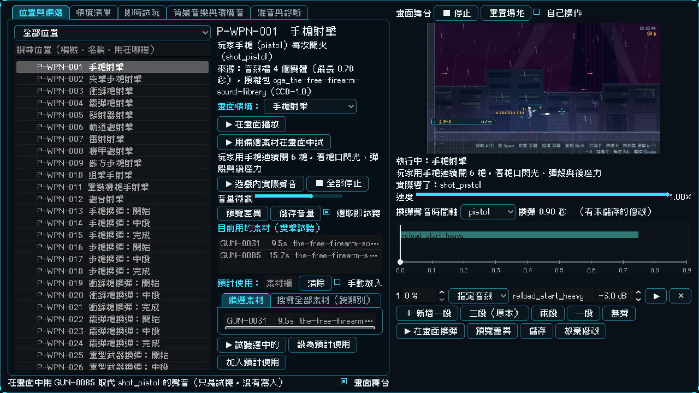

# [NE-166] 音效實驗室加入畫面舞台

> 狀態：完成

## 內文

### 需求
實驗室只能聽聲音，看不到聲音和動畫配起來是什麼感覺，也看不出一個聲音在遊戲裡會以什麼形式出現。要在實驗室裡有遊戲真正的畫面（玩家、敵人、HUD、特效），把每個聲音位置對應到它在遊戲裡出現的情境，按一下就做出真實的動作，聲音和動畫一起出現；還要能在畫面裡直接試備選素材，並能決定整段動畫（例如換彈）是分成幾段還是只用一個聲音。這張票做舞台、情境目錄與武器相關的情境。

### 來源
2026-10-04，使用者要求實驗室把聲音對應的動畫都列出來，並且以聲音在遊戲裡出現的形式顯示；換彈只是例子，目的是整段動畫不被切開，也要能整段用一個聲音。設計見 `design/16-audio/DESIGN.md` 5.3 節。

### 驗收條件
- [x] 實驗室右側有可收合的遊戲真實畫面，按鈕驅動真實的玩家與敵人動作，聲音由遊戲自己播出；滑鼠與鍵盤可以直接玩
- [x] 每個聲音位置都在情境目錄裡有登記：武器位置對應到情境，其餘位置標示由 NE-167 或 NE-169 處理；資料檢查保證不漏、不指向不存在的動作
- [x] 有「情境清單」分頁，依類別列出所有情境，點一下在畫面執行，並顯示該情境實際響了哪些聲音與它對應哪些位置
- [x] 位置分頁選一個位置會顯示它的情境，可以「在畫面中播放」，也可以選一個備選素材「用這個素材在畫面中試」，聲音只暫時替換、不寫入任何資料
- [x] 武器情境完成：八把玩家武器的射擊（單發與連發）、各武器的換彈、空槍、換槍、近戰輕斬與重斬（揮空與命中）、終結技
- [x] 每個武器情境執行後，實際響出來的音效包含對應位置的聲音（自動檢查）
- [x] 換彈時間軸編輯器：顯示動畫長度、每個聲音的位置與長度、目前進度游標；可新增、刪除、拖動、換聲音與音量，一鍵套用「三段」「兩段」「一段（整段一個聲音）」；聲音比動畫長或短時有提示
- [x] 時間軸修改立刻在畫面上生效，可預覽差異、驗證通過才寫回（先備份），也可放棄修改還原
- [x] 慢動作滑桿（0.1 到 1 倍），動畫與聲音一起放慢；離開實驗室時還原
- [x] 舞台不播背景音樂與環境音；原有的四個分頁與位置清單連動不受影響
- [x] 每個按鈕與欄位有 tooltip；資料損壞或缺聲音時提示、不崩潰

### 測試流程
1. 在遊戲中按 F5 進音效實驗室，右側看到遊戲畫面
2. 在情境清單點「手槍換彈」，看到玩家換彈的畫面與彈藥進度，同時聽到聲音，時間軸游標移動
3. 在時間軸改成「整段一個聲音」，再換彈，確認只響一次；開慢動作確認看得到聲音落在動畫哪裡
4. 在位置分頁選「手槍換彈：開始」，選一個備選素材，按「用這個素材在畫面中試」，確認聽到的是備選素材，而資料檔沒有任何改變

---

# 跟其他票的關係

- Blocks：NE-167、NE-169
- Blocked by：NE-165
- Related：NE-157、NE-162、NE-168

---

# Commit-1

## 內文

實驗室只能聽聲音，看不到聲音和動畫配起來是什麼感覺，也看不出聲音在遊戲裡以什麼形式出現。
現在實驗室右側有常駐的遊戲真實畫面（可用右下角的勾選隱藏）：真正的關卡、玩家、HUD 與特效，按鈕驅動玩家做真實的動作，聲音由遊戲自己播出。新增「情境清單」分頁，依類別列出所有情境，點一個就在畫面執行，並顯示它做了什麼、對應哪些聲音位置；畫面下方顯示這次實際響了哪些音效。「位置與備選」分頁的每個位置多了「畫面情境」：可以在畫面播放，也可以選一個備選素材「用備選素材在畫面中試」，那個位置的聲音暫時換成候選素材的預聽檔（只在記憶體，不寫入任何資料），看到的動畫配的就是候選聲音。
武器情境已經全部完成：八把武器的射擊、六組換彈（手槍、步槍、衝鋒槍、霰彈槍、發射器、雷射，另有軌道砲）、三種空槍、三種換槍、輕斬與重斬各自揮空與命中、終結技，共 26 個情境，涵蓋 41 個武器位置中的 37 個（其餘 4 個是敵方槍聲，由 NE-167 處理）；其他類別的位置在目錄裡標示由 NE-167 或 NE-169 處理。
換彈時間軸編輯器在畫面下方：顯示這把武器的換彈長度、每個聲音的位置與長度、目前進度的紅色游標；可新增、刪除、拖動標記、換聲音（該武器的開始／中段／完成／空槍／換槍，或指定任何音效）與音量，一鍵套用「三段（原本）」「兩段」「一段」「無聲」。整段只用一個聲音時，聲音比動畫短太多會提示。修改立刻生效，按「在畫面換彈」就在真實動畫上重試；預覽差異、驗證通過才寫回（先備份），也能放棄修改。慢動作滑桿（0.1 到 1 倍）讓動畫與聲音一起放慢。舞台不播背景音樂與環境音；實體按鍵預設鎖住（點實驗室的按鈕不會讓玩家誤開槍），勾「自己操作」才用鍵盤與滑鼠玩。
驗收：舞台測試套件 218 項通過——情境資料完整與壞資料容錯、每個有對應的位置執行情境後實際響出該位置的聲音（全部武器位置）、取消與取代不留殘局、備選素材暫時替換用完即還原、輸入鎖完整還原、整個實驗室連舞台的 tooltip、情境清單與位置分頁的操作、時間軸編輯器的編輯與套用與寫回與還原與上限。

### 測試結果

| 項目 | 結果 |
|---|---|
| 舞台測試套件 | 通過 218 / 218 |
| 完整測試套件 | 依指示 NE-169 完成、整批推送前統一執行 |
| 資料驗證 | 0 錯誤 |

### 截圖

