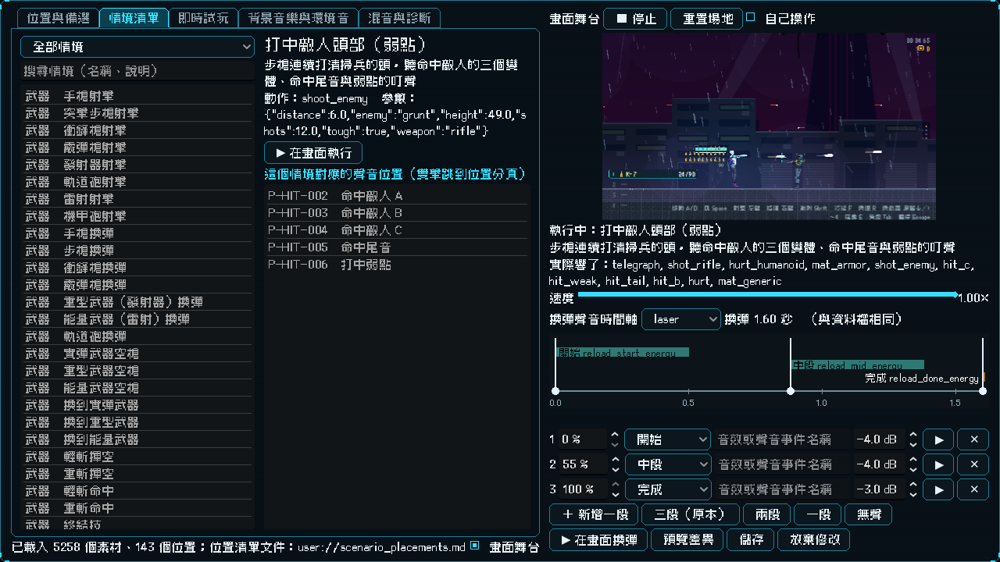
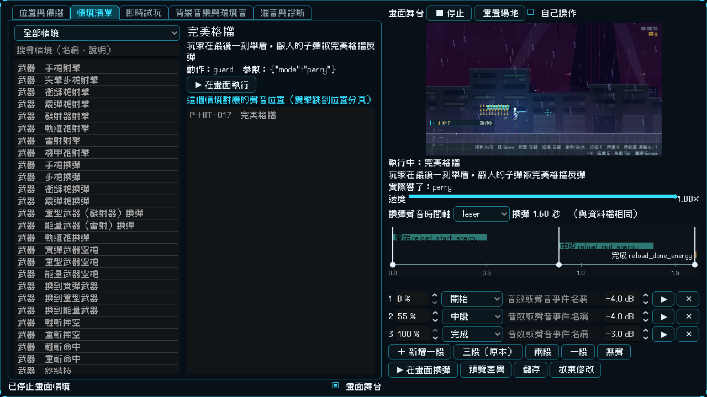
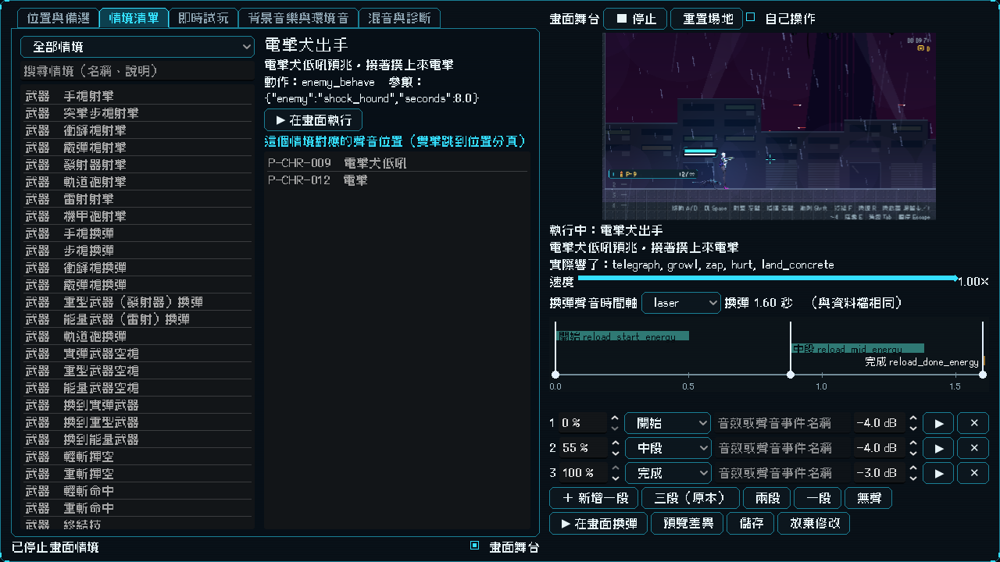

# [NE-167] 實驗室加入受擊、角色與移動情境

> 狀態：完成

## 內文

### 需求
舞台上要能看到命中、受擊、角色動作與移動的聲音在遊戲裡以什麼形式出現：子彈打在不同材質上、敵人與玩家受傷死亡、格擋與爆炸、敵人的攻擊預兆與各種攻擊、敵方槍聲、走路落地跳躍衝刺。

### 來源
2026-10-04，使用者要求實驗室把聲音對應的動畫都列出來，並以聲音在遊戲裡出現的形式顯示；設計見 `design/16-audio/DESIGN.md` 5.3 節。

### 驗收條件
- [x] 命中情境：打中敵人（一般、弱點、擊殺）、七種材質、跳彈、格擋、完美格擋、破防、大小爆炸
- [x] 角色情境：玩家受傷與死亡；人形、機械、生物敵人的受傷與死亡；每種敵人的預兆與攻擊（低吼、啃咬、搖晃、電擊、火焰、點火、機槍旋轉、散熱、警報、雷射瞄準…）；敵方一般槍、狙擊手、重裝機槍手、砲台的射擊
- [x] 移動情境：三種地面的走路與落地、通用落地、跳躍、衝刺
- [x] 每個情境執行後，實際響出來的音效包含對應位置的聲音（自動檢查）
- [x] 做不出畫面的位置標示原因，不影響其他情境

### 測試流程
1. 在情境清單依序執行各類情境，確認畫面與聲音同時出現
2. 在位置分頁選一個命中位置，用備選素材在畫面中試

---

# 跟其他票的關係

- Blocks：無
- Blocked by：NE-166
- Related：NE-158、NE-162

---

# Commit-1

## 內文

舞台上只有武器情境，命中、受擊、角色與移動的聲音還看不到它們在遊戲裡的樣子。
現在這四類位置（命中 21 個、角色 20 個、移動 9 個，加上敵方槍聲 4 個）都有畫面情境，共新增 41 個情境：
- 命中：子彈打在八種材質上、打中敵人頭部（弱點，聽命中聲三個變體、尾音、弱點叮聲）、子彈被護盾彈開（跳彈）、打中木箱、舉盾格擋、完美格擋、破防、擊殺、大小爆炸。
- 角色：玩家受傷與死亡；人形（清掃兵）、機械（無人機）、生物（電擊犬）各自的受傷與死亡；敵人自己出手的情境——清掃兵（預兆與開槍）、狙擊手（雷射瞄準）、重裝機槍手（旋轉、掃射、散熱）、砲台、電擊犬（低吼、電擊）、偽裝箱（搖晃、啃咬）、火焰兵（點火、噴火）、探照無人機（懸在玩家上方，嗶聲越來越急直到警報）。
- 移動：金屬、混凝土、潮濕三種地面的走路與落地、未知地面的落地後備音、跳躍、衝刺。
情境全部走真實的遊戲路徑：子彈真的飛出去打中靶與敵人（持續瞄準，敵人走動也打得到）、敵人用自己的 AI 出手、玩家真的舉盾被打中。舞台執行玩家死亡時，不會寫進玩家的敗北圖鑑存檔，離開實驗室時圖鑑進度還原；場地裡的敵人不依賴畫面是否可見，一律會動。
驗收：舞台測試套件 259 項通過，連續兩次穩定——每個有情境的位置（共 91 個，含武器 41 個）執行它的第一個情境後，實際響出來的音效都包含該位置的聲音（輪流播的變體算同一組）；情境資料完整性、取消與取代、備選素材暫時替換、輸入鎖、整個實驗室的 tooltip、時間軸編輯器都通過。

### 測試結果

| 項目 | 結果 |
|---|---|
| 舞台測試套件 | 通過 259 / 259 |
| 完整測試套件 | 依指示 NE-169 完成、整批推送前統一執行 |
| 資料驗證 | 0 錯誤 |

### 截圖

