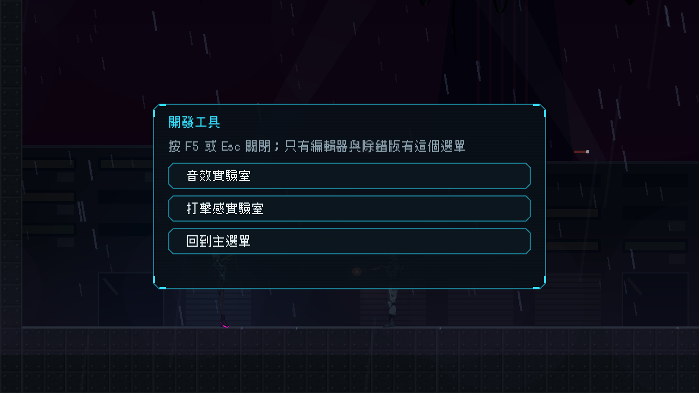

# [NE-168] F5 開發工具選單

> 狀態：完成

## 內文

### 需求
音效實驗室和打擊感實驗室每次都要在命令列輸入指令才能開，很麻煩。要在編輯器直接執行遊戲後，按 F5 就能開出一個工具選單，點一下進實驗室，也能點一下回主選單。正式匯出的遊戲不能有這個入口。

### 來源
2026-10-04，使用者要求在 F5 裡放音效實驗室的入口按鈕，不用每次打指令開啟。

### 驗收條件
- [x] 在編輯器或除錯版的遊戲中按 F5 開啟開發工具選單，再按 F5 或 Esc 關閉
- [x] 選單列出音效實驗室與打擊感實驗室，點一下切換過去；另有「回到主選單」
- [x] 在實驗室裡也能按 F5 切到別的工具或回主選單，離開音效實驗室後視窗縮放還原
- [x] 開啟時遊戲暫停並顯示滑鼠，關閉或切換後還原原本的暫停與滑鼠狀態
- [x] 工具清單由資料決定，新增工具只改資料；清單缺檔、格式錯誤或某項不完整時略過並指出位置，找不到場景時在選單上說明而不離開目前畫面
- [x] 正式匯出版沒有這個入口（匯出排除工具資料夾，按 F5 沒有反應）；玩家流程無法進入實驗室
- [x] 每個按鈕有 tooltip

### 測試流程
1. 在編輯器執行遊戲，在主選單按 F5，點「音效實驗室」，確認進入實驗室
2. 在實驗室按 F5，點「打擊感實驗室」與「回到主選單」，確認可以切換
3. 在遊戲關卡中按 F5，確認遊戲暫停，按 Esc 後恢復

---

# 跟其他票的關係

- Blocks：無
- Blocked by：無
- Related：NE-162、NE-166

---

# Commit-1

## 內文

實驗室每次都要在命令列輸入指令才能開。
現在在編輯器直接執行遊戲（F5）後，遊戲中再按 F5 會開出「開發工具」選單：音效實驗室、打擊感實驗室、回到主選單，點一下就切換過去；在實驗室裡也能再按 F5 切到別的工具或回主選單，離開音效實驗室後視窗縮放會還原。開啟時遊戲暫停、顯示滑鼠，按 F5 或 Esc 關閉後還原。工具清單是資料，新增工具只加一筆；清單缺檔、格式錯誤或某項不完整時略過並指出位置，找不到場景時在選單上說明、留在原地。正式匯出版沒有工具資料夾，按 F5 沒有反應，玩家流程進不了實驗室。
另外測試收尾多等一小段實際時間讓音訊釋放，並讓測試腳本不把引擎結束時的音訊資源檢查訊息當成失敗。
驗收：選單測試 25 項通過（工具清單資料與場景存在、壞清單容錯、F5 與 Esc 開關與暫停和滑鼠還原、切換場景與回主選單、找不到場景、tooltip），另用真實場景切換跑過一遍：主選單流程 → 音效實驗室 → 打擊感實驗室 → 主選單都正常。

### 測試結果

| 項目 | 結果 |
|---|---|
| 開發選單測試套件 | 通過 25 / 25 |
| 實驗室測試套件（遊戲檔案沒有引用實驗室） | 通過 48 / 48 |
| 完整測試套件 | 見最後一張相關票（NE-166 之後統一執行） |

### 截圖

