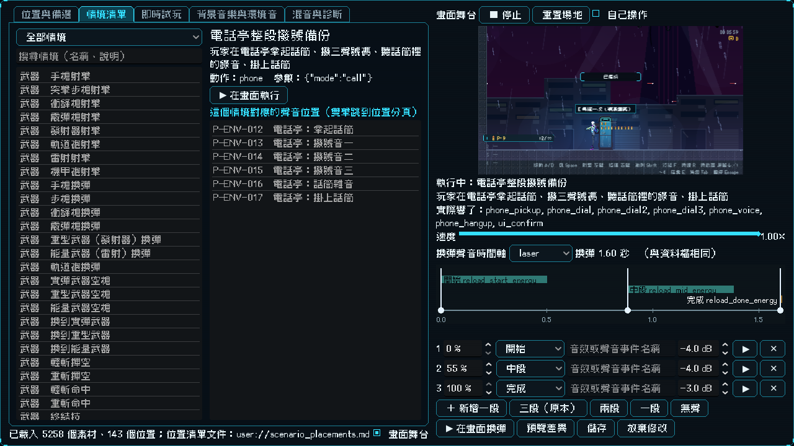
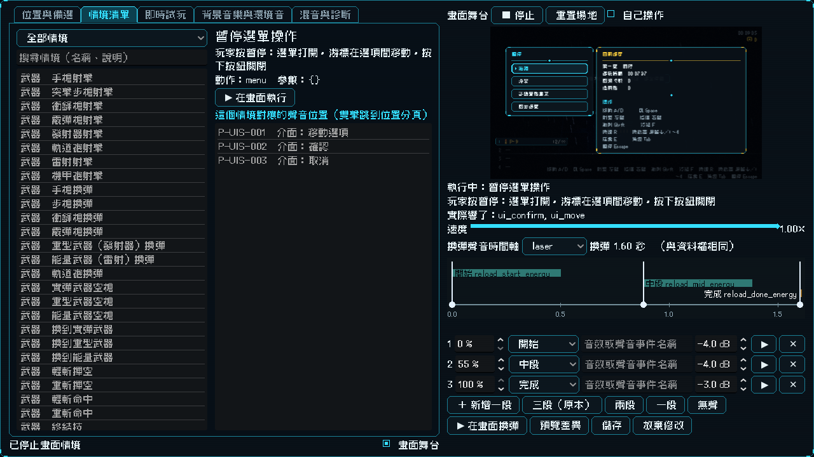
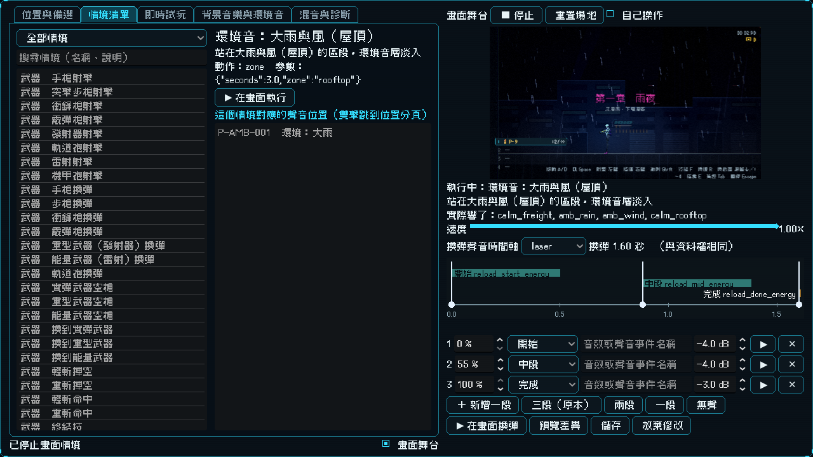

# [NE-169] 實驗室加入機關、介面、環境音與音樂情境

> 狀態：完成

## 內文

### 需求
舞台上要能看到機關、拾取、電話亭、介面、環境音與背景音樂在遊戲裡以什麼形式出現：撥開關、閘門、斷電復電、義體能力、拾取、打破木箱與玻璃、雷聲、電話亭整段通話、選單操作、各光影區段的環境音、各狀態的背景音樂。

### 來源
2026-10-04，使用者要求實驗室把聲音對應的動畫都列出來，並以聲音在遊戲裡出現的形式顯示；設計見 `design/16-audio/DESIGN.md` 5.3 節。

### 驗收條件
- [x] 機關情境：開關與閘門、斷電、復電、電磁脈衝、過載、義體能力就緒、拾取、木箱、玻璃、雷聲、電話亭整段通話與重生來電鈴聲
- [x] 介面情境：選單移動、確認、取消，顯示真實的暫停選單畫面；「錯誤」聲音遊戲裡目前沒有任何地方會響，標示原因
- [x] 環境音情境：每種環境音在對應光影區段的舞台中響起
- [x] 音樂情境：每個區段的平靜、安全、戰鬥、頭目曲目，顯示該區段與狀態
- [x] 每個情境執行後，實際響出來的音效或曲目包含對應位置的聲音（自動檢查）
- [x] 做不出畫面的位置標示原因，不影響其他情境

### 測試流程
1. 在情境清單依序執行機關、介面、環境音、音樂情境，確認畫面與聲音同時出現
2. 在位置分頁選一個環境音位置，在畫面中看到對應的區段

---

# 跟其他票的關係

- Blocks：無
- Blocked by：NE-166
- Related：NE-159、NE-160、NE-161、NE-162

---

# Commit-1

## 內文

舞台上還看不到機關、電話亭、介面、環境音與背景音樂在遊戲裡的樣子。
現在這四類位置（機關 18 個、介面 4 個、環境音 8 個、音樂 22 個）都有畫面情境，共新增 40 個情境，全部走真實的遊戲路徑：
- 機關：玩家站在開關旁按互動鍵，閘門真的滑開再放下；電力開關斷電（區域熄燈）再復電；義體能力電磁脈衝與過載（敵人癱瘓、子彈消除）和電量補滿的就緒提示；走過去撿修復道具；步槍打破木箱、玻璃牆；雨夜閃電與雷聲（過場動畫的閃電效果疊在舞台畫面上）；電話亭整段撥號備份（拿起話筒、三聲撥號音、話筒裡的錄音、掛上）與重生時的來電鈴聲。
- 介面：真實的暫停選單——打開、游標在選項間移動、按下按鈕關閉。
- 環境音：八種環境音各選一個光影區段，舞台換成那個區段的光影，環境音層像進遊戲一樣自己淡入（屋頂的大雨與風、貨運站的小雨與發電機、花園的風、市場的夜城底噪、機庫的機房嗡鳴、診所的通風、工廠的發電機、地下室的滴水）。
- 音樂：主選單與通關結算畫面（真的把畫面顯示在舞台上）、玩家倒下的短曲、十一個區段的平靜曲、電話亭旁與診所與當鋪的安全區曲、三個警戒敵人逼近時的戰鬥曲（三首輪流）、兩場頭目戰的頭目曲。環境音與音樂現在會送出訊號，舞台才記錄得到它們實際播了什麼。
其他：場地可以用任何光影設定重建並選擇要不要開音樂與環境音（預設仍然全關）；情境放進場地的敵人、靶與道具在還原場地時一併清掉，不會擋住下一個情境；舞台的暫停選單與過場會暫停整棵樹，所以實驗室本身改成暫停時照常運作。唯一沒有畫面的位置是「介面：錯誤」，因為遊戲裡目前沒有任何地方會響這個聲音。
驗收：每個有情境的位置（143 個位置裡 142 個）執行它的情境後，實際響出來的音效或曲目都包含該位置的聲音（變體輪流與三首戰鬥曲輪流算同一組）。這項完整覆蓋檢查分成三個套件（武器與命中、角色與移動、機關介面環境音音樂），加上舞台的代表性抽查與其餘舞台檢查，共 382 項，連續三次穩定通過。

### 測試結果

| 項目 | 結果 |
|---|---|
| 舞台與覆蓋測試套件 | 通過 382 / 382（連續三次） |
| 完整測試套件（平行） | 27111 項，新失敗 0；已知失敗 10 項（main 上就有，見 tests/known_failures.txt）；約 2 分 50 秒 |
| 資料驗證 | 0 錯誤 |

### 截圖

