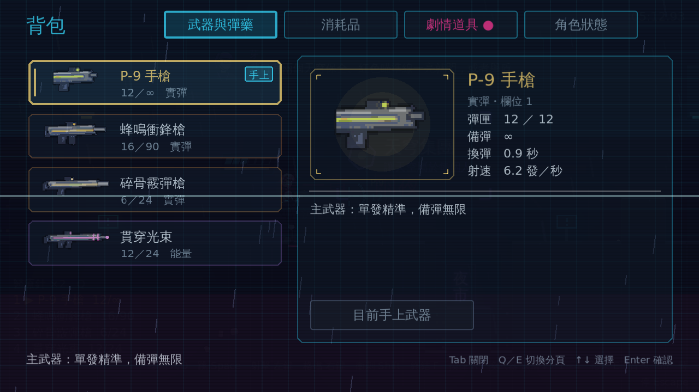
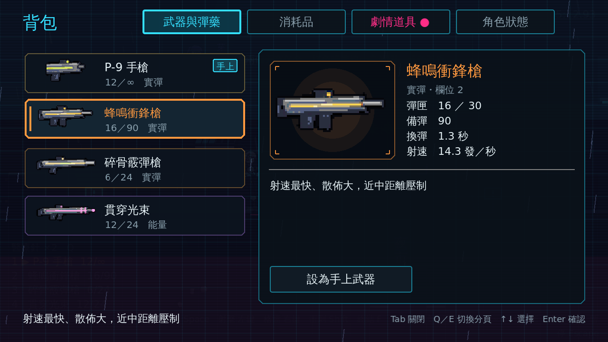
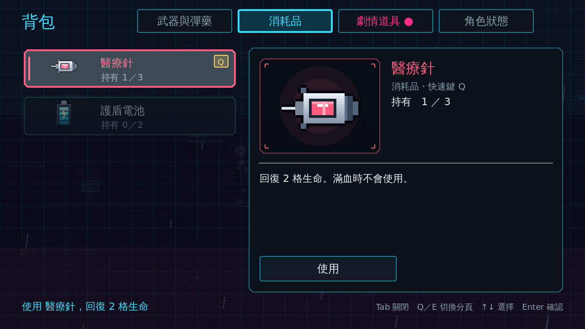
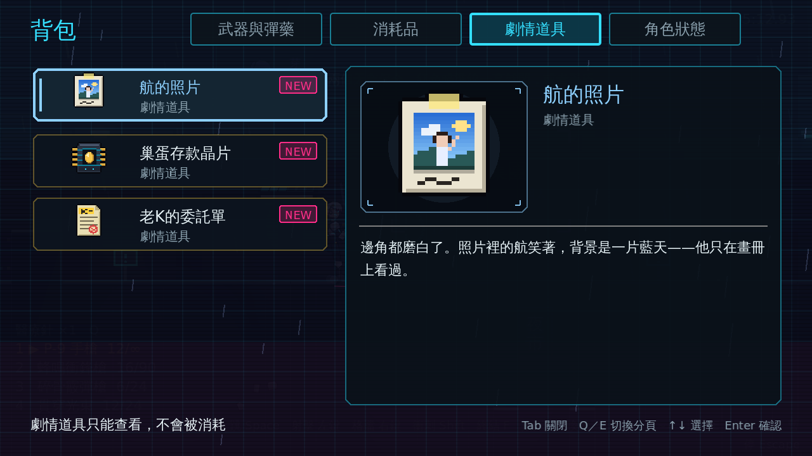
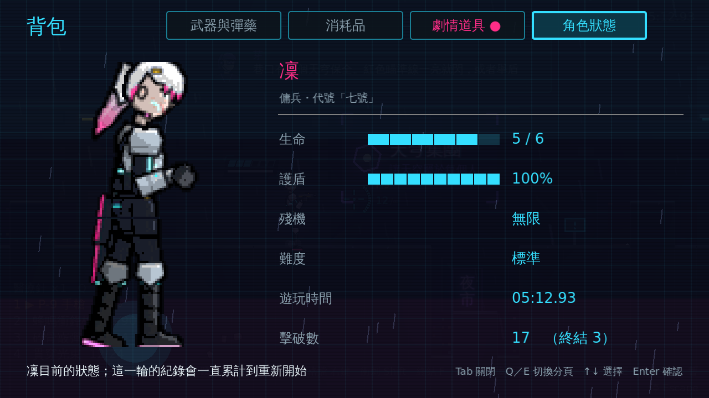

# [NE-16] 加入背包畫面

> 狀態：完成

## 內文

### 需求
沒有地方可以一次看清楚武器、彈藥、道具與角色狀態。按 Tab 開啟暫停的背包畫面，以高清像素風與動畫呈現四個分頁。設計見 `design/07-weapons-inventory/DESIGN.md` 第 5 節。

### 來源
2026-10-03，使用者於開發對話中提出：「案 Tab 會有背包的畫面（可以的話用超高清像素風＋動畫）」；確認分四個分頁、開啟時暫停。

### 驗收條件
- [x] 按 Tab 或 I 開關背包，開啟時遊戲暫停，關閉後繼續
- [x] 背包有武器與彈藥、消耗品、劇情道具、角色狀態四個分頁，可用 Q／E 或滑鼠切換
- [x] 武器分頁顯示每把武器的像素圖示、彈匣／備彈、類型與說明，可以直接換成手上武器
- [x] 消耗品分頁可以查看數量並使用
- [x] 劇情道具分頁可以查看說明，新取得的道具標記 NEW
- [x] 角色狀態分頁顯示凜的像素立繪（有待機動畫）與生命、護盾、殘機、難度、遊玩時間、擊破數
- [x] 所有圖示與立繪是高解析像素圖、放大後保持銳利，並可用同名 PNG 替換
- [x] 有開啟、切換分頁、選取項目的動畫
- [x] 每個可操作項目都有一句提示說明

### 測試流程
1. 遊戲中按 Tab，確認畫面暫停並播放開啟動畫
2. 逐一切換四個分頁，確認內容正確
3. 在武器分頁選一把武器，關閉背包後確認手上換成該武器
4. 在消耗品分頁使用醫療針，確認回血
5. 執行完整測試套件，全部通過

---

# 跟其他票的關係

- Blocks：無
- Blocked by：NE-13、NE-14、NE-15
- Related：NE-11、NE-31、NE-32

---

# Commit-1

## 內文

沒有地方可以一次看清楚武器、彈藥、道具與角色狀態。
現在按 Tab 或 I（手把 Back）開啟背包，遊戲暫停；再按一次、Esc 或 Back 關閉並繼續。開啟時有 CRT 開機掃描線展開的動畫，背景是細雨與掃描線。背包有四個分頁，Q／E（手把 LB／RB）或滑鼠切換，切換時內容滑入：
- 武器與彈藥：四個武器欄各一張卡片，顯示像素圖示、彈匣／備彈、實彈或能量；右邊詳情有射速、換彈時間與說明，可直接設為手上武器，彈藥用完或空欄位無法換上。
- 消耗品：列出所有種類與持有數量（數量 0 變暗），可直接使用；滿血或護盾已滿時不會浪費並提示原因。
- 劇情道具：新取得的標記 NEW，移開選取或關閉背包後取消，分頁標籤上有未看過的提醒點。
- 角色狀態：凜的像素立繪有待機動畫（呼吸、眨眼、頭髮擺動），並顯示生命、護盾、殘機、難度、遊玩時間、擊破數，數字由 0 跳動到目前的值。
選取項目時卡片浮起並掃過一道光，詳情圖示彈出；每個項目與分頁都有一句提示，同時顯示在畫面底部說明列。所有圖示與立繪都是高解析像素圖、以最近鄰放大保持銳利，可用同名 PNG 替換；死亡與過關時背包自動關閉。HUD 的操作提示加上背包按鍵。
驗收方式：冒煙測試驗證圖示與立繪分層齊全、按鍵預設、Tab 開關與暫停、Esc 只關背包不開暫停選單、Q／E 切換與循環、換武器、消耗品使用與不浪費、NEW 標記取消、狀態數字、死亡時關閉並鎖住；自動截圖確認四個分頁、使用醫療針與開啟動畫。

### 測試結果

| 項目 | 結果 |
|---|---|
| 完整測試套件 | 通過 585 / 585 |
| 資料驗證 | 0 錯誤 |
| 執行 log | 無非預期 ERROR |

### 截圖

