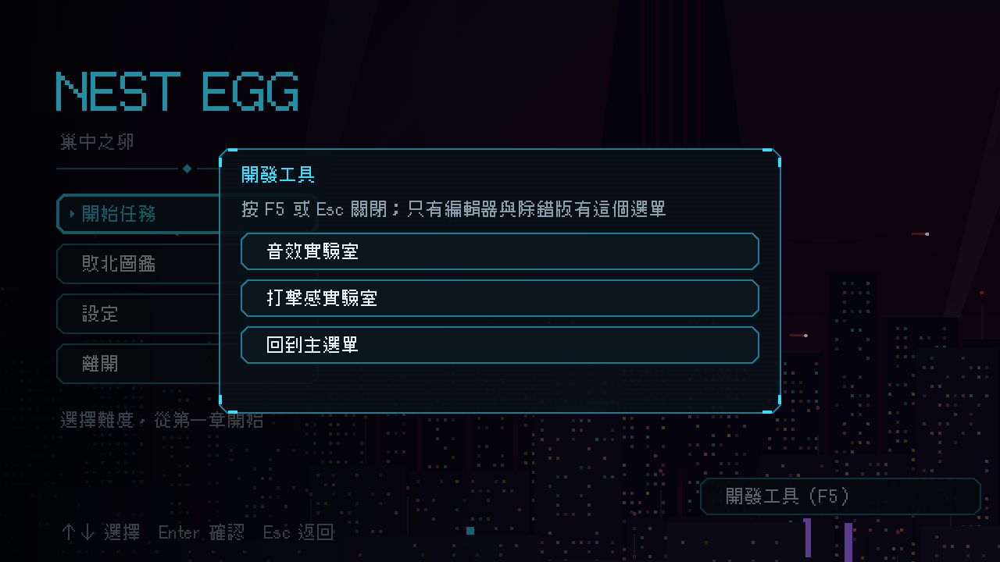

# [NE-171] 主選單加入開發工具入口按鈕

> 狀態：完成

## 內文

### 需求
開發工具選單只能靠 F5 開，不知道有這個按鍵的人在主選單完全看不到實驗室的入口，在編輯器裡 F5 也可能被編輯器自己先用掉。編輯器與除錯版的主選單要有一顆看得見的入口按鈕。

### 來源
2026-10-04，使用者回報「沒看到音效或是打擊感實驗室」。

### 驗收條件
- [x] 編輯器與除錯版的主選單右下角有「開發工具（F5）」按鈕，按下開出開發工具選單
- [x] 按鈕有說明（游標或焦點移上去時顯示在選單下方）
- [x] 正式匯出版沒有這顆按鈕
- [x] 視窗放大後按鈕仍完整顯示，不被切掉

### 測試流程
1. 在編輯器執行遊戲，主選單右下角看到「開發工具（F5）」
2. 點下去，選單列出音效實驗室、打擊感實驗室與回到主選單

---

# 跟其他票的關係

- Blocks：無
- Blocked by：無
- Related：NE-168

---

# Commit-1

## 內文

只靠 F5 開開發工具，看不到入口的人找不到實驗室。
現在編輯器與除錯版的主選單右下角多一顆「開發工具（F5）」按鈕，按下開出同一份工具選單，說明顯示在選單下方；貼著右下角向左上長，視窗大小改變也不會被切掉。正式匯出版沒有工具資料，按鈕不會出現。
驗收：主選單測試確認按鈕存在、有說明、按下會開出選單；受影響範圍的測試全部通過。

### 測試結果

| 項目 | 結果 |
|---|---|
| 受影響範圍的測試（9 個套件） | 782 項，新失敗 0 |
| 資料驗證 | 0 錯誤 |
| 執行 log | 無 ERROR |

### 截圖

