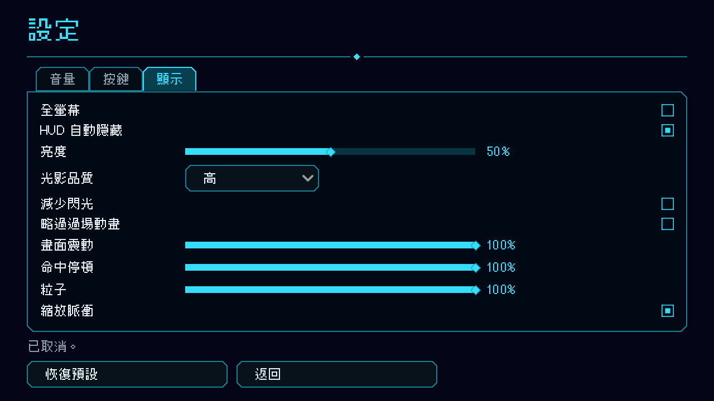

# [NE-172] 加入全螢幕選項並讓畫面隨視窗放大

> 狀態：完成

## 內文

### 需求
遊戲目前沒有全螢幕選項。玩家把視窗放大時，畫面看起來只是多了黑邊，遊戲內容沒有跟著放大。要提供全螢幕，並確保視窗放大或全螢幕時遊戲畫面會放到最大，只有螢幕比例和遊戲畫面比例不同時才留黑邊。

### 來源
2026-10-04，使用者回報：「現在遊戲沒有全螢幕的選項，我把畫面放大也只會填黑邊，而不是把遊戲畫面放大」。

### 驗收條件
- [x] 設定的顯示分頁有「全螢幕」選項，有一句說明，勾選後立刻進入全螢幕，取消後回到視窗
- [x] 任何畫面（主選單、關卡、暫停、實驗室）都能用 F11 切換全螢幕，設定畫面開著時勾選框跟著更新
- [x] 全螢幕設定存檔，下次啟動還原；設定檔內容損毀時退回視窗模式
- [x] 視窗拉大或進入全螢幕時，遊戲畫面等比放大到視窗放得下的最大尺寸；只有視窗比例和遊戲畫面比例不同時才有黑邊（在編輯器內執行與匯出版都要確認）
- [x] 「恢復預設」會回到視窗模式
- [x] 顯示分頁項目變多時可以捲動，底下的按鈕不被擠出畫面

### 測試流程
1. 執行遊戲，在設定的顯示分頁勾選「全螢幕」，確認畫面填滿螢幕且遊戲內容跟著放大
2. 按 F11 切回視窗，再按 F11 進全螢幕；在關卡中、暫停中各試一次
3. 把視窗拖大成不同比例，確認遊戲畫面放到最大、只有比例不合時才留黑邊
4. 關閉遊戲再開，確認全螢幕設定被記住

---

# 跟其他票的關係

- Blocks：無
- Blocked by：無
- Related：NE-173

---

# Commit-1

## 內文

遊戲沒有全螢幕選項，視窗放大也不保證畫面跟著放大。
現在設定的顯示分頁第一項是「全螢幕」（附說明），勾選立刻進入全螢幕、取消回到視窗；任何畫面都能按 F11 切換，設定畫面開著時勾選框跟著更新。設定會存檔，下次啟動還原，設定檔內容損毀時退回視窗模式；「恢復預設」回到視窗。遊戲啟動與切換時一律把畫面縮放設回「以 640×360 等比放到視窗放得下的最大尺寸」，不會被其他工具改過的縮放殘留影響，只有視窗比例與畫面比例不同時才留黑邊。顯示分頁項目變多，改成可捲動，底下的按鈕不會被擠出畫面。
驗收：自動測試涵蓋存檔與損毀退回、F11 切換與勾選框同步、恢復預設、顯示分頁可捲動且不擠出按鈕；用實際視窗把尺寸改成 1920×1080、1600×1000、2560×1080，畫面分別放大 3 倍、2.5 倍、3 倍，只在比例不合的方向留黑邊。

### 測試結果

| 項目 | 結果 |
|---|---|
| 受影響範圍測試 | 新失敗 0（一次平行跑時音效舞台套件偶發一項，單獨重跑與基準版都通過） |
| 執行 log | 無 ERROR |

### 截圖

